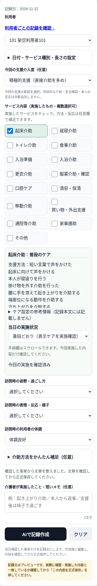
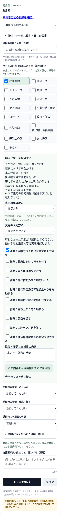

# AI介護記録：詳しい初期設定と簡単な日々の記録（本番未反映）

2026年11月22日。現在のmain `9a0a399`（PR #34・#35反映済み）から `feature/routine-care-final` を作成。過去のPRへ戻さず、既存のプロフィール・普段のケア・記録を引き継いでいます。

[今回の文章仕上げと必要な回帰テスト](polish.md)。初期設定・権限・保存処理・SQLは前回から変更していません。

## 原因と修正

1. 設定保存が旧来の限定された文型・項目名だけを許可していました。新しい保存RPCで自由記述を原文保存し、既知のケア・本人の動作・方法・注意点を区別します。未知の日本語から具体的な介助や観察結果を推測しません。
2. 初期設定の候補が少なく、関連ケアと順序を扱いにくい構造でした。15サービスを維持して8分類、各20〜31候補＋自由記述を用意。複数選択・上下移動・直接メモ編集に対応しました。
3. 「変更あり」は全文を書き直す方式でした。省略した手順だけを指定し、追加・変更した内容だけ入力する方式を標準にしました。全文を書き換える従来方式も残しています。
4. 手編集後の類似比較で、保存を一度止める分岐が残っていました。この分岐を取り除き、警告は1行、詳細は任意の展開にしました。保存時に文章を再生成しません。
5. 長めでも主体や具体的な介助が十分に整理されていませんでした。確認した手順の順序を保ち、職員と本人の動作を分け、具体的な方法と一般的な介助の重複を整理します。介入度は該当する実施内容に結び付け、合わない介入度から新しい介助を作りません。

## 15サービスの設定項目

[全候補の一覧](catalog.md)。声かけ・準備／身体介助・実施内容／本人が自分でできること／関連ケア／介助方法・程度／コミュニケーション／配慮・注意／独自手順の8分類です。

起床では、寝返り・起き上がり・端座位・立ち上がり・移乗・履物・衣類調整・更衣促し・口腔ケアなどを設定できます。既存のサービス名称を変えず、関連ケアのために別サービスを二重選択する必要はありません。初期状態でケアを自動選択しません。

「口腔ケア、更衣促し」はそのまま保存でき、実施確認後には一般的な口腔ケアの支援と更衣の声かけとして文章化します。歯磨き・義歯洗浄などの具体的方法を勝手に加えません。意味が確定しない独自文や条件文は設定と画面の参考欄に原文を残し（記録本文には転記せず）、当日の観察・実施済みとは断定しません。

## 管理者の初期設定

1. AI記録で利用者を選び「利用者プロフィール」→「利用者・サービスごとの普段のケア設定」を開く。
2. サービスを選び、分類ごとの必要なケアを複数選択する。
3. 手順一覧の上下ボタン、またはメモ欄の行順で順序を調整する。独自の日本語も入力できる。
4. 既存プロフィールを使う場合は参照先を指定する。同じ値を別の設定としてコピーしない。
5. 保存する。ほかのサービス・プロフィール・権限は変更されず、変更履歴を追記する。

管理者と `resident_info: full` の施設編集者だけが設定を変更できます。従来のlegacy編集者へプロフィール編集権限を自動付与しません。一般職員は設定を閲覧して当日の記録に利用します。

## 日々の操作

| 状況 | 操作・記録への反映 |
| --- | --- |
| 普段どおり | 表示された手順を読んで実施確認を1回選択。二重のサービス選択や手順の再入力は不要 |
| 変更あり | 行わなかった手順だけ選び、追加内容を入力して実施確認。省略したケアは文章に入れない |
| 未確認 | 普段のケアは参考表示。実施したとは断定しない |

普段どおりの最小モデルは、利用者選択1・サービスチェック1・実施状態の選択1・生成1・正式保存1の計5操作です。ネイティブ選択欄を「開く＋選ぶ」の2タップと数えると約7タップ。担当割当から利用者が設定済みなら約5タップです。スクロール・読解・文字入力・任意の介入度／長さ変更を含まない算定モデルであり、実機での計時ではありません。

訪問時の観察は任意で追加できます。未入力なら①は「訪問時の状態・様子・体調は未確認です。」と明記し、普段の体調を今日の状態として使いません。介入度・普通／長め・任意の当日メモ・文章の手編集を維持しています。

手順は大きな文字のスクロール領域に表示し、大量のチェックを日常画面へ出しません。詳細チェックは従来どおり任意です。同じ利用者・施設でサービスを外して再選択しても、入力内容を保持します。施設・利用者の切替は確認してからリセットし、別の利用者へ内容を持ち込みません。

## 実際の文章・重複・保存

[普通／長めの全文・30回生成・重複保存の結果](examples.md)。入力した手順、本人の動作、当日の変更を併記しています。文章量のための観察・反応・服薬完了・結果の補完はありません。

候補の自動比較は既存の最大32種類／128探索を維持。同じ施設・利用者でログイン職員が閲覧できる直近300件までを既存RLSで参照します。必須冒頭文・空白・句読点は比較から除外します。

警告は「過去の記録と似ていますが、今回の内容が正しければ、そのまま保存できます。」の1行です。過去の比較文は通常は閉じています。重複による書き直し・再生成・再入力・追加の保存確認は不要です。別の業務上の理由による確認（同じ担当に既存の正式記録がある場合など）は維持します。

**有限の全候補を保存済みにしたケースで、同文を無編集・再生成なし・正式保存ボタン1回で保存できることを確認しました。手編集した文が過去と完全一致するケースも1回で保存され、表示文＝DB保存文＝再読込した履歴文でした。**

## 検証

- 全15サービス×3状態×普通／長め×30回＝2,700生成。事実・原入力の保持、未確認・条件・服薬未確認、関連ケアと順序を確認。
- 新規DBテスト32確認：旧設定の無変換、自由文・順序・履歴、他施設・一般職員・legacy編集者・匿名の拒否、full編集者・権限解除、競合、旧RPCによる新形式消去の拒否、隔離DBへのバックアップ復元。
- 実NEXIAと同じ固定HTML・実Supabase SDK・RLS付き隔離PostgresでPC 1440px／スマホ390pxを操作。15サービスの設定・再読込・生成、重点5サービスの3状態、複数サービス、通常／長め、同一入力30回ずつ、正式保存・履歴、観察未入力、重複・手編集後の保存を確認。
- PR #35の既存ケア画面テスト、既存の文章・介入度・メモ・保存候補・類似比較テストを継続。
- NEXIAトップ、担当連携、AI記録、申し送り、担当割当、食事、出勤簿、出納帳、職員・権限画面のPC／スマホ回帰確認。担当PDF、出勤簿Excel／PDF、出納帳PDFの生成も確認。
- HTML・画面遷移・既存安全性契約21テスト合格。CIの最終結果はPRのChecksを参照。

## 画面比較

[変更前のスマホ（main・PR #35）](../resident-routine-care/images/mobile-usual.png)と、以下の変更後画像はすべて架空データです。変更後は登録手順を増やしたうえで、手順表示を一定の高さに抑えています。同一の設定量を用いた速度比較ではありません。

| スマホ・普段どおり | スマホ・変更あり |
| --- | --- |
|  |  |

[PC入力](images/1440-usual.png)・[スマホ初期設定](images/390-settings.png)・[PC初期設定](images/1440-settings.png)

## Supabase・既存データ・復旧

既存の `client_record_profiles.routine_care`、revision、監査テーブルを再利用。新規テーブル・列・RLS変更・既存行の一括変換はありません。1サービスだけを更新する `save_routine_care_v2` RPCを追加します。公開関数はINVOKER、private実装は空search_pathのDEFINERで、認証ID・施設所属・full編集権限をDBで検証します。実行権限は限定し、権限情報をブラウザの表示だけで判断しません。

旧形式の設定をそのまま読み、新規の当日確認だけを新しい組み立て方で記録します。保存済み記録は再生成しません。旧RPCには「すでに新形式で保存された当該サービスを古い画面から上書きしない」ガードを追加します。旧形式サービスの従来保存や既存プロフィールRPCは維持します。

本番では定義だけを読み取り確認し、利用者の行をテスト用に取得していません。本番SQL・本番データ変更・mainへのマージ・Pages公開は未実施です。

[本番反映・停止・復旧手順](rollout.md)。追加料金のあるAI API・Supabase機能・ホスティング・プランを導入していません。

## 制限・未検証

- Windows／iPhone実機、Safari、実Office／プリンター、本番DBへの新SQL適用・保存は未検証です。PC／スマホ幅のChromiumでの確認と区別します。
- 任意の日本語の意味を完全に判断するAIではありません。未知の自由文や条件は設定と画面の参考欄に原文を保持し、記録本文には転記しません。医療的判断・反応・結果を推測しません。
- 同じ事実で自然な表現が有限なら、同文は発生します。重複ゼロを約束せず、そのまま保存できます。詳しい設定がなければ文章も短くなります。
- 設定は1サービス80項目、1項目5,000文字まで。既存の利用者1人分の設定JSON 60KB・記録スナップショット150KBの保護制約は維持します。
- 未保存下書きは画面内で保持します。画面を閉じる／再読込する前に警告しますが、ブラウザの強制終了からの下書き復元は追加していません。
- 過去記録を取得できない通信・権限エラーと、文章が重複することは区別します。前者の保存保護や施設・利用者・職員の一致確認は維持します。
