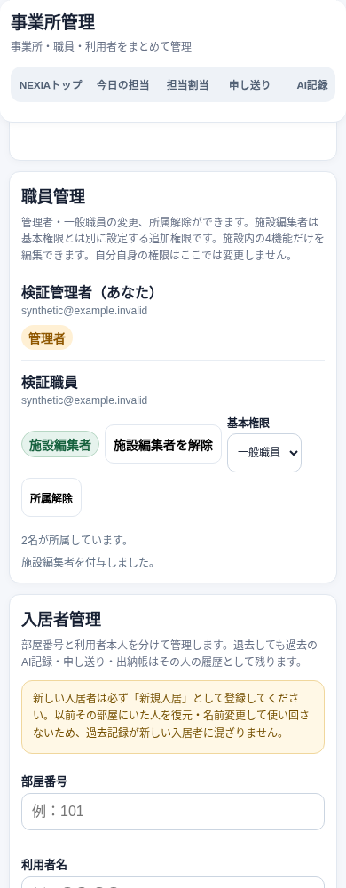
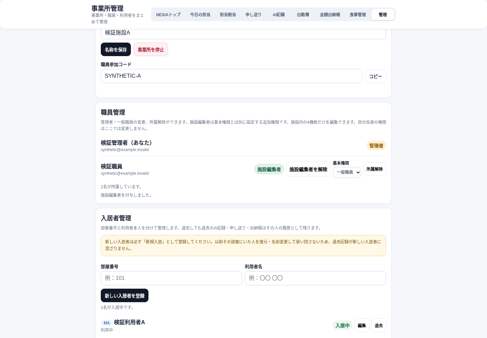
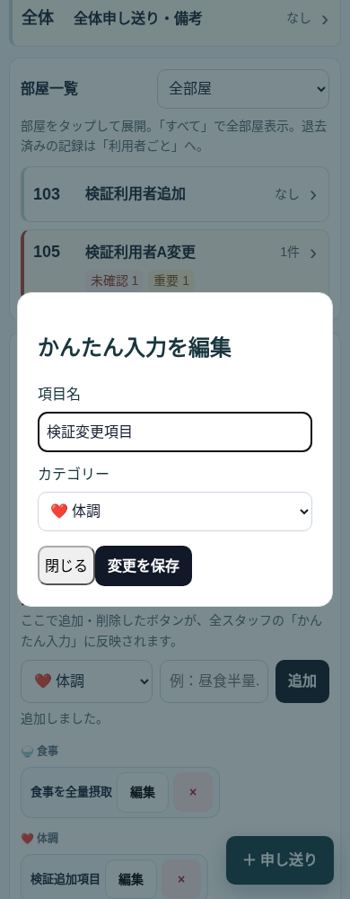
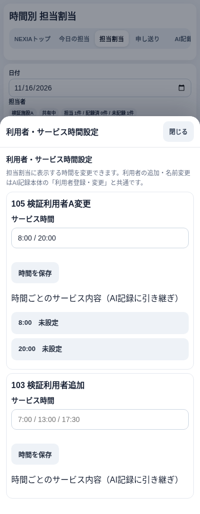
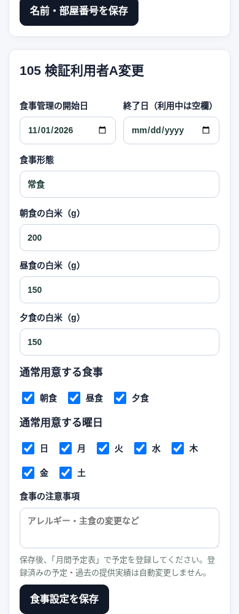

# NEXIA 施設編集者：開発・権限検証報告

開発ブランチ：`feature/facility-editor`。調査・開発起点：main `309c84a6bcd2fd3f1faf43b22de8ab460207bd32`。
本番はテーブル定義・制約・ポリシー・関数・権限・Security Advisorの読み取りだけを実施。本番DBへのSQL適用、既存データの更新、職員への権限付与、mainへのマージ・公開は行っていない。

## 調査結果と採用方式

本番の `organization_members.role` はtext型で、実際に `CHECK (role IN ('admin','staff'))` がある。主キーは `(organization_id,user_id)`。一般職員本人の氏名変更は列権限とRLSで制御され、権限変更・職員一覧／メールアドレス取得等は既存の管理者専用RPCを使う。`private.is_org_admin` はDB内の所属・本人ID・roleを確認している。

| 方式 | 影響・判断 |
| --- | --- |
| 新しいroleを追加 | CHECK制約、role変更RPC、トップの許可role一覧、各画面の管理者判定などの変更が必要。出勤簿・記録・既存RPCまで影響が広がりやすい |
| admin/staffを維持して追加権限を別管理 | 従来のrole判定・管理RPCを維持でき、指定した4機能にだけ追加できる。**こちらを採用** |

追加テーブル `organization_facility_editors` で、施設ID・認証ユーザーIDごとの付与／解除を管理する。既存の所属行やroleを更新しない。初期データは0件で、職員へ自動付与しない。複数施設に所属していても、付与した施設だけで有効になる。

権限判定はフロントエンドの `facility-permissions.js` と、DBの `private.can_edit_facility`／ロック付き検証に集約。氏名の一致、ブラウザに保存された任意のrole、ユーザーが編集できるJWTメタデータは判定に使用しない。

## 施設編集者でできること・できないこと

| 機能 | 管理者 | 施設編集者 | 追加付与のない一般職員 |
| --- | --- | --- | --- |
| 申し送りのかんたん入力 | 従来の追加・削除に加え、項目名・カテゴリー編集も可能 | 追加・項目名／既存カテゴリーの編集・削除 | 設定編集不可。通常の投稿・確認・対応は従来どおり |
| 所属施設の利用者登録・基本情報変更 | 従来どおり | 新規登録、入居中利用者の氏名・部屋番号変更 | 従来どおり設定編集不可 |
| 利用者の退去・復元・物理削除、機微な支援項目の編集 | 従来の管理者操作・制約を維持 | 追加権限では不可 | 従来どおり |
| 食事形態・白米量・通常の朝昼晩／曜日・開始／終了日・食事注意事項 | 従来どおり | 所属施設の入居中利用者を設定可能 | 閲覧と通常の提供チェック等は従来どおり |
| 食事単価の設定 | 従来の管理者操作・日付制約を維持 | 不可 | 不可 |
| 担当時間・サービス内容の設定 | 従来どおり | 所属施設で編集可能 | 従来どおり設定編集不可 |
| 担当者・メモ等の通常の割当操作 | 従来どおり | 一般職員が元々持つ操作を維持 | **従来の登録・変更等を維持** |
| 職員・権限管理、事業所名・参加コード・稼働状態の管理 | 従来どおり | 不可 | 不可 |
| 申し送りの管理者確認画面、職員管理・管理画面 | 従来どおり | 管理者権限を追加しない | 従来どおり |

担当割当については、現行RLSが一般職員にも通常の編集を許可していることを実DBで確認し、ユーザーから「一般職員の既存操作は維持する」という回答を得た。そのため、**施設編集者を解除しても、担当者・メモ等の従来の一般操作は残る**。解除されるのは担当時間・サービス設定など今回追加した編集権限である。

食事提供チェックや欠食への変更など、元々一般職員に許可されている操作は変更していない。今回追加する権限に料金設定・請求訂正用の管理権限は含めない。食事設定を保存しても登録済み予定や提供済み実績・保存時単価・請求スナップショットは自動更新しない。

利用者の「通常・特性・注意・コミュニケーション・支援方法・サービス開始前確認文」等の機微な項目の編集は追加しない。入居者ID・内部コード・所属施設も変更不可。既存の一般職員の閲覧範囲は広げていない。

## 管理者の付与・解除手順

1. 「事業所・権限管理」を開き、上部で対象施設を選ぶ。
2. 職員管理の対象職員を確認する。「基本権限」の管理者／一般職員変更とは別に、「施設編集者を付与」を押す。
3. 確認画面の施設名・職員名を確認して確定する。職員のバッジが「施設編集者」に変わる。
4. 解除する場合は、同じ職員の「施設編集者を解除」を押す。

自分自身や既存管理者への追加付与は行わない。管理者は元々必要な機能を利用できる。施設編集者から権限変更ボタンや管理者用カードは操作できず、直接APIを呼んでも拒否する。

施設編集者はログインを引き継ぎ、トップの「施設の編集」から各機能へ進む。申し送りは「入力設定」、食事管理は「利用者・料金設定」のうち許可された設定、担当割当は「利用者・時間設定」を開く。料金フォームや職員管理リンクは開放しない。

| 管理者のスマホ画面 | 管理者のPC画面 |
| --- | --- |
|  |  |

| 入力項目の編集 | 担当時間・サービス設定 |
| --- | --- |
|  |  |

画像は合成アカウント・合成データだけを使用しており、本番の職員名や利用者は含まない。追加権限のバッジを緑で区別し、付与・解除や入力設定のボタンを44px以上にした。

## Supabaseの変更

適用待ちのSQLは **`supabase/migrations/20261115235721_facility_editor_permissions.sql` 1本**。

- 所属主キーに外部キーを持つ `organization_facility_editors` を追加。RLS有効。本人は自分の状態、施設の管理者は施設内の状態だけ読める。通常のAPIからはINSERT／UPDATE／DELETE不可。
- 管理者専用の `set_facility_editor` を追加。施設・本人・対象職員・roleをDBで検証する。現在値の比較で古い画面からの付与／解除の競合を拒否する。
- publicの新規RPCはSECURITY INVOKER。必要な特権処理はprivateに置き、固定search_path・認証ユーザーID・所属・管理者判定を付ける。既存の管理者専用RPCを編集者へ開放しない。
- clients／handoff_quick_inputs／meal_profiles／client_service_slotsに、指定機能だけを許可する追加ポリシーを作成。既存ポリシー・管理者判定関数・role制約は置換しない。
- DBトリガーで、施設・利用者ID・既存内部コード・保護項目の変更を拒否する。片方の施設で編集者、もう片方で管理者でも、追加権限を使って施設をまたぐ移動はできない。
- 編集時に権限・所属行をロックし、解除・所属解除と競合しないようにする。権限をJWTや長期キャッシュへ保存しないため、同じログイン状態の次の操作にも解除が反映される。
- 担当時間設定の新RPCはトランザクションと変更前の時間一覧の比較を使う。外した時間は無効化し、旧時間のID・サービス内容・担当割当・AI記録を削除しない。夜勤から翌朝の並び順も維持。
- 権限変更履歴と、編集者が行った設定変更の履歴をprivateテーブルへ記録する。通常利用者の直接閲覧・改ざん・削除は不可。役割変更・所属解除時は古い追加権限を残して再有効化させない。

マイグレーションの実行自体では、既存の職員・利用者・記録・確認・対応・食事・単価・割当行を更新・削除しない。ロック取得は5秒で打ち切り、途中で失敗した場合はトランザクションをロールバックする。

## 共有データ・他システムへの影響

利用者登録・基本情報変更は従来と同じclientsを使い、既存利用者IDを維持する。AI記録、申し送り、食事、担当割当の参照先を作り直さない。出勤簿・金銭出納帳・職員管理の権限は既存のadmin/staff判定を維持する。URL・認証・施設切替・Excel／PDF出力処理も維持する。

担当割当は固定HTMLを読み込む既存方式を保ち、追加の設定権限だけを小さな補助モジュールで拡張した。部屋番号も最初から表示用に取得し、IDを変えずに変更後の番号を表示する。

回帰テストで名前登録後の復帰リンク待機が1回失敗した。AI記録側のURL正規化が、非同期の名前登録誘導より先に復帰トークンを消す競合を確認し、`returnDashboard`だけを残す最小修正を追加した。担当IDや認証・保存・本文の処理は変更していない。実際の正規化関数を使う単体試験と、名前登録→元の担当付きURL→復帰リンクのPC・スマホ試験が修正後に成功した。

## テスト結果

- 本番定義を基にした隔離Postgres（PGlite）で **96項目成功**。role制約・既存行の完全比較、初期付与0件、付与／解除、4機能、権限昇格・API直接操作・他施設・複数施設の異なるrole・保護列・ID変更の拒否、提供済み食事と単価、時間設定の競合、夜勤順、同一セッションでの失効、監査履歴、昇格／降格／所属解除・再参加を検証。
- 実Chromiumで **PC1440px・スマホ390px**。管理者の付与／解除、編集者の4機能、一般職員に戻った後の保存拒否・設定非表示、他施設での非表示、管理者機能非表示、既存データ不変を確認。ブラウザのスクリプトエラー・予定外通信0件。
- 既存の全体Chromium試験で、7機能の往復、ログイン継続、氏名登録・再ログイン、職員管理・事業所管理、担当→AI記録→担当の復帰を確認。出勤簿Excel、担当割当・出勤簿・出納帳PDFを生成。申し送りの別ブラウザ試験でもPDFを生成。
- 既存DB試験：職員名49項目、申し送り82項目。ルール28項目・部屋表示16項目。NEXIA DOM49ケース、管理者ナビ、担当復帰、記録リンク、サービス内容、食事の集計・保存・履歴単価・CSV・競合・ログアウト、一般職員／管理者の出勤簿、Python17件、構文・ナビ整合性が成功。
- GitHub CIの最終結果はPRに記載する。

本番のスキーマ・制約・RLS・関数を行データなしでテスト用に固定した。PGliteでは、未使用のpgcrypto参加コードデフォルトだけをテスト用スタブにし、施設の参加コードは合成値を明示している。認証ユーザーIDも合成JWTのテストコンテキストとして設定している。本番の職員・利用者・記録をテストに流用・更新していない。

## 未確認事項と本番反映

未確認：実機iPhone／Android・Safari、本番Auth／PostgRESTの実アカウント操作、実DBの複数接続を使った同時負荷試験。ローカルでは実SQLでのRLS・競合比較・同一セッションの解除を検証しているが、本番環境の負荷や全端末を再現したものではない。

参考として、調査時の既存Security Advisorには [認証ユーザーが実行できるSECURITY DEFINER関数](https://supabase.com/docs/guides/database/database-linter?lint=0029_authenticated_security_definer_function_executable) と [漏えいパスワード保護](https://supabase.com/docs/guides/auth/password-security#password-strength-and-leaked-password-protection) の指摘がある。今回、本番の既存関数やAuth設定を勝手に変更していない。新しいpublic RPCに特権実行を持たせない設計と、直接呼び出しの拒否試験を実施した。

承認後の操作：

1. このPRと新規SQL1本の変更内容・影響について承認を得る。
2. 最新main・本番の制約／ポリシー／適用履歴を再確認し、バックアップ・復旧方法を確認する。古いSQLを含む一括の `db push` は行わない。
3. 承認された新規マイグレーション1本だけを適用する。初期付与0件、既存role・データの保持、他施設・一般職員の拒否を確認する。
4. PRをmainへマージして既存GitHub Pagesで公開。SQLが先、画面が後。反映後に再読込し、管理者・一般職員・対象施設／別施設で確認する。
5. 管理者が画面から対象職員へ明示的に付与する。今回の開発・移行では、特定の本番職員へ自動付与しない。

問題時は追加付与を解除し、フロントエンドを前版に戻せる。履歴・記録を削除して戻す手順は使わない。追加ポリシー・トリガーのDB側ロールバックが必要な場合は、影響を確認した別の承認済みSQLで行う。

有料サービス導入・プラン変更なし。既存のSupabase・GitHubと無償のブラウザ／ローカルDBテストのみを使い、新しい外部API課金・有料契約は追加していない。
