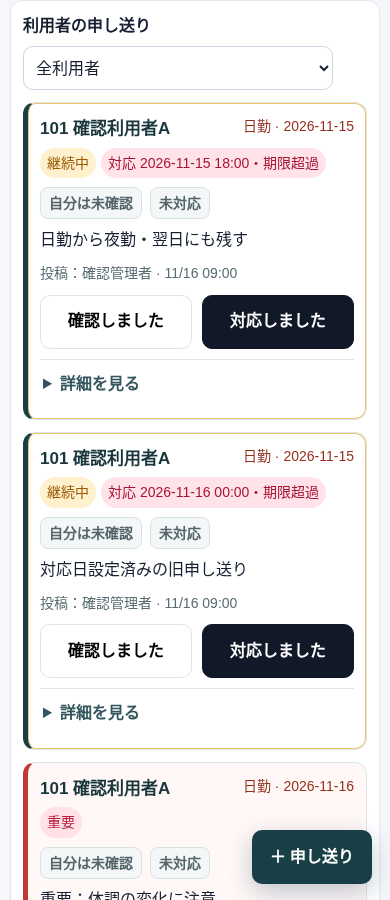
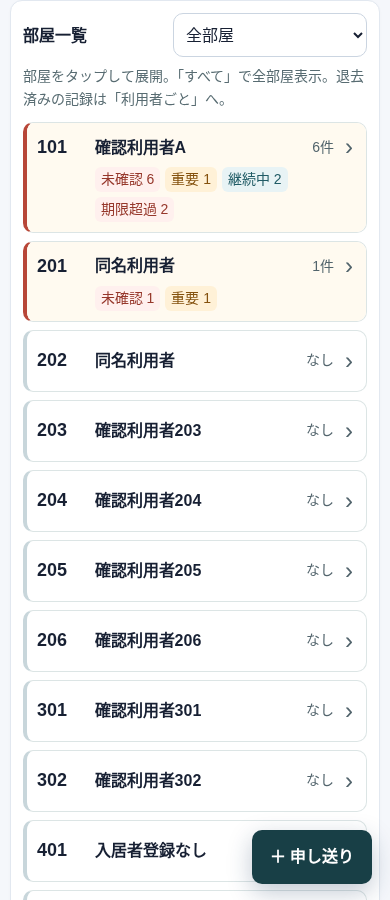
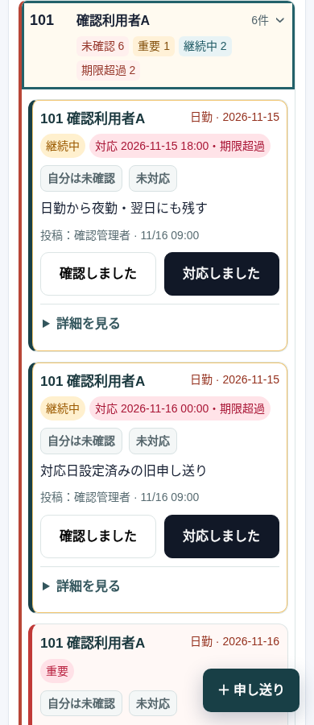
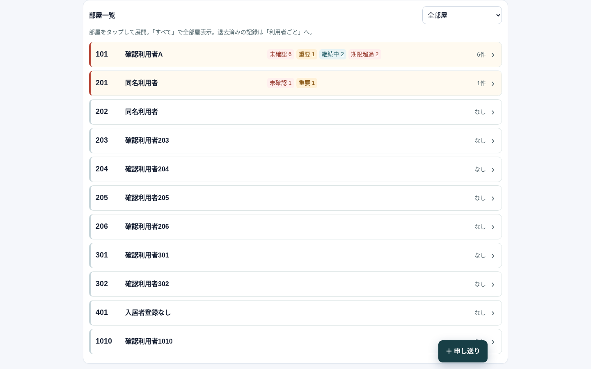

# NEXIA 申し送り：部屋ごとの一覧表示

開発ブランチ：`feature/handoff-room-list`。比較元：着手時main `d834ee9211abd6e5289d183e2faf2df1a1ddee5e`（PR #21 反映後）。
本番反映・mainへのマージ・SQL適用・本番データの更新は行っていない。追加サービス・有料プラン・新しい依存パッケージは使用していない。

## スマホの変更前後

同じ合成データを、Chromium・幅390px・高さ900pxで比較した。10部屋に入居中利用者が登録され、別の1部屋は入居中利用者の登録がないケース。画像に本番の利用者名・職員名・申し送りは含まれない。

| 変更前 | 変更後 |
| --- | --- |
|  |  |

以前は101号室の申し送りが1件ずつ並び、次の部屋を確認するまでスクロールする必要があった。変更後は101・201・202…を自然順で並べ、各部屋に番号・利用者名・件数・状態をまとめる。申し送りのない部屋も「なし」と表示し、入居者登録のない既知の部屋も氏名を出さずに表示する。

このデータでの**部屋一覧部分の高さは約2,535px → 830px（約67%減）**。PCは約2,599px → 762px（約71%減）。画面全体や、展開後の本文まで同じ比率で短くなるという意味ではない。

部屋番号は18px、利用者名は16pxを維持。通常の部屋行は高さ60px以上で、行全体をタップできる。スマホでは状態が多い行や長い名前を折り返し、文字を縮小したり名前を省略したりして詰め込まない。

## 操作の違い

| 内容 | 変更前 | 変更後 |
| --- | --- | --- |
| 一覧 | 申し送り1件につき1カード。部屋が繰り返し登場 | 1部屋につき1つの折りたたみ行。初期状態は閉じる |
| 並び | 期限・重要・未確認などの優先順 | 部屋の行は自然順。部屋の中は従来の優先順を維持 |
| 件数・状態 | カードごとに読む | 閉じた行でも未確認・重要・継続中・期限超過の件数を確認 |
| 内容・確認・対応 | 一覧に本文・主ボタンが並ぶ | 必要な部屋を1回タップして、個別カードの本文・主ボタンを開く |
| 退去済み | 日付一覧に入居中と混ざる場合がある | 通常一覧には混ぜない。「利用者ごと」または管理者画面で過去記録を確認 |
| 申し送りなし | 一覧に部屋が出ない | 「すべて」では部屋を表示し、「なし」と明示 |
| 全体申し送り | 本文カードが常時表示 | 同じ形式で折りたたみ。閉じていても件数・状態を表示 |

1. 日付・日勤／夜勤を選び、部屋の行で件数と状態を確認する。
2. 内容を読みたい部屋をタップする。同じ利用者の複数の申し送りを、その部屋の中で確認できる。
3. 各申し送りの「確認しました」または「対応しました」を使う。対応内容・職員・日時の保存は従来どおり。
4. そのカードの「詳細を見る」で確認者・日時・対応履歴、確認取消、継続、再開、保管／復元を操作する。
5. 申し送りを追加する場合は、部屋内の追加ボタンから対象利用者を選択済みで入力できる。全体追加と、従来の「＋申し送り」も維持する。

開いた部屋は、その画面内の確認操作・再取得後も開いたままになる。再読込・ログアウト後は閉じた状態から始まる。開閉だけではAPIの取得・更新は発生せず、開閉状態は一時メモリだけに保持する。

未確認・重要・継続中・期限超過の絞り込み中は、該当する申し送りがある部屋だけを表示する。「すべて」に戻すと「なし」の部屋も表示する。個別の利用者選択も維持する。上部の件数は申し送りの件数で、部屋数とは区別する。

## 部屋・利用者・権限の扱い

現行コードは `clients` の `room_number`、`code`、`display_name`、`is_active` を参照しており、独立した部屋マスターはない。

- 登録されている部屋番号を表示対象とする。入居中利用者がいない既知の部屋は「入居者登録なし／なし」。退去済み利用者の氏名・ID・過去の申し送りを、その部屋の現利用者に引き継がない。
- 部屋番号が未設定の退去済みデータから、内部利用者コードを部屋番号として推測しない。
- 入居中の旧データは従来の `code` を表示上の代替に利用。番号のない入居中利用者は別々の「未設定」行で扱う。
- 全角数字や前後の空白は表示用に正規化する。保存値は変更しない。2→10、302→1010も自然順になる。
- 確認・対応の紐付けは既存の申し送りID・利用者ID・本人IDのまま。氏名の一致や同じ部屋番号から、履歴の所有者を推定しない。同姓同名の別部屋も別行として扱う。
- 管理者の確認画面・利用者別の経過は従来の表示と絞り込みを維持する。退去済みの記録もそこから参照できる。

**DB・SQL・RLS・保存RPC・認証方式の変更はない。** 既存の本文、確認・対応・操作履歴、職員ID、所属・権限、AI記録・出勤簿との紐付けを変更・削除していない。保存・履歴取得・PDF生成の処理は維持する。閉じた部屋の申し送りも、従来のPDF出力には含まれる。

登録されたことのない物理的な空室は、現行データだけでは番号が分からないため自動生成しない。部屋の新設・削除や利用者の登録は今回行わない。

## PC表示

PCは番号・氏名・状態・件数を横に配置する。スマホも同じ操作を使用し、幅320pxで横にはみ出さないことを確認した。

## テスト結果

- 部屋表示の単体試験 **16項目成功**：自然順、申し送りなし、同じ部屋の複数件、同姓同名の別部屋、退去・部屋再利用、入居者登録なし、未設定、重複ID、元データ非変更。
- 申し送りのChromium試験：PC1440px・スマホ390pxで成功。320pxでも一覧の横はみ出しなし。初期折りたたみ、キーボード展開、開閉時の通信なし、件数・強調・絞り込み、部屋からの追加、退去済み記録への切替を確認。
- 一般職員・複数職員の確認／本人取消、対応内容付き完了・再開・履歴保持、旧データの対応者不明表示、応答喪失後の再試行・競合を確認。日勤→夜勤・翌日、管理者確認、保管・復元、施設切替・ログアウトも成功。
- 申し送りPDFをPC・スマホで実生成。A4・2ページを確認。PDF生成処理は変更していない。
- 全体Chromium試験：PC・スマホの7機能往復、既存ログイン継続、職員管理・事業所／権限管理・氏名登録・再ログインが成功。PCでは担当割当・出勤簿・出納帳PDFと出勤簿Excelも生成。
- 隔離Postgres：申し送り **82項目**・職員名 **49項目**。既存RLS・役割・ID・履歴保全・競合を確認。勤務区分等のルール **28項目**も成功。
- NEXIA DOM **49ケース**、管理者ナビ、記録リンク、一般職員／管理者の出勤簿保存・競合・出力、Python安全性 **17件**、構文・ナビ整合性も成功。
- 他テストと同時実行した初回に、既存の担当復帰DOM試験の60ms待機が不足し、スクロール位置の確認が1回失敗した。単独再実行と全体の実ブラウザ試験は成功。該当する機能・テストコードは変更していない。

すべて合成データ・模擬API・隔離DBで検証した。本番Supabaseにテストデータを書き込んでいない。申し送り・全体ブラウザ試験のスクリプトエラー・予定外通信／更新は0件。GitHub CIの最終結果はPRに記載する。

## 変更ファイルと反映手順

- `handoff/rooms.js`：表示用の自然順・部屋グループ作成。
- `handoff/app.js`：通常一覧の部屋行、件数・状態、退去済みの分離、開閉状態。
- `handoff/app.css`、`handoff/index.html`：部屋行のPC／スマホ表示、見出し・案内、JS・CSSのキャッシュ更新。
- `tests/handoff_rooms.cjs`、`tests/handoff_browser.cjs`、`tests/prepare_nexia_browser.py`、`.github/workflows/safety-check.yml`：自動試験と比較元固定。
- `docs/handoff-room-list/`：本報告と比較画像。

未確認：実機iPhone／Android、Safari、本番アカウントによる操作、登録されていない空室を含む物理的な全部屋との照合。

承認後にPRをmainへマージし、既存のGitHub Pagesでフロントエンドを公開する。SQL適用・データ移行・権限変更は不要。反映後は再読み込みし、部屋順・件数・展開・確認／対応・履歴・PDFを確認する。今回の作業ではマージ・本番公開を行わず、承認を待つ。
