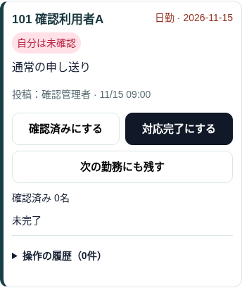
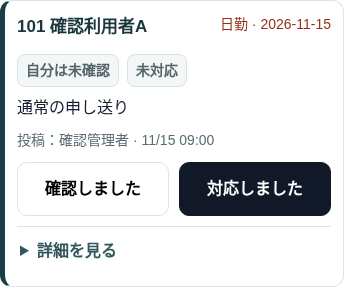
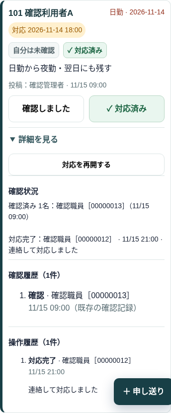
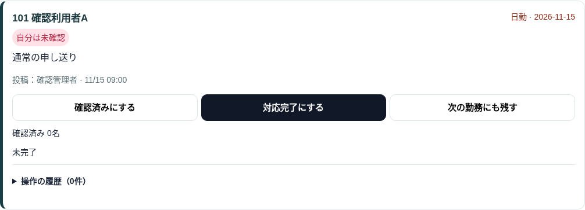
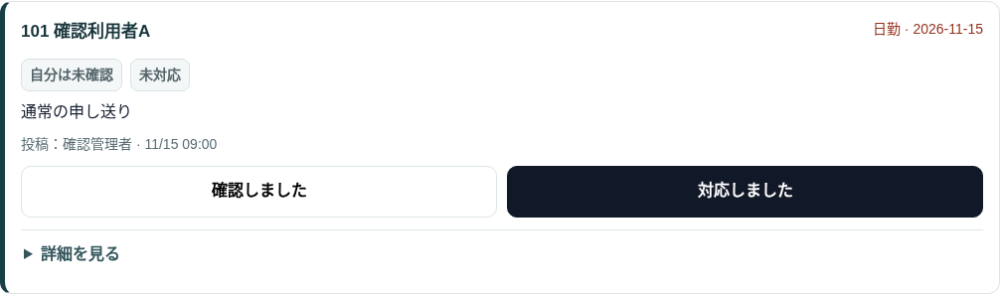

# NEXIA 申し送り画面の操作簡素化

2026年11月15日。開発ブランチ：`feature/handoff-simple-actions`。
比較元は着手時の本番コード `a4263db18002fb6a41be49f0a1e069b8f264a5df`（PR #20 反映後）。
今回の変更は一覧の表示と操作の配置に限定する。本番へのSQL適用、既存データの更新、mainへのマージ、公開は実施していない。追加の有料サービス・プラン変更はない。

## 画面と操作の違い

| 操作・表示 | 変更前 | 変更後 |
| --- | --- | --- |
| 普段の操作 | 確認、対応完了、次の勤務にも残す、条件によって保管が並ぶ | **「確認しました」「対応しました」**の2つを常時表示 |
| 自分の確認 | 確認後にボタンが「確認を取り消す」に変わる | 緑色のチェック付き「確認済み」と状態表示。取消は詳細内に移動 |
| 対応状態 | 完了後にボタンが「対応を再開する」に変わる | 緑色のチェック付き「対応済み」と状態表示。再開は詳細内に移動 |
| 補助操作 | 一覧に継続・保管等のボタン | 「詳細を見る」を1回開くと、利用可能な取消・再開・継続・保管／復元を表示 |
| 確認者・日時・履歴 | 一覧に確認者、別の開閉欄に操作履歴 | 詳細内で確認状況・確認履歴・操作履歴をまとめて表示 |
| 管理者 | 別の開閉欄で全職員の確認状況を表示 | 詳細を開くと全職員の確認状況も表示。さらに開く操作は不要 |
| 未確認・重要・継続中・期限超過 | 上部件数・絞り込み、カードの強調と表示 | 維持。確認と対応の状態を文字・チェックでも区別 |

**一般職員の手順**

1. 内容を読んだら「確認しました」を1回押す。「自分は確認済み」と表示される。
2. 対応が終わったら「対応しました」を押す。必要なら対応内容を入力し、「保存する」を押す。従来どおり対応職員・日時・内容を保存し、「対応済み」と表示する。確認と対応は独立しており、対応だけで確認済みにはしない。
3. 確認者や対応内容を見たい場合、継続設定、取消・再開等は「詳細を見る」を押す。確認の取消は引き続き本人分だけ。保管・復元の操作権限も従来どおり。

完了済みの主ボタンを押しても取消・再開は起こらない。詳細内の操作後も開いた状態を保ち、結果と履歴を続けて確認できる。ページ再読込・ログアウト後は閉じた状態から始まる。開閉だけではデータの取得・保存を行わず、開閉状態はブラウザ内の一時メモリだけに保持する。

**管理者の手順**：従来の管理者確認画面で件数・職員・利用者・日付等から対象を絞り、「詳細を見る」を開く。全職員の確認／未確認、確認日時、対応者・日時・対応内容・再開履歴を確認できる。

## スマホ画面の比較

合成データのみを使用し、幅390pxのChromiumで同じ通常カードを比較した。本番の氏名・利用者・申し送りは含まれない。

| 変更前 | 変更後 |
| --- | --- |
|  |  |

通常カードの高さは **約408px → 287px（約29%減）**。本文16px、主ボタン16px・高さ54px以上を維持し、文字を小さくして詰め込んでいない。詳細ボタンも高さ46px以上。入力画面は今回変更していない。

詳細を開いた例。確認と対応は別状態で、対応者・時刻・内容や確認履歴を引き続き確認できる。

## PC画面の比較

幅1440pxで同じカードを比較。高さは **約362px → 295px（約18%減）**。PCでも同じ2つの主操作と詳細を使用する。

| 変更前 | 変更後 |
| --- | --- |
|  |  |

## 変更ファイルとデータ保護

- `handoff/app.js`：カード描画、確認履歴／操作履歴の表示、詳細の開閉状態を変更。
- `handoff/app.css`：主ボタン、確認／対応状態、詳細の余白・文字・スマホ表示を調整。完了状態は無効ボタンでも読みやすい色で表示。
- `handoff/index.html`：JS・CSSのキャッシュ更新用URLを変更。
- `tests/handoff_browser.cjs`：新しい操作手順、完了状態、キーボード開閉、開閉時に通信しないこと、変更前後の比較を検証。
- `tests/prepare_nexia_browser.py`：比較元の本番コードをコミット固定で取得。
- `docs/handoff-simple-actions/`：本報告と合成データによる比較画像。

**DB・SQL・RLSの変更はゼロ。マイグレーションは不要。** `handoff_entries`、`handoff_confirmations`、`handoff_activity` と既存RPCをそのまま使い、読込・保存・認証・施設切替・本人ID判定・PDF出力の処理を維持した。既存の本文・対応状態・確認記録・履歴の一括更新や削除は行わない。過去の対応者不明データも推測して補完しない。

他の画面、共通ナビ、認証処理、職員ID・所属・権限、出勤簿や記録のコードは変更していない。今回のテストは合成データと隔離DB・模擬APIだけで実施し、本番Supabaseにテストデータを書き込んでいない。

## テスト結果

- 申し送りの実Chromium検証：PC（1440px）・スマホ（390px）とも成功。2つの主操作、大きさ・読みやすさ、キーボードでの詳細開閉、確認済みの再クリックで更新しないこと、詳細の開閉だけでは通信しないことを確認。
- 複数職員の確認と本人取消、対応内容付き完了・再開、再読込後の履歴、確認と対応の独立、応答喪失後の再試行、別端末との競合を確認。旧データの対応者不明表示を維持。
- 重要／継続／対応日、日勤→夜勤・翌日の表示、管理者の職員別確認、保管・復元、施設切替・ログアウトを確認。ブラウザのスクリプトエラー・予定外リクエストは0件。
- 申し送りPDFをPC・スマホで実生成し、従来どおりA4・2ページであることを確認。PDF生成処理自体は変更なし。
- 隔離PostgreSQL：申し送りDB **82項目**、職員名DB **49項目**が成功。既存のRLS・権限・本人ID・履歴保持・競合処理を検証。日付・勤務区分等のルール **28項目**も成功。
- NEXIA DOM **49ケース**、管理者ナビ、担当への復帰、記録リンク、一般職員／管理者の出勤簿保存・競合・出力が成功。Python安全性 **17件**、構文・ナビ整合性の確認も成功。

- 全体ブラウザ検証：PC・スマホで7機能の往復、既存ログイン継続、職員管理・事業所／権限管理、氏名登録と再ログインを確認。PCでは既存の担当割当・出勤簿・出納帳PDFと出勤簿Excelも生成した。
- 全体ブラウザ検証の初回実行では、スマホの「今日の担当に戻る」リンクを待つ箇所が1回タイムアウトした。コードを変更せず再実行し、PC・スマホとも最後まで成功した。原因の特定と実機での再現確認は未完了。今回そのリンクやAI記録のコードは変更していない。

GitHub CIの最終結果はPRに記載する。

## 未確認事項と承認後の反映

実機のiPhone／Android、Safari、本番アカウントによる操作は未確認。ブラウザ検証はChromiumのPC・スマホ表示と模擬APIであり、本番通信や実端末の動作を保証するものではない。

本番反映には、変更内容の承認後にPRをmainへマージし、既存の公開方法でフロントエンドを配信する。**SupabaseのSQL適用、データ変換、RLS変更は不要。** 反映後に再読み込みし、一般職員・管理者それぞれの表示、確認・対応・履歴・PDFを確認する。今回のブランチではmainへのマージ・本番公開を行わず、承認を待つ。
