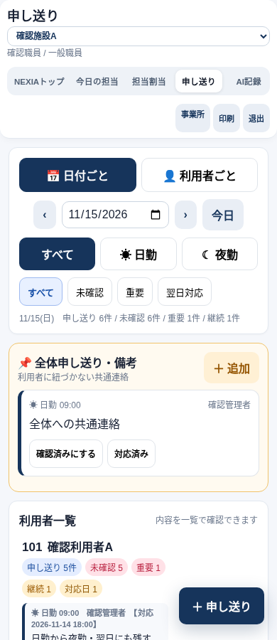
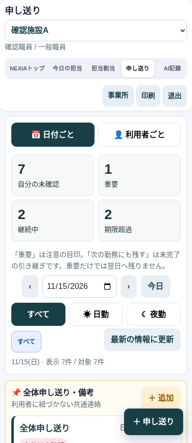
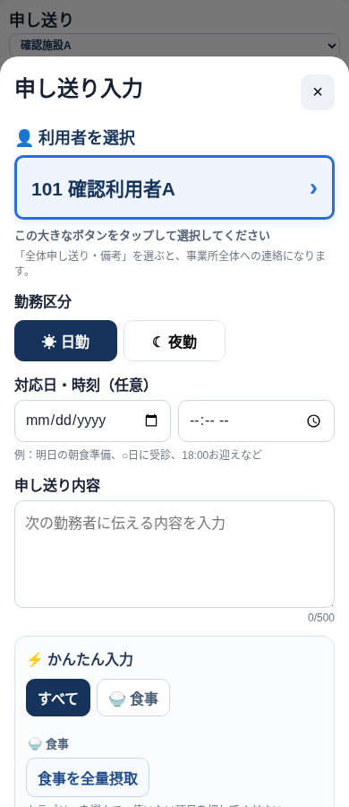
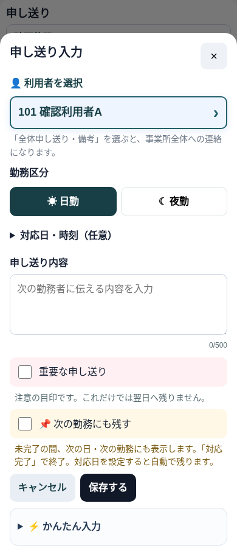

# NEXIA 申し送りの改善報告

2026年11月15日。開発ブランチ：`feature/handoff-workflow`。
起点：`main` の `5c0d5b0d401f5bebc7086a54a9f622d696bcef14`。
本番はコード・メタデータ・集計の読み取り調査だけを行った。本番SQLの適用、データの更新、mainへのマージ、公開は未実施。追加サービスや有料プランは利用していない。

## 変更前と変更後

| 項目 | 変更前 | 変更後 |
| --- | --- | --- |
| 確認 | 自分が確認したかだけを画面で取得。取消は行の削除 | 確認者と日時、複数職員の確認状況を表示。取消は本人の状態変更として保存し、過去の操作を残す |
| 対応完了 | `resolved` の真偽値だけ更新 | 完了した本人ID・職員ID・登録名・サーバー時刻・任意の対応内容を履歴へ保存 |
| 再開 | 状態を戻すだけ | 再開も独立した履歴。以前の完了・対応内容を保持 |
| 同時操作・通信切断 | 競合検出なし | 行ロックと変更番号で古い操作を拒否。操作IDを使い、応答が失われた後の再試行でも二重記録しない |
| 重要／継続 | 違いが分かりにくい。勤務区分で継続案件が隠れる場合があった | 独立した設定として説明。重要だけでは翌日へ残さず、未完了の継続案件は日勤・夜勤の切替後も表示 |
| 対応日 | 過去のデータに、対応日があって継続フラグがないものが1件あった | 元の値を一括補正せず、未完了の対応日設定済み案件も継続表示する |
| 入力 | かんたん入力・体重・バイタルが常時展開 | 必要時に開く。対象・本文・重要／継続・保存を先に操作できる |
| 管理者 | 全職員の確認・対応をまとめて追いにくい | 未確認者あり・重要・継続・期限超過を件数と絞り込みで確認。職員、利用者、日付でも絞れる |
| 削除 | 投稿者／管理者の削除で確認記録も失われる | 「保管」に変更し履歴を保持。管理者画面で保管済みを表示・復元できる |
| 画面配信 | 過去コミットのHTMLを外部から読み込む | リポジトリ内のHTML・JS・CSSを直接配信。同じ `/handoff/` URLを維持 |

確認と対応完了は別のボタン・別の保存処理であり、完了しても自動で確認済みにはしない。投稿者は従来どおり未確認件数の対象から除き、管理者の確認一覧では「投稿者」と明示する。必要なら本人も確認を記録できる。

管理者の確認対象は「現在、事業所に所属するログイン職員（投稿者を除く）」。ログインなし職員を未確認者として数えない。同姓同名の職員はIDの末尾も表示し、操作・絞り込みは氏名ではなくIDで行う。

## スマホ画面の比較

同じ合成データ・Chromium・幅390px／高さ900pxで比較した。以下に本番の氏名・利用者・申し送りは含まれない。

| 一覧：変更前 | 一覧：変更後 |
| --- | --- |
|  |  |

| 入力：変更前 | 入力：変更後 |
| --- | --- |
|  |  |

初期状態の入力フォームの内容高は **1,708px → 1,016px（約41%削減）**。文字を縮小せず、補助入力を折りたたみ、保存操作を先に配置している。基本の操作ボタンは44px以上。体重・バイタル・かんたん入力の機能は保持する。

## 調査結果とDB変更

調査時点の本番には、申し送り164件、対応済み27件、確認記録5件があった。確認テーブルは既に `entry_id + user_id` を主キーとし、`confirmed_at` を保持していたが、画面は自分の行しか読み込んでいなかった。対応済みのフラグから対応者や完了日時を特定することはできなかった。

適用待ちSQL：`supabase/migrations/20261115082458_handoff_workflow_history.sql`。

- `handoff_entries` に変更番号 `workflow_revision` と保管フラグ `archived` を追加する。既存の本文・対象・投稿者・日付・重要・継続・対応済みの値は書き換えない。
- `handoff_confirmations` に取消日時・変更番号・今後の職員名と職員IDの記録欄を追加する。既存の確認者・確認日時・行はそのまま保持する。再確認で現在の確認日時が変わっても、以前の日時は履歴に残る。
- `handoff_activity` を新設し、確認・取消・完了・再開・継続開始・保管・復元を追記する。通常の画面利用者には履歴のSELECTだけを許可する。
- 既存の確認記録は、保存されている本人IDと確認日時をそのまま新しい履歴にもコピーする。過去時点の氏名は推定して保存しない。
- 既存の対応済みについても、「以前から対応済みだった」という事実だけを履歴へ引き継ぐ。**過去の対応者・対応日時はSQL NULLのまま**であり、投稿者やSQL実行者、移行時刻を埋めない。その後に再開しても、この旧データの事実は残る。
- 新しい確認・対応操作は2つのRPCを経由する。公開窓口は `SECURITY INVOKER`、権限を使う処理はprivateスキーマ内に置き、ログイン・施設所属・施設の稼働状態・操作権限をサーバーで検証する。全関数で空の `search_path` を指定する。
- 認証本人IDを `auth.uid()` から取得し、施設IDと認証本人IDの両方で `organization_members` と `organization_staff` を参照する。氏名の一致、メールアドレス、認証のユーザー編集メタデータを本人判定に使わない。
- 既存のRLSは維持し、新しい履歴にも所属施設のRLSを設定する。古い直接更新・確認行削除・申し送りの物理削除のGRANTは取り消し、監査処理を迂回できないようにする。

履歴と状態更新は同一トランザクションで行う。履歴保存に失敗した場合は状態もロールバックする。新規投稿も同じ下書きIDで再試行し、応答切断時の重複投稿を防ぐ。未保存の内容を新しくlocalStorageへ保存することはなく、ログアウト時は画面内の下書き・個人情報を破棄する。

## 既存データ・他機能への影響

本番の申し送りや確認記録は、今回の作業で更新・削除していない。今後SQLを適用しても、既存行の元の列や対応状態を初期化しない。コピーするのは確認済みの事実と、対応済みであるという既知の事実だけ。新しい履歴は、職員の退職・所属解除後も本人IDと当時記録できた登録名を保持する設計としている。

NEXIAトップ・認証・施設切替・AI記録・担当割当・出勤簿・食事管理・出納帳・職員管理・事業所／権限管理を維持する。今日の担当と管理画面の申し送り集計には、保管済みを除外する条件を追加した。今日の担当では対応日設定済みの継続案件も漏れなく表示する。

申し送りの印刷は従来のA4・2ページ形式を維持した。共通の利用者管理は既存の事業所管理へつなぎ、退去済み利用者を別人として再利用しない。かんたん入力の管理者設定は申し送り内に残している。

## テスト結果

| 確認内容 | 実施した検証 |
| --- | --- |
| 一般職員の確認・複数職員・本人だけの取消 | 実SQL・実Chromiumで成功。他人の確認を消せず、同姓同名でもID別に保存・表示 |
| 対応完了・再開 | 対応内容・本人ID・職員ID・サーバー日時を保存。再開後も完了履歴・旧対応済みの事実を保持 |
| 通信切断・重複・競合 | 確認・完了・投稿の応答が失われた後の再試行、同じ変更番号への2要求、別端末で先に完了した状態を再現して成功 |
| 重要・継続・日勤→夜勤・翌日 | 重要だけでは翌日へ残さない。継続・対応日設定は勤務区分や日付が変わっても未完了の間は表示。完了後は次の勤務の対象から外れる |
| 事業所の分離・権限 | 他施設の管理者、未認証、施設・利用者IDの不一致を拒否。管理者権限の不正付与・履歴改ざん・物理削除を拒否 |
| スマホ・PC・管理者確認 | 幅390pxと1440pxで確認。件数、職員・利用者・日付の絞り込み、全職員の確認状況、保管・復元を確認 |
| 既存のシステム | 7機能往復とパスワードログイン1回維持、担当→記録→担当の戻り、旧URL、名前登録、職員管理・事業所管理を確認 |
| 出力 | 申し送りPDFを実生成しA4・2ページを確認。既存の担当割当・出勤簿・出納帳PDF、管理者／本人用出勤簿Excelも生成 |

- 隔離PostgreSQL（PGlite 0.5.16）で **82項目成功**。実際の新旧マイグレーションを同じDBで実行し、既存データ・確認時刻・職員・所属・役割の保全を確認した。
- 日付・勤務区分・確認状態等の純粋なルールテスト **28項目成功**。
- 既存の職員名DBテスト **49項目**、NEXIA DOM **49ケース**、Python安全性 **17件**が成功。管理者ナビゲーション、担当復帰、記録リンク、出勤簿の保存・切替・通信失敗・競合・取り込み・印刷の検証も成功。
- 新しい申し送りの実ブラウザ検証では、PC・スマホともスクリプトエラー・予定外の外部通信／更新リクエストは0件。
- 既存の記録URLは読み込み後にクエリーを整形するため、全体ブラウザテストは一瞬のURL文字列ではなく、実際の「今日の担当に戻る」リンクが復帰情報を維持することを検証するようにした。AI記録側の実装は変更していない。

テストは合成データとローカルの隔離DB・模擬APIだけで行う。本番の利用者・職員・申し送りをテスト用に作成・変更・削除していない。CIにも本番DBへの適用処理や本番認証情報を追加していない。

再実行は `.github/workflows/safety-check.yml` に記載。追加の実行ファイルは `tests/handoff_database.cjs`、`tests/handoff_rules.cjs`、`tests/handoff_browser.cjs`。履歴用DBテストには旧職員名マイグレーションとの組合せ確認も含む。

## 未確認事項

- 本番Supabase Auth／PostgRESTを通した実アカウントでの操作と、本番へSQLを適用した後のスモーク確認。
- スマホ実機、Safari、実際の弱い通信環境での操作。
- 複数の実DB接続・実端末を同時に使った負荷試験。ローカルでは行ロック・変更番号・同じ変更番号での競合・通信結果の喪失を検証しているが、本番の高負荷を再現したものではない。
- 既存のSecurity Advisorの指摘は今回の範囲で変更していない。調査時は[既存の公開SECURITY DEFINER関数の指摘](https://supabase.com/docs/guides/database/database-linter?lint=0029_authenticated_security_definer_function_executable)7件と[漏えいパスワード保護の指摘](https://supabase.com/docs/guides/auth/password-security#password-strength-and-leaked-password-protection)があった。今回の新しい公開RPCはSECURITY INVOKERとしている。

## 承認後の本番反映

1. SQLとフロントエンドの両方の変更・影響について承認を得る。PRや開発ブランチを作成しただけでは本番へ反映されない。
2. その時点のmainとDB構造・権限、既存の確認記録／対応済み件数を再確認し、バックアップ・復旧方法を確認する。移行時点で存在する記録が対象で、5件・27件という調査時の件数をハードコードしていない。
3. 承認済みSQLをトランザクションで1回だけ適用する。ロック取得に5秒以上かかる場合は失敗させ、勝手に長時間待機・破壊的な変更を行わない。既存のSQL適用履歴を確認し、リポジトリの一部のマイグレーションだけで無条件に `db push` しない。
4. 既存列・確認時刻・対応状態が変わっていないこと、新しい履歴の件数とNULLの扱い、施設別アクセス、一般職員の操作権限を確認する。
5. 続けて承認済みフロントをマージ・公開する。**新しい画面は追加テーブル・列・RPCが必要なので、フロントだけを先に公開しない。** SQL適用後は旧画面からの直接更新・確認取消・削除が拒否されるため、作業中の職員に画面の再読み込みを案内する。
6. 一般職員・管理者で確認、取消、完了、再開、日勤→夜勤、翌日表示、施設切替、既存の出力を確認する。本番の記録を確認用に一括変更したり、過去の対応者を埋めたりしない。

問題時に新しい履歴を削除・初期化しない。フロントだけ旧版へ戻すと直接更新権限がないため操作できない点に注意し、権限と履歴保護を含めた復旧内容を確認してから対応する。

## 主な変更ファイル

- `handoff/index.html`、`handoff/app.js`、`handoff/app.css`、`handoff/core.js`：画面、保存・取得処理、表示ルール。
- `supabase/migrations/20261115082458_handoff_workflow_history.sql`：適用待ちDB変更案。
- `dashboard/index.html`、`admin/index.html`：保管済みの集計除外、対応日設定済みの継続案件表示。
- `tests/handoff_*`、`tests/fixtures/handoff_schema.sql`、既存ブラウザ／構文／安全性テスト、CI：新機能と回帰確認。
- `docs/handoff/`：報告と合成データの画面比較。

旧キャッシュ画面から参照される `handoff/safety-addon.js` は互換用に残しているが、新画面からは読み込まない。
