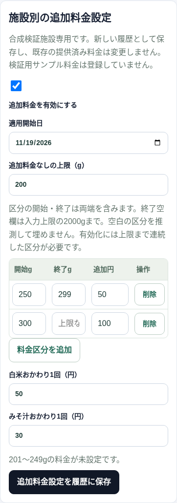
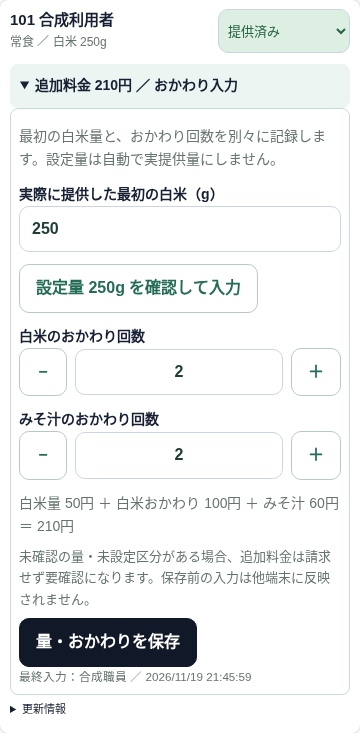
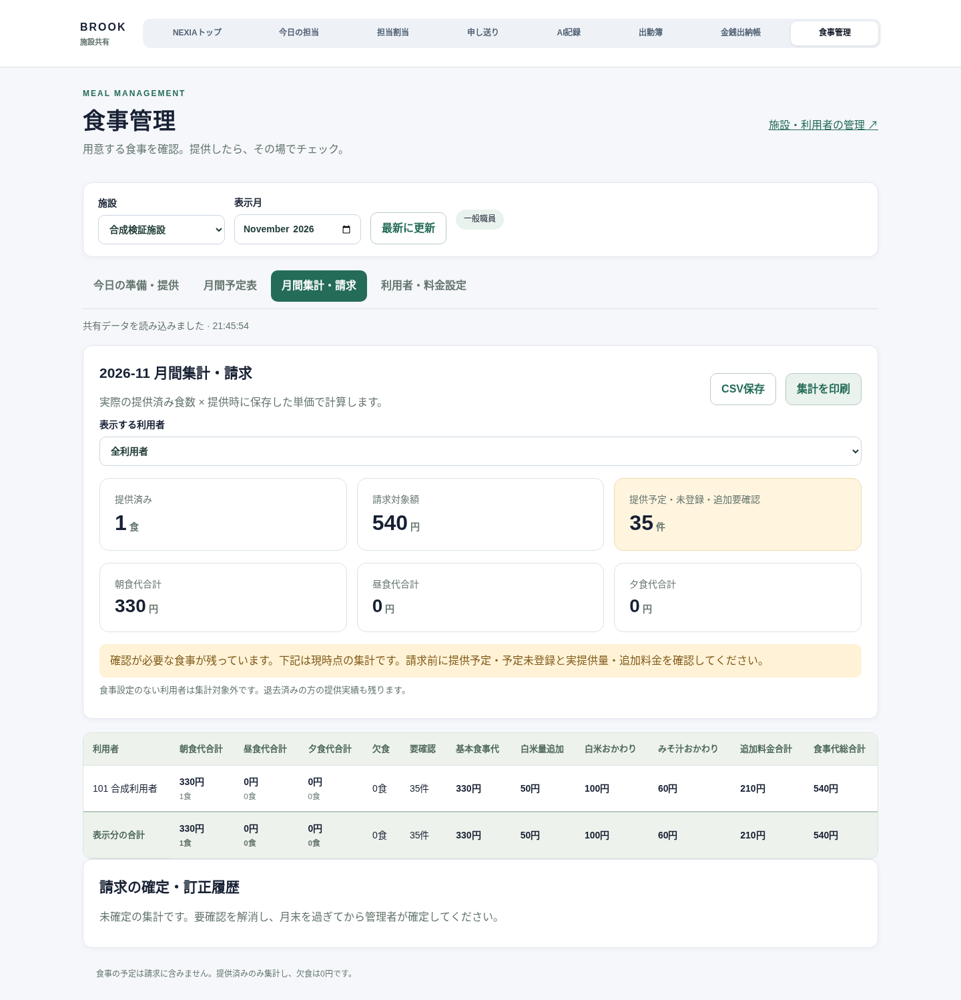

# 食事管理・施設別追加料金：開発報告

開発ブランチ：`feature/meal-extra-charges`。起点：main `6ae6ca5b7062600cb8e7ac0587e39829a443ad46`。
本番Supabaseは定義・RLS・関数・Security Advisorの読み取り調査のみ実施。**新SQLの本番適用、料金登録、既存行変更、mainへのマージ、公開は未実施。**

## 調査結果と変更点

既存の `meal_entries` は施設・利用者・日付・朝昼夕を主キーとし、提供時の基本単価・食事形態・白米設定量を固定していた。`private.meal_validate` が単価の固定・認証職員ID・更新者を検証し、`meal_history.changes` が監査を保存する。料金は管理者、プロフィールは管理者／施設編集者、通常の提供チェックは所属職員が操作する。

NEXIAとAI記録からの食事管理リンクは同じ `meals/` と `clients`・`organization_members` を使う。別系統の `sm_*`（独立版食事管理）は対象外とし変更しない。AI記録本文、担当割当、出勤簿、出納帳の保存・出力コードも変更しない。

| 変更前 | 変更後 |
| --- | --- |
| 提供時の白米設定量のみ | 設定量を残し、実際の最初の提供量を別に確認・保存 |
| 基本食事代のみ | 基本代・白米量追加・白米おかわり・みそ汁おかわりを分離 |
| おかわり入力なし | 朝昼夕・利用者・日付ごとの＋／−、保存、最終入力者・日時 |
| 追加料金なし | 施設別、適用日別の変更履歴。管理者だけが設定 |
| 現在の月間集計 | 未確定集計に加え、月末経過後の確定・理由付き解除・再確定・過去版の表示 |

## 管理者の料金設定

1. 食事管理の上部で対象施設を確認する。
2. 「利用者・料金設定」の先頭にある「施設別の追加料金設定」を開く。
3. 無料の上限g、区分の開始g・終了g・追加円、白米／みそ汁おかわり1回の単価、今日以降の適用開始日を入力する。
4. 区分は追加・編集・削除できる。両端を含む。終了の空欄は既存の入力上限である2000gまでを示す。
5. 空白・重複・負数・小数・未入力を確認し、有効チェックと確認ダイアログを経て履歴として保存する。既存履歴は変更・削除しない。
6. 無効化も新しい適用開始日で保存する。既に提供済みの料金は、その提供時の有効／無効と単価を保持する。

**料金は一切初期登録しない。提示された200／250／300g、50円／30円もテスト専用。本番料金として確定していない。201〜249gは未確定のまま。** 有効な設定でこの範囲を飛ばすと保存を拒否する。無効の下書きとして区分の空白を残すことはできるが、有効化には未確定範囲を管理者が決定し、全範囲を埋める必要がある。未入力の単価を0円に置き換えない。

画像は合成データ。後続の保存・請求テストでは区分の連続性を検証するため、201〜249gに明示した仮のテスト単価を使用したが、本番への提案・補完・登録ではない。

## 職員の実提供量・おかわり入力

1. 「今日の準備・提供」で日付と朝昼夕を選び「提供済み」にする。
2. 利用者の「追加料金／おかわり入力」を展開する。
3. 実際の最初の白米量を入力する。設定量と同じ場合も「設定量を確認して入力」を押して確認する。設定値だけで大盛り代を請求しない。
4. 白米・みそ汁のおかわり回数をそれぞれ＋／−で入力し、内訳・合計を確認して「量・おかわりを保存」を押す。
5. 保存後は再読み込み・別端末でも共有され、入力職員・日時が表示される。保存前の入力は未保存として警告する。

量が不明・区分が不明な場合は「要確認」にし、追加料金全体の請求を保留する。基本食事代は既存どおり残る。予定・欠食では基本代も追加代も0円。欠食への変更時に確認を出し、おかわり履歴は削除しない。再び提供済みに戻した場合は、最初に保存した料金・回数を保持する。

通常の当日入力は所属職員が可能。過去日の追加料金訂正は管理者が理由を記録して行う。施設編集者は既存の食事プロフィール編集ができるが、追加料金の設定・請求確定・過去日の料金訂正はできない。

## 月間集計と確定

表示・CSV・印刷／PDFに、基本食事代、白米量追加、白米おかわり、みそ汁おかわり、追加料金合計、食事代総合計を追加する。朝昼夕それぞれの既存基本代合計も維持する。CSV明細には設定量と実提供量、回数、3種類の追加額、状態、入力職員と日時を保存する。Excelでは既存と同じCSVを開く方式。新しい有料のExcel／PDFサービスは使わない。

管理者は、月末が経過した月の未確認量・提供予定・予定未登録を解消して「この月の請求を確定」を押す。理由・確認メモを必須にし、職員ID・日時・氏名／部屋番号・食事明細・単価・追加額を含む確定版を保存する。確定月の提供記録・追加料金は、直接APIからも変更を拒否する。

訂正は「理由を記録して確定を解除」→訂正→再確定。前の確定版は削除しない。「表示する請求版」で過去版を選ぶと、現在の単価や氏名に置換せず、保存した版から表示・印刷・CSVを作る。

## DB変更と既存データ

新規SQL：`supabase/migrations/20261119123222_meal_extra_charges.sql` 1本。

- `meal_extra_prices`：施設別・適用日別の追記専用料金履歴。
- `meal_entry_extras`：既存の複合主キーへのFK。実量・回数・提供時の料金設定ID／単価・追加額・更新職員／日時・競合検出用revision。
- `meal_bill_versions`：施設・月・版ごとの請求明細スナップショット、確定／解除、理由、職員ID・日時。
- `private.meal_extra_history`：量・回数・状態の訂正前後と理由の監査。直接閲覧・変更不可。
- 既存 `meal_entries` に請求確定チェックと最初の提供時の料金固定トリガーを追加する。既存RLS・基本単価固定関数・監査トリガーを置換しない。
- 新規public APIはSECURITY INVOKER。private側で施設の稼働状態・所属・認証UID・管理者を検証。新規表はRLS有効、通常のAPIにはSELECTのみ。直接INSERT／UPDATE／DELETEによる単価改ざんを許可しない。
- 料金設定の保存と請求確定は管理者のみ。施設編集者の権限表やadmin/staff制約は変更しない。
- 現在値との比較、NULLのrevision拒否、食事行→所属→施設→追加情報のロック順で、連打・旧画面・提供状態変更・料金変更・請求確定の競合を制御する。競合は保存を拒否して再読み込みを案内する。

**マイグレーションは既存の食事・利用者・職員行を更新／削除しない。導入前に一度でも提供済みになった行には、新しい追加料金を推測して付けない。** 導入前記録は基本代だけを既存どおり集計する。既存の予定が導入後に初めて提供済みになる場合は、食事日を基準に有効な設定を固定する。既存の基本料金・提供済み白米設定量・履歴単価は維持する。

仕込み量は従来どおり提供予定だけから計算する。おかわりの追加額・回数を炊飯量やみそ汁の仕込み見込みへ二重加算しない。

## 検証結果

- 隔離Postgres（PGlite）：追加料金のDB権限・履歴・既存値不変・NULL／古いrevisionの拒否・区分空白・請求確定／訂正・他施設を53項目検証。
- 計算：32項目。200g以下0円、250g50円、300g100円、201〜249gは要確認・追加請求0円、白米2回100円、みそ汁2回60円、250g＋両おかわり2回は追加210円／朝食込み540円。予定・欠食は0円。
- ChromiumでPC1440px・スマホ390px。実際のsupabase-js経由の通信を、隔離Postgresの実RLS／RPCへ接続。料金保存の空白拒否、提供・実量・＋／−・保存・再読み込み・別端末、集計、CSV・PDF、請求確定／解除・過去版表示、一般職員／施設編集者の料金API拒否を確認。スクリプトエラー・予定外外部通信0件、入力画面の横はみ出しなし。
- 既存の施設編集者DB100項目とPC／スマホ4機能の回帰が成功。一般職員の既存割当操作や料金変更禁止を維持。
- 全体Chromium：7機能往復、認証・再ログイン・氏名変更、職員／施設管理、担当からAI記録への復帰、出勤簿Excel、担当・出勤簿・出納帳PDFが成功。
- 既存食事の計算・DOM試験、HTML内JS構文・ナビ整合性、Python17項目が成功。GitHub CIにも新規3試験を組み込んだ。CIの最終結果はPRに記載する。

テストには合成職員・合成利用者・合成料金だけを使用。本番アカウントや提供記録を書き換えていない。PGliteでは既存参加コードの未使用pgcryptoデフォルトだけテスト用スタブを使い、参加コードは明示する。

未確認：実機iPhone／Android・Safari、本番Auth／PostgRESTでの実職員による保存、本物の複数DB接続を使った競合・負荷試験。単一接続の隔離Postgresで権限・SQL・旧revision拒否を確認したことと、複数接続の負荷確認は区別する。

既存Security Advisorには、[既存のSECURITY DEFINER公開関数](https://supabase.com/docs/guides/database/database-linter?lint=0029_authenticated_security_definer_function_executable)、[漏えいパスワード保護](https://supabase.com/docs/guides/auth/password-security#password-strength-and-leaked-password-protection)等の指摘がある。今回の開発で既存関数・Auth設定を変更していない。

## 承認後に必要な操作

1. **今回のSQL・画面変更の本番反映について承認を得る。以前の施設編集者リリースの承認は流用しない。**
2. 最新mainと本番定義・RLS・マイグレーション履歴を照合し、バックアップ／復旧手順を確認する。
3. 新規SQL1本だけ適用。古いSQLを含む一括db pushは行わない。初期料金0件、既存データ不変、RLS・権限の保持を確認する。
4. PRをmainにマージして、既存のGitHub Pagesで公開する。SQLが先、画面が後。画面が先だと必要な新規表を取得できず、食事画面を停止するため順序を守る。
5. 管理者が施設ごとの本番料金と適用開始日を確認・登録する。**201〜249gを含む全区分、単価、有効化は別途決定が必要。今回の実装だけで本番料金を登録・有効化しない。**
6. 公開後に実職員で対象施設／別施設・保存・再読込・月間出力を確認する。問題時は画面を前版へ戻し、記録・請求版・料金履歴を削除しない。DB側の戻しが必要なら別の内容確認・承認を経る。

追加の外部サービス、有料プラン、従量課金APIは導入していない。既存のSupabase／GitHubと無償のローカルDB・ブラウザ試験を利用する。
