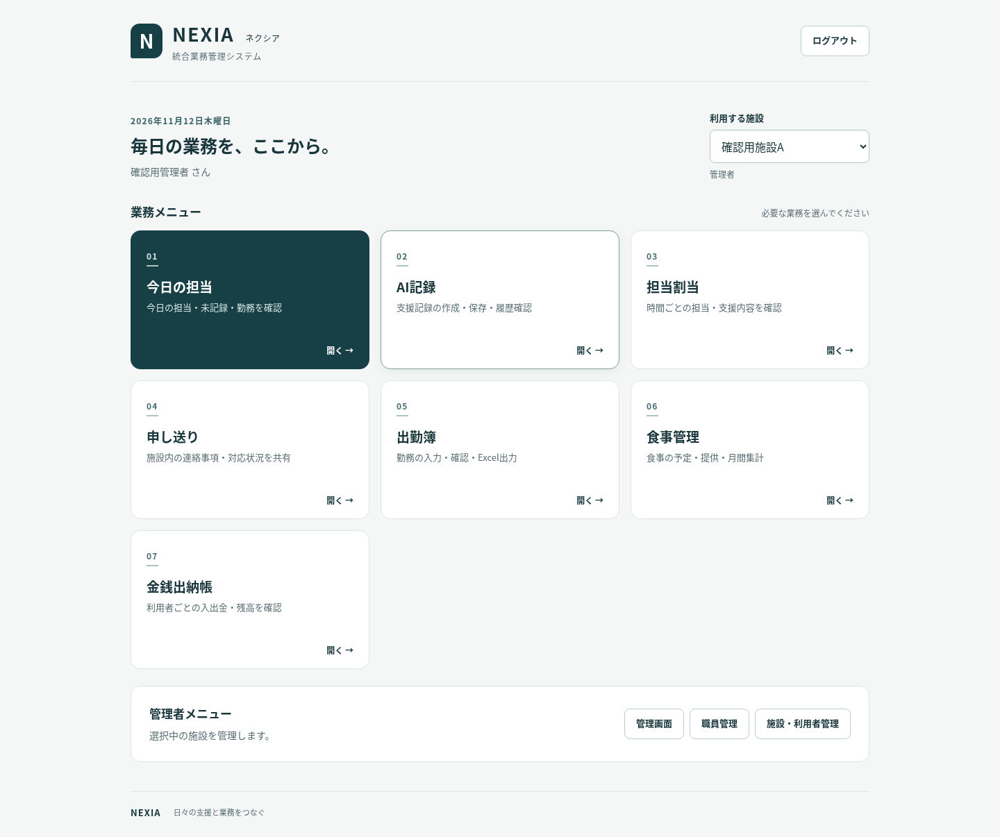
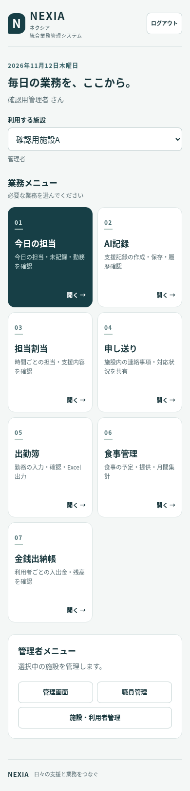

# NEXIA 開発・調査報告

作業日：2026年11月12日（日本時間）。開発ブランチ：`codex/nexia-portal`。
調査・実装の起点：`c9a89e25b5cfeb7bc9c1aeb3957d05ff3ce3758e`。
この変更は本番反映前のレビュー用。DB変更、データ変更、公開範囲変更、PRマージ、追加サービスの契約は実施していない。

## 既存構成を調査した結果

- 静的HTML/JavaScriptとSupabaseを使用。主要業務は同一オリジン・同一SupabaseプロジェクトのAuthセッションを共有している。メールアドレスとパスワードによる既存認証、永続セッション、自動トークン更新を維持する。別ドメイン・別ブラウザへのセッション移送は行わない。
- ルートのAI記録、担当割当、申し送り、金銭出納帳は、特定コミットの既存HTMLをGitHub Raw/CDNから読み込むラッパー構成。参照コミット、安全性アドオン、記録の正式保存処理は変更していない。
- `/dashboard/` は今日の担当・夜勤・未記録・申し送り・出勤簿の既存業務画面。トップとは別に維持する。担当から記録へのリンク、記録ID指定、日付・夜勤・施設・スクロールの復帰処理も維持する。
- 施設は `organizations`、所属と管理者権限は `organization_members`、職員と本人の対応は `organization_staff.linked_user_id` を使用。ブラウザの施設IDは選択のヒントであり、権限の根拠にはしない。
- 食事管理の入口は既存アカウントで使う `/meals/`。独立した `/shared-meals/` は異なる所属テーブル群を使うため統合対象へ混ぜていない。採用ページ `/recruitment/` も変更していない。
- 既存の記録・利用者・職員・出納・食事・出勤簿の保存処理、Excelテンプレート、担当表の印刷/PDF出力処理は維持する。

## 実装内容

- `/home/` にNEXIAトップとログイン画面を追加。7業務へのカード、施設選択、権限表示、管理者専用の管理画面・職員管理・施設/利用者管理へのリンクを配置した。
- 既存と同じSupabaseプロジェクト、公開キー、SDKバージョン `2.57.4`、Auth永続化設定を使用。トップは所属・施設を読むだけで、業務データの取得・作成・更新・削除を行わない。新しい認証基盤や有料サービスは追加しない。
- 未認証時はログイン画面、未所属・全施設停止時は案内画面を表示。所属・施設の取得に失敗した場合は業務メニューを隠して再試行を案内する。
- 施設切替、別タブの施設変更、画面復帰時にサーバーから所属と施設を再取得する。別施設で管理者でも、選択施設で一般職員なら管理者メニューを表示しない。ログアウト中に古い通信結果が届いても業務画面を再表示しない。
- 各業務の共通メニューに「NEXIAトップ」を追加。管理者ホームにも共通メニューを追加。共通メニューの管理リンクも、選択施設の所属・管理者権限・利用状態を取得して判定するよう修正した。
- PCは3列、タブレット・スマホは2列のカード配置。施設選択はスマホで全幅。キーボードのフォーカス、フォームラベル、本文へのスキップリンク、状態メッセージを用意した。
- ブラウザ検証で、出勤簿の一般職員用に隠した職員切替欄が、既存の `label` / `.staff-nav` の表示指定により見えてしまう点を発見した。出勤簿内で `[hidden]` を確実に非表示にし、本人用の表示を維持するよう修正した。出勤簿の職員管理リンクも選択施設の管理者だけに表示する。本人以外のアクセスを制限するRLSは変更していない。
- 出勤簿PDFに新しいトップリンク・メニュー名が混入する影響を検出し、印刷時はトップ項目を除外して「今日」「出納帳」の従来表記を維持した。3帳票のPDF本文を変更前と比較し、すべて一致することを確認した。

## 開発版の画面

以下は合成データによるChromiumでの画面。実在する施設・職員・利用者の情報は含まない。





## URL互換性

| URL（`/ai-kiroku-app/` からの相対表記） | 動作 |
| --- | --- |
| `/`、`index.html`（クエリ・ハッシュなし） | `home/` へ置換遷移し、NEXIAでログイン/トップ表示 |
| `home/` | NEXIAトップ |
| `?app=record` | 従来のAI記録。トップと共通メニューからの記録入口 |
| `?from=assignment&assignment=…` | 従来どおり、割当情報を安全に取得して記録作成 |
| `?from=record&record=…&assignment=…` | 従来どおり、指定した保存済み記録を開く |
| その他の既存クエリ、認証用ハッシュ | トップへ強制転送せず、従来の認証/記録処理へ渡す |
| `dashboard/`、`assignment/`、`handoff/`、`attendance/`、`meals/`、`cashbook/` | 従来のURL・業務処理を維持。トップへ戻れる |
| `admin/`、`staff/`、`manage/` | 既存URL・権限確認を維持 |
| `integrated/`、`integrated/fixed.html` | 既存のルートへの転送を維持し、最終的にNEXIAへ。案内リンクの表示を更新 |

ルートだけをAI記録のブックマークとして使っていた場合は、NEXIAトップが開くようになる。AI記録へ直接進むブックマークは `?app=record` に変更する。記録や割当IDを持つ既存URLは変更不要。

通常の入口からログインするとNEXIAトップが表示される。既存業務への直接アクセス、記録リンク、メール認証、新規登録・施設参加は従来の認証と画面を維持するため、その業務画面を続けて利用できる。

## サーバー権限の調査

本番Supabaseに対してメタデータのSELECT、既存関数定義、セキュリティアドバイザー、直近24時間のログを読み取り調査した。利用者・職員・記録の実データはテストに取得していない。

対象15テーブル（`organizations`、`organization_members`、`organization_staff`、`clients`、`client_service_slots`、`staff_assignments`、`care_records`、`handoff_entries`、`attendance_months`、`meal_profiles`、`meal_entries`、`meal_prices`、`cashbook_accounts`、`cashbook_entries`、`cashbook_choices`）はすべてRLS有効を確認した。既存RLS・GRANT・RPC・監査トリガーは変更していない。

- 所属施設のアクセスは既存の `private.is_org_member`、管理者操作は `private.is_org_admin` 等で制御される。一般職員の出勤簿は本人紐付けを含むRLS、食事設定・利用者/職員管理は既存の管理者制御を維持する。画面表示だけを権限の根拠にしていない。
- `organization_members` の本人更新にはRLSに加え、一般認証ユーザーのUPDATE列が `staff_name` に制限されていることを確認した。トップに権限変更操作は追加していない。
- 既存の施設名/利用状態更新、職員権限変更・所属解除RPCには、認証ユーザーと管理者のチェックがあることを定義で確認した。
- 既存の `private.is_org_member` / `is_org_admin` 自体は施設の停止状態を判定しない。食事・出勤簿には個別の稼働施設チェックがある一方、記録など一部の既存ポリシーは所属判定のみ。NEXIAトップは停止施設を除外するが、停止施設に対するサーバー側アクセスを全面禁止したことにはならない。変更する場合は別途DB変更の承認と影響調査が必要。
- 既存アドバイザーの警告は、認証ユーザーから呼び出せるSECURITY DEFINER関数7件、漏洩パスワード保護無効。非公開スキーマのRLSポリシーなし3件はINFO。今回の変更による新規発生ではなく、設定変更は実施していない。関連資料：[関数の警告](https://supabase.com/docs/guides/database/database-linter?lint=0029_authenticated_security_definer_function_executable)、[パスワード保護](https://supabase.com/docs/guides/auth/password-security#password-strength-and-leaked-password-protection)、[RLSポリシーなし](https://supabase.com/docs/guides/database/database-linter?lint=0008_rls_enabled_no_policy)。
- 調査時の直近24時間の認証ログには、認証情報不一致5件、更新トークン不在1件の警告があった。今回の実装前からのログであり、個別の利用者や端末の原因までは確定していない。

RLSの調査は定義と有効状態の確認。実ユーザーとして他施設の操作を試す検証は未実施であり、「全権限の実機確認済み」という意味ではない。

## テスト結果

以下は合成データ・API代替を使ったローカル検証。テスト用DBやSupabaseの有料ブランチを作成していない。

| 検証 | 結果 |
| --- | --- |
| `tests/nexia_portal.cjs` | 35ケース成功：未認証、ログイン成功/失敗、セッション再利用、7メニュー、施設切替、施設ID改ざん、未所属、停止施設、不明な権限、管理者権限の取消、通信障害と再試行、ログアウト成功/失敗、応答競合、文字列の安全表示、別タブ、URL互換、各画面の戻り導線 |
| `tests/nexia_admin_nav.cjs` | 選択施設の管理者判定、一般職員への切替、施設停止、通信失敗、ログアウトの表示制御に成功 |
| Python安全性・ケア導入文 | 17件成功 |
| `tests/dashboard_return.cjs` | 日付・夜勤・施設・表示範囲・スクロールの復帰に成功 |
| `tests/record_link.cjs` / `record_history.cjs` | 記録ID指定、同時刻の複数記録、旧記録、他施設/削除済み/不整合リンクの拒否、履歴の月/利用者絞込に成功 |
| `tests/service_presets.cjs` | 支援内容の編集、保存、再表示、取得失敗時保持、一般職員UIの回帰確認に成功 |
| `tests/meals_core.cjs` / `meals_dom.cjs` | 集計・欠食・料金履歴・CSV、提供保存、競合、設定保存、月表示、通信失敗、ログアウトに成功 |
| `tests/attendance_dom.cjs` | 管理者/本人の表示範囲、保存、再読込、切替、通信失敗、競合、Excel出力、印刷DOMに成功 |
| 出勤簿xlsxのopenpyxl検査 | 本人1シート・管理者2シート、数式67/133個、全シートの既存印刷範囲 `$A$1:$I$53` を確認 |
| `tests/nexia_browser.cjs` | 実ChromiumでPC 1440px・スマホ相当390pxを実行。ログイン1回で7機能との往復、割当→記録→担当へ復帰、施設切替、管理者リンク、食事設定の一般職員による編集不可、出勤簿の本人表示、ログアウトを確認。両環境とも横方向のはみ出し・未捕捉JSエラー・予定外通信なし |
| トップの画面幅 | 320 / 390 / 560 / 768 / 1024 / 1440pxで横方向のはみ出しなし。PC・スマホ相当のトップをスクリーンショットで確認 |
| ブラウザ経由のExcelダウンロード | 管理者2シート・本人1シートを生成。openpyxlで氏名、対象シート、数式、既存印刷範囲を確認 |
| ブラウザ経由のPDF | 既存の印刷ボタン経由で担当表・出勤簿・出納帳を生成。テスト施設・職員・利用者、担当、出納額を確認。起点コミットの画面から生成した同データのPDFと本文が3種類すべて一致 |
| JS・HTML内JS構文、共通ナビ整合、`git diff --check` | 成功 |

CIには新規トップの構文・認証/権限/ナビテストと、担当への復帰・記録リンクの回帰テストを追加した。さらに、隔離した合成応答を使うChromiumのPC・スマホ相当ブラウザテストを追加した。

再実行例（既存テストと同じ `JSDOM_PATH` 方式）：

```sh
export JSDOM_PATH=/path/to/jsdom
node tests/nexia_portal.cjs
node tests/nexia_admin_nav.cjs
node tests/dashboard_return.cjs
node tests/record_link.cjs
python -m pytest -q tests/test_system_safety.py tests/test_care_intro.py
```

ブラウザ検証にはPlaywright（検証時1.62.1）、Chromium、Python、curlが必要。公開済みの既存HTML・SDKだけを事前取得し、実行中のSupabase通信はすべて合成応答へ置き換える。実アカウントや本番DBへの接続は不要。画面用のローカルHTTPサーバーはループバックだけで待ち受け、終了時に停止する。

```sh
python tests/prepare_nexia_browser.py --assets /tmp/nexia-browser-assets
NEXIA_BROWSER_ASSETS=/tmp/nexia-browser-assets node tests/nexia_browser.cjs
```

Playwrightが通常のNode検索パスにない場合は `PLAYWRIGHT_PATH` にそのパッケージのパスを指定する。必要に応じて `NEXIA_CHROMIUM` でブラウザ実行ファイルを指定できる。スクリーンショット・PDF・Excel・結果JSONは assets ディレクトリ内の `browser-results/` に出力される。

PDFの比較用には起点コミットを別ディレクトリへ展開し、`NEXIA_BASELINE=1 NEXIA_BASELINE_ROOT=/path/to/base NEXIA_BROWSER_ASSETS=/tmp/nexia-browser-assets node tests/nexia_browser.cjs` を実行する。生成先は `baseline-results/`。今回の比較では `pdftotext -layout` の全文が3帳票すべて一致した。

既存の印刷上の課題として、今回のデータ・ブラウザ設定では出勤簿PDFに2ページ目の空白、担当表PDFに画面操作バーの混入がある。起点コミットでも同じ状態を確認した。PDF内容を維持する今回の範囲では、これらの既存帳票レイアウトを改修していない。担当表・出納帳は各A4 1ページ、出勤簿はA4 2ページだった。

## 未確認事項

- 実アカウント・本番Supabaseを使ったE2E、実データでのExcel/PDF出力。合成認証・API応答で確認した結果と区別する。
- スマホ実機、Safari / Firefox、OSの印刷ダイアログ、実際のプリンター、キーボード/スクリーンリーダーの全操作。スマホの確認はChromiumの390px・タッチ設定によるエミュレーションであり、実機確認ではない。
- 共有デスクトップの操作ツールは未提供だが、インストール済みのChromiumをPlaywrightから起動でき、自動ブラウザ確認・スクリーンショット取得・PDF生成を実施できた。
- 認証メール遷移・外部CDN障害時の実ブラウザ動作。既存の外部HTML/CDN依存は残る。ホスティングはGitHub Pagesの `main` ブランチ・ルート配信であることを設定の読み取りで確認済み。
- 本番で書き込みを伴うRLSテスト。既存の `tests/*_rls.sql` は書き込みを含むため、今回は実行していない。

## 承認後の本番反映での注意点

1. 差分とCIを確認し、承認後にマージ・デプロイする。今回はSQL適用不要。DB変更・認証設定変更・公開範囲変更を同時に行わない。
2. GitHub Pagesは `main` ブランチの `/` を公開している。マージするとPagesのビルドで本番へ反映されるため、マージ自体を承認後に実施する。変更前コミットを復旧先として控える。
3. 共通ナビと管理リンクのキャッシュ識別子を更新済み。反映後に通常更新で新しい「NEXIAトップ」が表示されるか確認し、古い表示が残る場合は再読み込みする。
4. 実アカウントで、トップから7業務へ追加ログインなしで進めること、各業務からトップへ戻れることを確認する。施設A管理者/施設B一般職員など、施設ごとに権限が異なるアカウントでも確認する。
5. 既存の割当リンク・保存済み記録リンク・今日の担当への復帰、Excel/PDF出力を確認する。既存記録や利用者/職員を変更する操作をスモークテストへ混ぜない。
6. 不具合があれば、承認後にこのフロントエンド変更を起点コミットへ戻す。DB復元やデータ削除は不要。作業中の各業務に未保存入力がある場合は、その業務の既存手順で保存/退避してから更新する。
