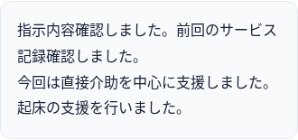
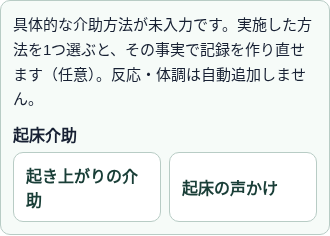
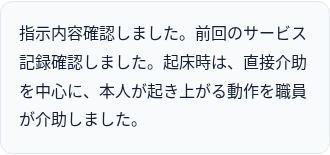
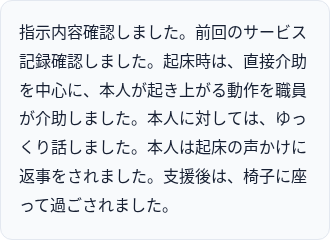

# AI記録：通常操作で短文になる原因と事実に基づく生成の再設計

## 本番の問題を再現した結果

比較元はPR #31を公開したmain `85e60d663f4eb0244ad3bd1482db31e75d3bd528`。ユーザーが示した「ベッド上で側臥位・笑顔・体調良好・起床介助・積極的支援（直接介助を多め）」を使いました。実際の固定HTML画面を隔離DBへ接続したブラウザ比較で、以前の長めの訪問文43文字を再現しました。

> 訪問時は、ベッド上で側臥位にて休まれていました。笑顔が見られました。体調は良好でした。

以前の実施内容（必須冒頭文以降）は次の汎用文でした。

> 今回は直接介助を中心に支援しました。起床の支援を行いました。

### 原因

1. 15サービスのチェックは「そのサービスを実施した」という範囲の情報だけです。起き上がりの直接介助、起床の声かけ等の具体的動作とは別に保存されています。通常操作では任意欄が閉じており、方法未入力に気づく導線がありませんでした。
2. 生成側は具体的動作が空だと常に汎用文へ戻り、介入度を別の定型文で追加していました。サービスと介入度だけから具体的介助を推測しない点は必要ですが、結果として二つの短い定型文になっていました。
3. 長さ設定は接続・段落・言い回しの差が中心で、同じ事実の主体や支援方法の関係を整理する段階がありませんでした。候補数・重複率の確認だけではこの通常操作の問題を十分に検出できませんでした。

## 今回の実装

生成前に「訪問時の観察」「実施したサービスの範囲」「具体的な動作」「本人が行った部分」「方法」「反応」「支援後」「介入度」を区別した事実の構造を作ります。介入度は支援の範囲として扱い、対応する動作が実際に選択されている場合だけその動作と結び付けます。起床介助＋積極的支援だけで起き上がり・立位・移乗・安全確認を追加しません。互換性のため既存の入力形式・保存列を維持します。

- 短め：同じ職員が行った動作や方法を接続し、要点を簡潔にまとめます。確認した事実・本人の発言を省略しません。
- 普通：サービスごとに、選択した介助・方法・反応・支援後を経過としてまとめます。
- 長め：本人の動作と職員の介助、誰にどのように伝えたか、訪問時の観察と支援後を明確にします。見出し・改行・重複説明で文字数を作りません。
- 同じ反応や終了後の状態を個別欄と全体欄に重ねて選んだ場合は、同じ内容の繰り返しを避けます。本人発言や自由記載は原文を保持します。
- 確認していない服用・本人の反応・安全確認・体調・プロフィール情報は生成しません。服薬拒否・未確認のまま服用済みにはしません。

## 方法が未入力の場合の1回補足

生成結果の近くに、方法未入力のサービスについて既存の方法ボタンを表示します。起床介助なら「起き上がりの介助」「起床の声かけ」から実際に行った方を1回選ぶだけで、選んだ動作を追加し、自動的に生成・類似比較をやり直します。サービスの再選択、任意欄を開く操作、生成ボタンの再押下は不要です。

ボタンは自動では選択しません。反応・支援後・体調は追加しません。「声かけ＋服用確認」「上半身は本人・背部を介助」等、複数事実を含む既存ボタンはラベルに明示された内容だけを反映します。すでに文章を手修正していれば自動上書きせず、入力や利用者・施設が変わった古いボタンも使いません。連打でも追加保存しません。正式保存は従来どおり別のボタンです。

サービスと介入度だけの記録は、今回も無理に詳しくしません。この入力から確認できる情報には限りがあります。補足は任意で、短文を理由に通常保存を禁止しません。

## 同じ入力での文章比較

以下の表は同じ架空事実を両版の生成関数に与えた比較です。seedを0に固定し、空白・改行を除きます。介助文の文字数には必須冒頭文を含みます。見出しで増えた量を数えていません。

訪問の基本3事実のみでは、修正後の訪問文は短め37文字・普通40文字・長め59文字でした。サービスだけの介助文は短いままとし、未入力を補足する案内を表示します。

詳細例には、本人の発言「このあと椅子で過ごしたい」、普段より動作がゆっくり、実施した介助、ゆっくり話した、実際の反応と支援後を明示的に追加しています。入浴・排泄の介入度は必要な部分の介助、食事は見守り中心とした架空例です。利用者プロフィールから当日の事実を追加していません。

| サービス | 介助文：短め 前→後 | 普通 前→後 | 長め 前→後 |
|---|---:|---:|---:|
| 起床介助 | 103→97 | 106→102 | 112→119 |
| 服薬介助・確認 | 120→123 | 123→131 | 129→143 |
| トイレ介助 | 125→120 | 128→131 | 134→146 |
| 入浴介助 | 132→127 | 135→138 | 141→150 |
| 食事介助 | 133→121 | 136→132 | 142→144 |

量の差は確認済みの情報を圧縮するか、主体・対象・方法の関係を明確に書くかの差です。事実の数が増えるわけではありません。情報が少ない入力では、3設定で大きな差が出ない場合があります。

### 起床介助：今回の入力に方法・反応等を追加した例

**短め**

修正前① 訪問時、ベッド上で側臥位にて休まれており、笑顔が見られました。体調は良好でした。本人から「このあと椅子で過ごしたい」との発言・訴えがありました。普段との違いとして、普段より動作がゆっくりでした。

修正後① 訪問時、ベッド上で側臥位で休息中で、笑顔が見られました。体調は良好でした。本人から「このあと椅子で過ごしたい」との発言・訴えがありました。普段との違いとして、普段より動作がゆっくりでした。

修正前② 指示内容確認しました。前回のサービス記録確認しました。今回は直接介助を中心に支援しました。起き上がりを介助し、ゆっくり話しました。本人は起床の声かけに返事をされました。支援後は、椅子に座って過ごされました。

修正後② 指示内容確認しました。前回のサービス記録確認しました。今回は直接介助を中心に、起き上がりを介助し、ゆっくり話しました。本人は起床の声かけに返事をされました。支援後は、椅子に座って過ごされました。

**普通**

修正前① 訪問時、ベッド上で側臥位にて休まれており、笑顔が見られました。体調は良好でした。本人から「このあと椅子で過ごしたい」との発言・訴えがありました。普段との違いとして、普段より動作がゆっくりでした。

修正後① 訪問時、ベッド上で側臥位にて休まれており、笑顔が見られました。体調は良好でした。本人から「このあと椅子で過ごしたい」との発言・訴えがありました。普段との違いとして、普段より動作がゆっくりでした。

修正前② 指示内容確認しました。前回のサービス記録確認しました。今回は直接介助を中心に支援しました。
起き上がりを介助しました。ゆっくり話しました。本人は起床の声かけに返事をされました。支援後は、椅子に座って過ごされました。

修正後② 指示内容確認しました。前回のサービス記録確認しました。起床時は、直接介助を中心に、起き上がりを介助しました。ゆっくり話しました。本人は起床の声かけに返事をされました。支援後は、椅子に座って過ごされました。

**長め**

修正前① 訪問時、ベッド上で側臥位にて休まれていました。笑顔が見られました。体調は良好でした。本人から「このあと椅子で過ごしたい」との発言・訴えがありました。普段との違いとして、普段より動作がゆっくりでした。

修正後① 訪問した際、本人はベッド上で側臥位にて休まれていました。本人の表情には笑顔が見られました。体調については、良好でした。本人から「このあと椅子で過ごしたい」との発言・訴えがありました。普段との違いとして、普段より動作がゆっくりでした。

修正前② 指示内容確認しました。前回のサービス記録確認しました。
今回は直接介助を中心に支援しました。
起き上がりを介助しました。支援の際は、ゆっくり話しました。本人は起床の声かけに返事をされました。支援後は、椅子に座って過ごされました。

修正後② 指示内容確認しました。前回のサービス記録確認しました。起床時は、直接介助を中心に、本人が起き上がる動作を職員が介助しました。本人に伝える際は、ゆっくり話しました。本人は起床の声かけに返事をされました。支援後は、椅子に座って過ごされました。

### 服薬介助・確認：短め・普通・長めの修正後

**短め**

指示内容確認しました。前回のサービス記録確認しました。今回は直接介助を中心に支援しました。服薬に向けて声をかけると、本人はうなずいて応じられました。本人が薬を服用されたことを確認しました。ゆっくり話しました。服薬後、特に変化は見られませんでした。

**普通**

指示内容確認しました。前回のサービス記録確認しました。今回は直接介助を中心に支援しました。
服薬の支援では、服薬に向けて声をかけると、本人はうなずいて応じられました。本人が薬を服用されたことを確認しました。ゆっくり話しました。服薬後、特に変化は見られませんでした。

**長め**

指示内容確認しました。前回のサービス記録確認しました。今回は直接介助を中心に支援しました。
服薬の支援では、職員が服薬に向けて声をかけると、本人はうなずいて応じられました。本人が薬を服用されたことを確認しました。本人に伝える際は、ゆっくり話しました。服薬後、特に変化は見られませんでした。

### トイレ介助：短め・普通・長めの修正後

**短め**

指示内容確認しました。前回のサービス記録確認しました。衣類を下げる動作は本人が行われました。今回は必要な部分への支援として、パッドの交換を介助し、ゆっくり話しました。本人から排泄の希望が伝えられました。支援後は、椅子に座って過ごされました。

**普通**

指示内容確認しました。前回のサービス記録確認しました。排泄の支援では、衣類を下げる動作は本人が行われました。今回は必要な部分への支援として、パッドの交換を介助しました。ゆっくり話しました。本人から排泄の希望が伝えられました。支援後は、椅子に座って過ごされました。

**長め**

指示内容確認しました。前回のサービス記録確認しました。排泄の支援では、衣類を下げる動作は本人が自分で行われました。今回は必要な部分への支援として、職員はパッドの交換を介助しました。本人に伝える際は、ゆっくり話しました。本人から排泄の希望が伝えられました。支援後は、椅子に座って過ごされました。

### 入浴介助：短め・普通・長めの修正後

**短め**

指示内容確認しました。前回のサービス記録確認しました。上半身は本人が自分で洗われました。今回は必要な部分への支援として、背部の洗身を介助し、ゆっくり話しました。本人から湯の温度の希望が伝えられました。入浴の支援後、本人から休憩したいとの希望がありました。

**普通**

指示内容確認しました。前回のサービス記録確認しました。入浴の支援では、上半身は本人が自分で洗われました。今回は必要な部分への支援として、背部の洗身を介助しました。ゆっくり話しました。本人から湯の温度の希望が伝えられました。入浴の支援後、本人から休憩したいとの希望がありました。

**長め**

指示内容確認しました。前回のサービス記録確認しました。入浴の支援では、上半身は本人が自分で洗われました。今回は必要な部分への支援として、職員は背部の洗身を介助しました。本人に伝える際は、ゆっくり話しました。本人から湯の温度の希望が伝えられました。入浴の支援後、本人から休憩したいとの希望がありました。

### 食事介助：短め・普通・長めの修正後

**短め**

指示内容確認しました。前回のサービス記録確認しました。食物を口元へ運ぶ動作は本人が行われました。食事中の見守りを中心に、職員が対応し、ゆっくり話しました。本人から食べる量の希望が伝えられました。食事の支援後、本人から満腹との発言がありました。

**普通**

指示内容確認しました。前回のサービス記録確認しました。食事の支援では、食物を口元へ運ぶ動作は本人が行われました。食事中の見守りを中心に、職員が対応しました。ゆっくり話しました。本人から食べる量の希望が伝えられました。食事の支援後、本人から満腹との発言がありました。

**長め**

指示内容確認しました。前回のサービス記録確認しました。食事の支援では、食物を口元へ運ぶ動作は本人が自分で行われました。食事中の見守りを中心に、職員が対応しました。本人に伝える際は、ゆっくり話しました。本人から食べる量の希望が伝えられました。食事の支援後、本人から満腹との発言がありました。

## 実画面での比較・操作数

PC1440px／スマホ390pxで、同じ起床介助条件の修正前画面・修正後画面を比較しました。5サービスそれぞれでサービスのみ、方法1回補足、反応等を追加した3段階を実際のボタンから生成しました。短め・普通・長めを操作して、詳細例は改行を除いた実際の文章量も短め＜普通＜長めになることを検証しました。

| 操作モデル | 修正前 | 修正後 |
|---|---:|---:|
| 通常最小の生成（利用者・1サービス・1観察） | 6 | 6 |
| 今回の再現条件（3観察・介入度あり） | 12 | 12 |
| 作成後に起床の方法を補い再生成 | ＋3（任意欄を開く・選ぶ・生成） | ＋1（選ぶと自動再生成） |
| 正式保存 | ＋1 | ＋1 |

選択欄は開く＋選ぶを2操作、ボタン・チェックは1操作。ログイン・スクロール・長さ設定の変更は含まない机上モデルです。実機の作業時間は測定していません。生成前の通常入力は15サービスのチェック・既存の介入度・状態選択を維持し、新しい必須項目や二重サービス選択はありません。補足ボタンは出力欄にだけ表示し、通常入力欄を縦に増やしません。

[5サービスの同一事実・全長さの修正前後全文](comparisons.json)、[PCでの実画面の生成全文・入力値](1440-browser.json)、[スマホ相当の全文・入力値](390-browser.json)。画面では回数・既存の許可された履歴に応じて候補を選ぶため、固定seedの例と語順・字数が少し異なる場合があります。

## 検証結果

- 新規3,936生成：今回の起床条件、5サービス×3長さ×256seed、不足時に具体的介助を推測しないこと、ボタンで選んだ方法だけを追加すること、服薬未確認／拒否、引用・自由記載の保持、プロフィール非転記を検証。
- 既存125,000生成の同義表現保持、11,008生成の15サービス・詳細事実テスト、375介入度ケース、既存の品質・7日比較・入力互換・類似チェックを維持。定型文の文言だけを固定していた一部の検査は、同じ介入範囲を保つ表現として検査します。
- 実固定HTML・実SDK・隔離Postgresで、PC／スマホ幅の1回補足、自動再生成、二重タップ、正式保存、介入度と新しい方法の保存、既存記録不変、手修正の保護、古い入力の拒否、担当・履歴・プロフィール・施設分離・管理者／編集者／一般職員を確認。
- 類似チェック・同じ事実の通常保存を維持。従来の30回連続生成テストも維持し、今回の別の固定入力では普通の介助文12種類、長め17種類でした。回数や一意性より事実の具体性と自然さを優先しており、重複ゼロは保証しません。
- PC／スマホ幅の既存の画面・操作比較、保存済み記録の保持、プロフィールの再読込、PDF作成の回帰確認を実施。Excel・PDFの出力処理・形式を変更していません。

実在利用者のデータ・本番DBは使用・変更していません。実機Windows・iPhone、本番DBへの保存、実Excelアプリ・プリンターでの確認は未検証です。

## 変更範囲と反映条件

`record-facts-core.js`（事実の構造・3長さ・介入度との関係）、`record-facts-ui.js`（未入力時の任意の1回補足）、`record-facts.css`（案内の表示）、`index.html`（該当ファイルのキャッシュ更新）、テスト・CI・本報告を変更しています。

既存の記録・プロフィールを移行／再生成しません。新規記録のdaily_facts内のcomposerRevisionを4として区別し、既存列・職員ID・利用者ID・施設ID・介入度・保存経路を維持します。DB・認証・RLS・権限・担当割当・申し送り・食事管理・出力のコードに変更はありません。SQLマイグレーション不要、有料API・新規サービス不要です。

開発ブランチ `fix/record-evidence-narrative` のみで準備し、mainマージ・本番公開は承認待ちです。承認前には反映しません。反映する場合は対象コミット・CIを再確認して既存GitHub Pagesの手順を使います。復旧はフロントエンド変更の取り消しで対応でき、DBの復元は不要です。
