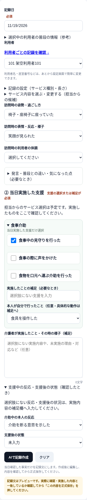
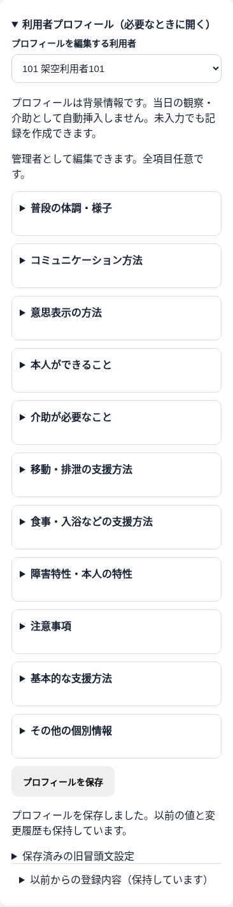
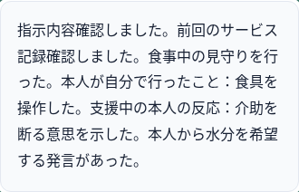

# AI記録作成・利用者プロフィール改善：開発報告

開発ブランチ：`feature/record-facts-profiles`。起点main：`f952f2f61d3a5dcd4c1f7d6ca7e1cf3b681c7164`。
**本番DB変更・mainへのマージ・公開は未実施。今回の変更は改めて承認を得てから反映する。** 本番調査は列・関数・RLS・権限・Advisorの読み取りだけで、実利用者のプロフィール・記録をテストにコピーしていない。

## 実際に動くコードと原因

入口の `index.html` は、固定commit `a8fa212e05b08867c5a426d13f05baa8847e4165` の過去HTMLを取得して加工し、`document.write` で実行する。さらに `common-nav.js` から `record-safety.js`・`care-intro-addon.js`・担当コンテキスト等を追加する構造だった。確認したのは、この合成後の実画面と関数である。

1. `buildActionSentences` がサービス名から一律に複数の介助文を追加する。職員が選んでいない姿勢への配慮・声かけ等も文章になる。
2. `buildCareRecord` が基本支援方法やコミュニケーション方法をプロフィールから本文へ加える。普段の支援と、その日に実際にしたことの境界が弱かった。
3. `next_variant_seed` の連番で、表情や反応を確認したという一般文を付け足す。実際の観察の違いによる文章の変化ではない。
4. 短い／標準の設定では自由記述の先頭1〜2文を使う旧処理もあり、後ろに入力した重要な事実が落ちる可能性があった。
5. 担当メモが実施内容の入力欄へ入るため、予定を当日実施したこととして扱う余地があった。

既存の安全対策は、生成文のプレビューと正式保存を分け、サービス定型文の表現を抑制していたが、上記の構成自体は残っていた。今回、固定HTMLの元ファイルを直接書き換えず、入口で実際の生成関数を置き換えてから既存の正式保存ラッパーに渡す。

## 新しい職員操作

- 記録日は当日を初期表示。担当から開いた場合は、その担当の日付を固定する。
- ①は訪問時の姿勢・表情・体調のうち確認した項目を選ぶ。発言・普段との違い・気になる点は必要なときだけ展開して入力する。「その他」は具体的な内容を確認する。
- ②は担当からのサービスを候補として表示し、その日に実施した支援だけを選ぶ。本人が自分でした動作や反応を選び、選択肢にない事実は補足へ書く。
- 従来の「支援介入度」の追加選択は不要。サービス種別・文字数の設定は折りたたみ、当日の入力を優先する。
- ①の観察と②の実施内容が不足していたら、具体的な追加入力を求めて作成・正式保存を止める。サービス候補にチェックがあるだけでは作成しない。
- 作成後の①②は直接編集できる。必須冒頭文を削除した場合は保存を止める。入力項目を変えた場合も作り直しを案内する。
- 正式保存まではDBへ記録を作らない。連打で二重保存しない。担当ID・利用者ID・施設ID・作成職員IDの検証と、保存後の担当画面への復帰は維持する。

担当メモは参考表示に残すが、当日の実施内容には自動コピーしない。プロフィールからも当日の事実を挿入しない。同じ利用者でも当日の痛み・反応・自分でできた部分が変わればその差を記載する。同じ事実なら同じ文章になり、利用者名や日付だけでは無理に言い換えない。

新規記録は必ず「指示内容確認しました。前回のサービス記録確認しました。」で始める。保存済みの利用者別旧冒頭文は削除しないが、新しい生成ではこの必須文を使う。文章を整える操作でも入力事実を文字数で切り捨てない。

## プロフィール

選択式＋必要なときの自由記述で、次を任意登録する：普段の体調・様子、コミュニケーション、意思表示、本人ができること、介助が必要なこと、移動・排泄、食事・入浴、本人の特性、注意、基本支援、その他。

プロフィールは毎回入力しない。本人ID・施設で共有保存し、当日は参考欄で確認できる。以前の `clients.usual / trait / caution / communication / support_method` は下の「以前からの登録内容」に残し、管理者が明示的に変更するまで上書きしない。旧文章を推測で選択項目へ変換する一括移行は行わない。新しい項目を追加せずに、既存プロフィールのままでも記録作成できる。

**編集は既存どおり管理者だけ。一般職員・施設編集者は閲覧のみ。** 施設編集者は基本情報の氏名・部屋番号等を編集できるが、今回の機微なプロフィール情報はその追加権限に含めない。画面非表示だけでなく、DBの管理者判定とAPIの直接呼び出し拒否で強制する。

保存前に新プロフィールのrevisionと、旧5項目の変更前の値を照合し、他の管理者の変更を一括上書きしない。施設や本人が切り替わった場合も読み込み結果・保存対象を確認する。

## 比較テスト

架空の利用者・プロフィール・記録のみを使用。旧画面も単に元HTMLの関数を見るのではなく、main時点の入口と安全対策を実行したブラウザで比較した。基礎となる事実は「椅子に座っている・笑顔・食事の見守り・食具は本人が操作・うなずく」。旧プロフィールには別の背景情報として「洗身する」を登録した。

下記の同じ事実の比較は、手編集前の生成結果である。別途、反応を「介助を断る意思」に変更し、水分を希望する発言を手編集で加えた正式保存試験も実施した。比較用の生成文と、その後の編集済み保存本文を混同していない。

**改善前（旧画面の実行結果）**

> 指示内容確認しました。前回のサービス記録確認しました。本人主体で進めてもらい、介護者は見守りを中心に安全面を確認しながら必要時のみ声をかけた。食事姿勢と本人のペースに配慮し、必要な見守り・介助を行った。摂取中の本人の様子を確認しながら、必要な声かけ・介助を行った。本人は食具を操作した。支援中はうなずいて応じた。利用者ごとの支援方法として「洗身する」を踏まえて対応した。支援中は、本人の表情や反応を確認しながら、本人のペースに合わせて対応した。

**改善後（同じ事実での新しい生成結果）**

> 指示内容確認しました。前回のサービス記録確認しました。食事中の見守りを行った。本人が自分で行ったこと：食具を操作した。支援中の本人の反応：うなずいて応じた。

| ケース | 確認した結果 |
| --- | --- |
| 同じ利用者・同じ介助、当日の状態が違う | 入力した痛み・発言・表情の違いを記載。日付だけでは水増ししない |
| 異なる利用者、同じサービス | 本人がした動作・当日の反応が違えば反映。同じ事実なら同じ文章を許容 |
| プロフィールあり | 参考表示・保存はできるが、一般情報を当日の出来事として書かない |
| プロフィールなし | 当日の事実だけで作成可能 |
| 体調変化あり | 入力した訴えを保持し、診断や未確認の症状を加えない |
| 本人の反応が違う | うなずき／拒否等の確認した反応を反映 |
| 自立してした部分が違う | 食具操作や衣類を脱いだ動作等、入力した部分だけ記載 |
| 入力不足 | 不足箇所を示し、生成・正式保存を止める |
| 同じ事実 | 完全に同じ生成結果。連番や乱数による観察表現を追加しない |

## DB・保存への変更

SQL：`supabase/migrations/20261119134048_record_facts_profiles.sql` 1本（未適用）。

- `care_records.daily_facts` をNULL許可のJSONBとして追加する。既存行はNULLのままで、本文や旧列の値を更新しない。新規の入力スナップショットの版・記録日と実際のサービス日が一致すること、サイズをDBで検証する。
- `client_record_profiles` を追加。施設・本人IDごとの選択項目／補足・revision・更新職員と日時を保存する。
- 新プロフィールのRLSは、稼働施設の所属に加えて親の利用者と施設が一致することを検証する。通常のAPIはSELECTのみ。直接INSERT／UPDATE／DELETEは拒否。
- 新規 `save_record_profile` はpublicではSECURITY INVOKER。private関数で認証UID・管理者・稼働施設・対象利用者・項目・文字数・変更前の値を検証して、選択項目と明示的に編集した旧項目を一つのトランザクションで保存する。既存値の変更がなければclientsをUPDATEしない。
- `private.record_profile_history` に変更前後・操作職員ID・日時を保存する。通常の職員には直接閲覧・変更・削除を許可しない。
- `care_records` と `clients` の既存RLS、admin/staff制約、施設編集者の判定関数は変更しない。保存済み記録を編集・削除する権限も新たに追加しない。

`daily_facts` は生成時点の入力、`visit_note / care_note` は確認・編集後の本文として別に保存する。既存の担当IDと施設・本人・職員の一致チェックも保持する。利用者マスターや職員マスターを複製しない。

## 既存機能への影響と検証

- 純粋な生成処理：35項目。プロフィール混入なし、同一事実の再現、各状態の違い、日付・不足入力・「その他」、長い重要入力を切らないこと。
- 隔離Postgres：43項目。旧列の全値保持・プロフィールの保存／競合／不正項目・他施設・所属不整合・一般職員／施設編集者の直接API拒否・親の利用者ID・入力日一致・旧冒頭文保持・監査・匿名拒否。
- Chromium PC1440px／スマホ390px：実際の固定HTML＋入口加工＋追加スクリプト＋supabase-jsから隔離Postgresの実RLS／RPCへ接続。不足時停止、生成後の編集、冒頭文削除の拒否、入力変更後の保存拒否、二重クリック、正式保存、担当ID保持、プロフィール保存・再読み込み、職員／編集者の保存拒否、異なる利用者、保存済み記録の不変を確認。新しい生成から連番RPCを呼ばないことも確認。
- NEXIA全体のPC／スマホ回帰：7機能往復、ログイン継続・再ログイン・氏名登録、職員管理、担当から記録への復帰、食事管理、出勤簿Excel、担当割当／出勤簿／出納帳PDFが成功。
- 施設編集者のPC／スマホ4機能、担当復帰・記録リンク、構文・ナビ整合性、Python17項目も成功。新規3試験をGitHub CIへ追加した。最終CI結果はPRに記載する。

AI記録自体の既存機能は本文コピーと利用者別履歴表示であり、今回も維持する。他システムのExcel／PDFの出力コードは変更していない。食事追加料金のSQL・料金・申し送り・担当割当の保存処理も変更しない。

テストで使う職員・利用者・料金・プロフィールはすべて架空。実利用者の情報を外部の文章生成APIへ送信していない。生成はブラウザ内で行い、有料AI APIや新しい有料サービスは追加しない。PGliteでは未使用の既存pgcryptoデフォルトだけテスト用スタブを使用し、認証UID・参加コードを合成値で明示する。

## 未確認事項・本番反映

実機iPhone／Android・Safari、本番Auth／PostgRESTでの実職員の保存、複数DB接続による同時更新負荷は未確認。単一接続の隔離PostgresでSQL・RLS・競合拒否を確認したことと、実機／本番での運用確認は区別する。

既存Security Advisorには [SECURITY DEFINERの公開関数](https://supabase.com/docs/guides/database/database-linter?lint=0029_authenticated_security_definer_function_executable)、[漏えいパスワード保護](https://supabase.com/docs/guides/auth/password-security#password-strength-and-leaked-password-protection)、非公開監査表の [RLS有効・ポリシーなし](https://supabase.com/docs/guides/database/database-linter?lint=0008_rls_enabled_no_policy) の指摘がある。本番の既存関数・Auth設定は変更していない。新しいprivate監査表も直接アクセスを拒否する設計。

承認後の手順：

1. 今回のSQL1本・画面変更の本番反映について承認を得る。以前の食事管理・施設編集者の承認は流用しない。
2. 最新main・本番の列／RLS／適用履歴・バックアップ／復旧手順を確認する。
3. 新SQL1本だけを適用し、既存列の値・RLS保持、初期プロフィール0件、権限を確認する。古いSQLを含む一括db pushは行わない。
4. その後にPRをmainへマージし、既存GitHub Pagesで公開。必要な表・新列が先、画面が後。プロフィールの一括移行や既存記録の再生成は行わない。
5. 公開後に実職員で対象施設／別施設・プロフィール・当日入力・編集・保存・担当への復帰を確認する。問題時は画面を旧版へ戻し、新列・履歴・入力内容を削除して戻す手順は使わない。

追加契約・プラン変更・有料APIなし。本番SQL適用・マージ・公開は承認待ち。
