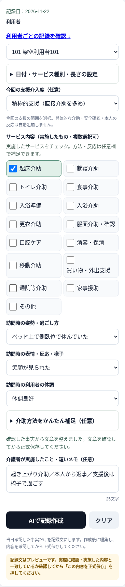
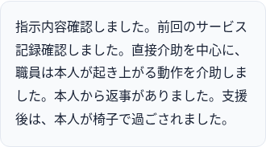
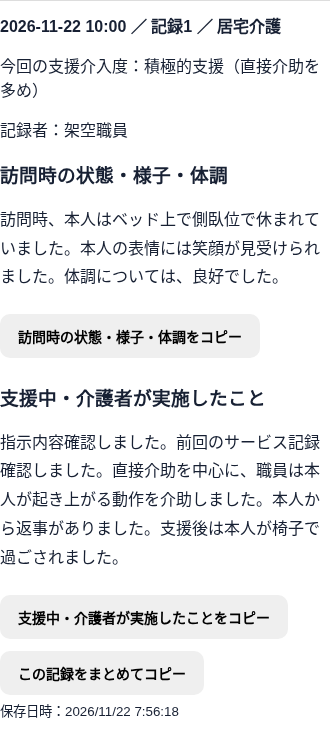

# 短い自由入力メモの文章品質：入力と生成全文の比較

2026年11月22日（日本時間）。PR #34の初回版 `590a7f9b898bd5ea84edbef8ade7288b1202faec` を基準にした追加調整です。本番DB・main・GitHub Pagesは変更していません。実在利用者のデータは使用していません。

## 原因と変更

初回版では自由入力を `sentence(plan.supportNote)` で記録末尾に追加しており、メモの句点を補うだけでした。そのため、選択サービスの短い定型文に「起き上がり介助／本人から返事」などがそのまま並び、普通・長めの切替もメモ部分へ反映されていませんでした。

- 同じサービスが明示され、全てのメモ句の意味が確定できる場合に、実施内容・本人の行動／反応・支援後へ分けて文章化します。既存15サービスの具体的介助表現と、今回確認した短縮表現を利用します。プロフィールから当日の事実を補いません。
- 普通は同じ職員の行為、本人の反応と支援後などを自然に接続。長めは本人と職員の役割を明示して分けて記載します。既存の必須冒頭文、同義の表現候補、過去記録との比較を維持します。
- メモで実施方法が分かる場合、サービス名だけの定型文を重ねず、その具体的事実を使います。同じ介助を選択欄とメモへ入力した場合も、意味が一致するものは一度だけ記載します。
- 未対応語・曖昧な修飾・引用が混ざり、メモ全体の意味を確定できない場合は、全体を原文で保持します。例えば「起き上がり介助／ではなく声かけ」を、起き上がり実施へ変換しません。未知の文の一部分だけを肯定文に変える処理はしません。
- 服薬の確認と未確認／拒否が重なるときは、経過を推測してつじつまを合わせず原文を保持し、既存の作成状況欄に表示します。保存を理由なく妨げる新しい必須操作はありません。
- 短いメモ欄のラベルと入力例だけを整理。11月12日を基準にした画面、15サービス、介入度、任意の詳細欄、ボタンや入力欄の数は維持しています。

## 比較条件と処理経路

比較は単体関数だけでなく、実際のNEXIAと同じ固定HTML・追加スクリプト・Supabase SDKをChromiumで実行しました。通常の入力欄へメモを入れ、生成ボタン→入力収集→文章生成→履歴を参照した候補選択→類似判定→文面編集→正式保存→再読込→履歴表示まで通しています。通信先は全てRLS付きの隔離Postgresへ差し替え、本番DBは読んでも書いてもいません。

全ケースの①は、メモとは別に「ベッド上で側臥位」「笑顔」「体調良好」を当日の事実として選択しています。②の具体的介助はメモだけに入力し、詳細チェックで再入力していません。起床は積極的支援、服薬は声かけ中心、排泄・入浴は必要部分の介助、食事は見守り中心を選択しました。

## 5サービス：短いメモと普通／長めの全文

以下はスマホ幅390pxで、実際の画面に表示された全文です。普通・長めとも、確認した事実を減らしたり、字数のために追加したりしません。本文を読み、自然さも確認するための比較資料です。

### 起床介助

**入力メモ**

起き上がり介助／本人から返事／支援後は椅子で過ごす

**確認された事実**：起き上がりの介助／本人からの返事／支援後に椅子で過ごした

**修正前（PR #34初回版）・普通の②全文**

指示内容確認しました。前回のサービス記録確認しました。起床の支援は、直接介助を中心に行いました。起き上がり介助／本人から返事／支援後は椅子で過ごす。

**修正前（PR #34初回版）・長めの②全文**

指示内容確認しました。前回のサービス記録確認しました。直接介助を中心に、起床の支援を行いました。起き上がり介助／本人から返事／支援後は椅子で過ごす。

**修正版・普通の全文**

① 訪問した際は、ベッド上で側臥位で休まれており、笑顔が見られました。体調は良好でした。

② 指示内容確認しました。前回のサービス記録確認しました。直接介助を中心に、起き上がりの介助を行いました。本人から返事があり、支援後は椅子で過ごされました。

**修正版・長めの全文**

① 訪問時、本人はベッド上で側臥位で休まれていました。本人の表情には笑顔が見受けられました。体調については、良好でした。

② 指示内容確認しました。前回のサービス記録確認しました。直接介助を中心に、職員は本人が起き上がる動作を介助しました。本人から返事がありました。支援後は、本人が椅子で過ごされました。

②の文字数（改行・空白を除く、必須冒頭文を含む）：普通 76文字／長め 89文字。

**事実照合：追加なし・欠落なし。** 返事が「起床の声かけに対する反応」とは書かれていないため、その因果関係を作っていません。椅子で過ごしたことから、座位や移乗の介助も推測していません。

普通は関連する事実を接続し、長めは動作の主体・介助の役割を明示します。短いメモの事実量を超えて長くすることはしていません。

### 服薬介助・確認

**入力メモ**

服薬の声かけ／服用を確認／本人がうなずいた／服薬後変化なし

**確認された事実**：服薬の声かけ／服用したことの確認／本人のうなずき／服薬後に変化がなかった

**修正前（PR #34初回版）・普通の②全文**

指示内容確認しました。前回のサービス記録確認しました。服薬に関する支援は、声かけ・促しを中心に行いました。服薬の声かけ／服用を確認／本人がうなずいた／服薬後変化なし。

**修正前（PR #34初回版）・長めの②全文**

指示内容確認しました。前回のサービス記録確認しました。声かけ・促しを中心に、服薬に関する支援を行いました。服薬の声かけ／服用を確認／本人がうなずいた／服薬後変化なし。

**修正版・普通の全文**

① 訪問した際は、ベッド上で側臥位で休まれており、笑顔が見られました。体調は良好でした。

② 指示内容確認しました。前回のサービス記録確認しました。服薬に向けた声かけを中心に行い、本人が薬を服用されたことを確認しました。本人のうなずきが見られ、服薬後、特に変化は見られませんでした。

**修正版・長めの全文**

① 訪問した際、本人はベッド上で側臥位にて休まれていました。本人の表情には笑顔が見受けられました。体調については、良好でした。

② 指示内容確認しました。前回のサービス記録確認しました。職員から本人への服薬の声かけを中心に対応し、本人が薬を服用されたことを確認しました。本人のうなずきが見られました。服薬後、特に変化は見られませんでした。

②の文字数（改行・空白を除く、必須冒頭文を含む）：普通 94文字／長め 103文字。

**事実照合：追加なし・欠落なし。** 声かけと明示された服用確認を接続しました。うなずきを声かけへの反応とは断定せず、薬剤名・用量・準備・嚥下・副作用は追加しません。

普通は関連する事実を接続し、長めは動作の主体・介助の役割を明示します。短いメモの事実量を超えて長くすることはしていません。

### トイレ介助

**入力メモ**

衣類は本人が下げた／パッド交換介助／本人から排泄希望／支援後はベッドで休む

**確認された事実**：本人が衣類を下げた／パッド交換の介助／本人の排泄希望／支援後にベッドで休んだ

**修正前（PR #34初回版）・普通の②全文**

指示内容確認しました。前回のサービス記録確認しました。排泄に関する支援は、必要な部分への介助として行いました。衣類は本人が下げた／パッド交換介助／本人から排泄希望／支援後はベッドで休む。

**修正前（PR #34初回版）・長めの②全文**

指示内容確認しました。前回のサービス記録確認しました。必要な部分への介助として、排泄に関する支援を行いました。衣類は本人が下げた／パッド交換介助／本人から排泄希望／支援後はベッドで休む。

**修正版・普通の全文**

① 訪問した際は、ベッド上で側臥位で休まれており、笑顔が見られました。体調は良好でした。

② 指示内容確認しました。前回のサービス記録確認しました。衣類を下げる動作は本人が行われました。必要な部分への支援として、パッドの交換を介助しました。本人から排泄の希望があり、支援後はベッドで休まれました。

**修正版・長めの全文**

① 訪問した際、本人はベッド上で側臥位で休まれていました。本人の表情には笑顔が見られました。体調については、良好でした。

② 指示内容確認しました。前回のサービス記録確認しました。衣類を下げる動作は本人が自分で行われました。必要な部分への支援として、パッドの交換を職員が介助しました。本人から排泄の希望がありました。支援後は、本人がベッドで休まれました。

②の文字数（改行・空白を除く、必須冒頭文を含む）：普通 101文字／長め 114文字。

**事実照合：追加なし・欠落なし。** 衣類を下げたのは本人、パッド交換を介助したのは職員と区別しています。排便／排尿・清拭や、衣類の上げ下げ全体の介助へ広げていません。

普通は関連する事実を接続し、長めは動作の主体・介助の役割を明示します。短いメモの事実量を超えて長くすることはしていません。

### 入浴介助

**入力メモ**

上半身は本人が洗う／背中洗身介助／本人から湯温の希望／支援後本人が休憩希望

**確認された事実**：本人が上半身を洗った／背部の洗身の介助／本人の湯温の希望／支援後の休憩希望

**修正前（PR #34初回版）・普通の②全文**

指示内容確認しました。前回のサービス記録確認しました。入浴の支援は、必要な部分への介助として行いました。上半身は本人が洗う／背中洗身介助／本人から湯温の希望／支援後本人が休憩希望。

**修正前（PR #34初回版）・長めの②全文**

指示内容確認しました。前回のサービス記録確認しました。必要な部分への介助として、入浴の支援を行いました。上半身は本人が洗う／背中洗身介助／本人から湯温の希望／支援後本人が休憩希望。

**修正版・普通の全文**

① 訪問した際は、ベッド上で側臥位で休まれており、笑顔が見られました。体調は良好でした。

② 指示内容確認しました。前回のサービス記録確認しました。上半身は本人が自分で洗われました。必要な部分への支援として、背部の洗身を介助しました。本人から湯の温度について希望があり、支援後には休憩したいとの希望がありました。

**修正版・長めの全文**

① 訪問した際、本人はベッド上で側臥位にて休まれていました。本人の表情には笑顔が見られました。体調については、良好でした。

② 指示内容確認しました。前回のサービス記録確認しました。上半身は本人が自分で洗われました。必要な部分への支援として、背部の洗身を職員が介助しました。本人から湯の温度について希望がありました。支援後、本人から休憩したいとの希望がありました。

②の文字数（改行・空白を除く、必須冒頭文を含む）：普通 109文字／長め 118文字。

**事実照合：追加なし・欠落なし。** 本人の上半身の洗身と、職員の背部の介助を区別しました。休憩の希望を、休憩を実施した記録に変えていません。洗髪・全身介助・疲労や水分補給は追加しません。

普通は関連する事実を接続し、長めは動作の主体・介助の役割を明示します。短いメモの事実量を超えて長くすることはしていません。

### 食事介助

**入力メモ**

食事見守り／食具は本人が操作／本人から食べる量の希望／支援後本人が満腹と発言

**確認された事実**：食事中の見守り／本人が食具を操作した／食べる量について本人の希望／支援後の満腹の発言

**修正前（PR #34初回版）・普通の②全文**

指示内容確認しました。前回のサービス記録確認しました。食事の支援は、見守りを中心に行いました。食事見守り／食具は本人が操作／本人から食べる量の希望／支援後本人が満腹と発言。

**修正前（PR #34初回版）・長めの②全文**

指示内容確認しました。前回のサービス記録確認しました。見守りを中心に、食事の支援を行いました。食事見守り／食具は本人が操作／本人から食べる量の希望／支援後本人が満腹と発言。

**修正版・普通の全文**

① 訪問した際は、ベッド上で側臥位で休まれており、笑顔が見られました。体調は良好でした。

② 指示内容確認しました。前回のサービス記録確認しました。食事中は見守りを中心に対応しました。食具の操作は本人が行われました。本人から食べる量について希望があり、支援後には満腹との発言がありました。

**修正版・長めの全文**

① 訪問した際、本人はベッド上で側臥位で休まれていました。本人の表情には笑顔が見受けられました。体調については、良好な状態でした。

② 指示内容確認しました。前回のサービス記録確認しました。食事中は、職員が見守りを中心に対応しました。食具の操作は本人が自分で行われました。本人から食べる量について希望がありました。支援後、本人から満腹との発言がありました。

②の文字数（改行・空白を除く、必須冒頭文を含む）：普通 97文字／長め 110文字。

**事実照合：追加なし・欠落なし。** 食事中の見守りと本人の食具操作を区別しました。食べた実量・完食・口元へ運ぶ介助・嚥下状態を補っていません。満腹は本人の発言として扱います。

普通は関連する事実を接続し、長めは動作の主体・介助の役割を明示します。短いメモの事実量を超えて長くすることはしていません。

## 入力画面と保存済み履歴

通常はサービスを直接チェックし、介入度・訪問時の状態を選び、必要なら既存の自由入力欄へ短いメモを入力します。大量の詳細項目は閉じたままで生成できます。新しい選択欄や、同じ事実の二重入力はありません。

## 実施した検証

- PC1440px・スマホ390pxで、5サービスそれぞれの普通／長めを実画面で生成。メモの各句と生成文を照合し、原文の範囲が追跡できること、入力の事実が揃うこと、禁止した事実が混入しないことを確認しました。
- 詳細チェックは未選択のまま、メモだけで具体的な支援を入力。追加の必須操作数は0です。
- 文面の句読点を編集してから、各サービスを正式保存。原文メモ・生成文・編集後の保存文・介入度・施設ID・利用者ID・作成者IDを照合し、再読み込み後の実際の履歴でも同じ保存文を確認しました。
- 実行前から存在する架空記録・利用者情報を全件比較し、変更されていないことを確認しました。
- 未確認／拒否／予定／疑問、未知語、本人の引用、数値・単位・日付・割合、メモと選択欄の重複、プロフィールの混入防止を追加確認。意味を確定できないメモは原文を保ちます。
- 既存の文章生成・15サービス・介入度・入力復元・7日比較・類似候補選択の関連回帰テストも合格。保存・履歴・権限・他機能・出力に関する回帰確認は、PR #34の最新コミットのCI結果も参照してください。
- 実際の比較結果：[スマホJSON](390-results.json)、[PC JSON](1440-results.json)。入力・画面の生成文・保存文を含み、テスト件数だけで判断しないための証拠として残しています。

## 保存データ・権限・費用

保存する原文は既存のdaily_facts.supportNoteとcare_inputのままです。新しいメモ整形を通った記録にはdaily_facts内にmemoComposerRevision:1を付けます。既存の記録・プロフィールを変換／再生成しません。DBマイグレーション・RLS・認証・権限・他機能の変更はありません。担当割当IDとの関連、既存の保存・編集・履歴・Excel/PDF出力を維持します。

処理は端末内だけで行い、有料AI API・外部サービス・有料プランを追加していません。実在利用者のデータや本番バックアップもテストに使っていません。

## 主な変更ファイル

- record-facts-core.js：意味が確定できるメモ句の整理、普通／長めの文章構成、原文保持と重複防止。
- record-facts-ui.js：既存メモ欄のラベル・入力例・確認表示、保存時の整形版番号。
- index.html：変更スクリプトのキャッシュ更新。
- tests/record_memo_core.cjs、tests/record_memo_browser_part.cjs、架空入力fixture：事実照合と実画面・保存経路の確認。
- tests/record_facts_browser.cjs、比較元の固定版定義、既存CI：新しい比較の呼出し。
- docs/record-memo-quality：全文比較・実画面・検証結果。

## 制限と承認待ち

任意の日本語を無制限に解釈する方式ではありません。意味が確定できる短縮表現・既存の具体的介助だけを整えます。未知の表現、曖昧な修飾、引用、経過を確定できない内容は原文を保持するため、その部分は職員による確認が必要です。文体の全組合せを介護職が実業務で確認したという意味ではありません。

Windows・iPhone実機／Safari、本番DBへの正式保存、実際のExcelアプリ・プリンターは未検証です。スマホ幅／PC幅の検証と実機確認を区別しています。

変更は開発ブランチ内です。mainへのマージ・本番DB変更・本番公開は行いません。承認後の反映にSQL適用は不要です。
