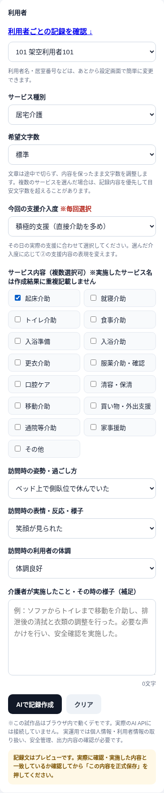
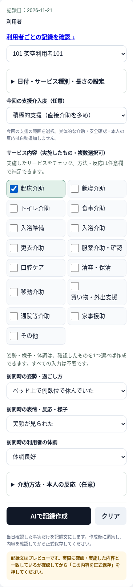
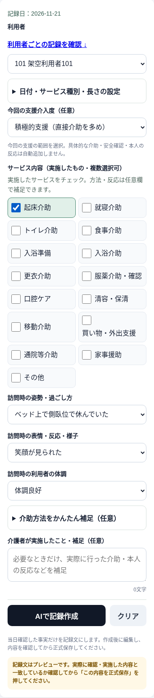
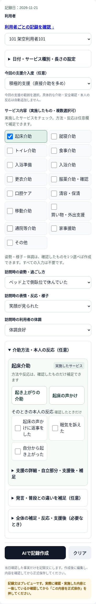
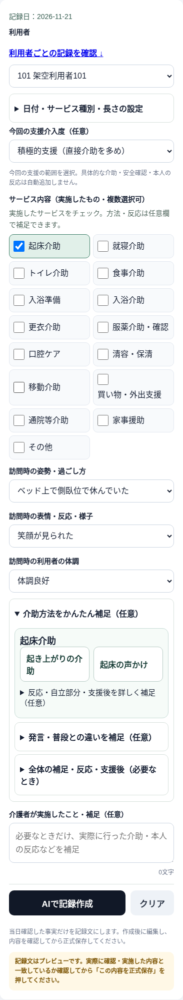

# 11月12日を基準にしたAI記録の再整理

2026年11月22日追記：[短い自由入力メモの最終調整・5サービスの全文比較](../record-memo-quality/report.md)。以下はPR #34初回版の比較です。

開発ブランチ `fix/record-nov12-simple` で実装。本番DB変更・mainへのマージ・GitHub Pages公開は実施していません。架空データだけで比較しています。

## 比較対象と原因

- 11月12日版：`982997ab351f6ddb2fc2461973729b68d1ce61c3`。現在のmain：`e050e93763418a7cf38cf3d9452cf668473238c1`（PR #33公開済み）。システム全体を巻き戻していません。
- 実際の画面はindex.htmlが固定HTMLを読み込み、追加スクリプトで構成します。固定HTML、各版の追加スクリプト、実Supabase SDKをChromiumで動かして比較しました。比較元のコミットとSHA256をテスト用定義に固定しています。
- 旧版のnextVariantSeed・variantDigitsは回数を数えて表現を組み合わせ、cloudNextVariantSeedはサーバーのカウンターを利用していました。ただしbuildVisitVariantSentence・buildCareVariantSentenceやサービス定型文は、未入力の覚醒状態・安全への配慮・声かけ等も追加していました。プロフィールの「洗身する」等が起床記録へ入る例も、実画面で再現しました。旧版の長さ・種類数を、そのまま正確性の指標にはできません。
- 現行の補足欄は、一度開くとサービスごとの反応チェックが同時に並びます。また再読込で生成回数がリセットされ、少ない事実では文章候補も限られていました。

## 修正版の操作と文章生成

- 通常画面は15サービスの直接チェック、介入度、姿勢・様子・体調、任意の自由記述。旧版のサービス名・順番・観察の選択肢を維持しました。介助方法の再選択は必須にしません。
- 「介助方法をかんたん補足」は閉じて表示。開くと実施方法を1回選べます。反応・自立部分・支援後の多数の項目は、さらに「詳しく補足」を開いたときだけ表示します。重複するサービス選択欄は追加していません。
- 生成後の補足案内も閉じた状態です。必要な職員だけ開いて方法を1つ選べば再生成できます。未選択のまま保存も可能です。編集中の文章や変更前の入力を自動で上書きしない保護を維持しました。
- ①は姿勢・表情・体調と、本人の発言・普段との違いを区別して構成します。②は選択した本人の行動、職員の介助、反応、支援後を区別します。普通は接続した文章、長めは動作と介助の主体を明確にします。見出し・改行・架空の確認文で長くしません。
- 生成回数を端末内で保持する旧版の長所を採用しました。保存するのは匿名の数値1個だけで、利用者・施設・プロフィール・入力内容をカウンターへ保存／外部送信しません。保存禁止の端末でも生成できます。
- 確認済みの文節だけを同義の表現・語順・構成へ組み替えます。PR #33の最大32種類・最大128回の探索、同一施設／同一利用者の閲覧可能な直近300件と最新訂正の参照、完全一致を優先して避ける処理を維持しています。候補不足時にも保存を妨げません。
- 必須冒頭文「指示内容確認しました。前回のサービス記録確認しました。」を維持します。

## スマホの実画面と操作数

390px幅、利用者・起床介助・介入度active・姿勢・様子・体調を同じ条件で選択。通常画面はすべて任意欄を閉じ、生成前に測定しました。

| 版 | 通常入力の高さ | 表示コントロール数 | 表示チェック数 | 生成まで／正式保存まで |
|---|---:|---:|---:|---:|
| 11月12日 | 1766px | 25 | 15 | 12／13操作 |
| 現在のmain | 1601px | 24 | 15 | 12／13操作 |
| 修正版 | 1649px | 25 | 15 | 12／13操作 |

修正版は旧版より約6.6%短く、文字サイズは16pxです。現行mainより48px長いのは、旧版と同じく任意の自由記述を通常画面へ戻したためです。介助方法の任意欄を開いた状態は、現行2,283pxから修正版1,997pxへ短縮しました。単に文字を縮小していません。

操作数はネイティブ選択欄を「開く＋選ぶ」で2操作、チェック・生成・保存を各1操作とするモデルです。ログイン、スクロール、文字入力時間は含みません。3サービスなら生成14・保存15操作。姿勢／様子／体調は1つでも生成できるため、介入度を選ぶ最小の流れなら生成8操作です。新しい必須項目はありません。実機の操作時間は未計測です。

### 11月12日の通常画面

### 現在のmainの通常画面

### 修正版の通常画面

### 任意欄を開いた比較

## 実際の生成文章の全文比較

①の共通入力はベッド上で側臥位・笑顔・体調良好。起床は介入度active。詳細ケースの追加事実は起き上がりの介助、起床の声かけへの返事、支援後に椅子で過ごしたことです。旧版は既存の自由記述欄、main／修正版は同じ事実を構造化した任意欄に入力しています。プロフィールは全版で同じ架空の参考情報です。

旧版の文章は比較資料としてそのまま示します。旧版が追加した未確認の覚醒・安全配慮・プロフィール由来の介助は、修正版には入れていません。

### 起床介助：サービス名と介入度だけの入力

**11月12日／普通**

① 訪問時はベッド上で側臥位となり、休まれていた。笑顔が見られた。体調良好。

② 指示内容確認しました。前回のサービス記録確認しました。本人の様子を確認しながら、必要な場面では介護者が動作を一緒に行い、直接介助を中心に支援した。覚醒状態を確認し、本人のペースに合わせて起き上がりを支援した。足元と動作の安全に注意し、必要な見守り・介助を行った。利用者ごとの支援方法として「洗身する」を踏まえて対応した。本人には短い言葉で声をかけた。支援中は、本人の表情や反応を確認しながら、本人のペースに合わせて対応した。

**現在のmain／普通**

① 訪問時は、ベッド上で側臥位にて休まれており、笑顔が見られました。体調は良好でした。

② 指示内容確認しました。前回のサービス記録確認しました。起床の支援では、直接介助を中心に対応しました。

**修正版／普通**

① 訪問した際は、ベッド上で側臥位で休まれており、笑顔が見られました。体調は良好でした。

② 指示内容確認しました。前回のサービス記録確認しました。起床の支援は、直接介助を中心に行いました。

**11月12日／長め**

① 訪問時はベッド上で側臥位となり、休まれていた。笑顔が見られた。体調良好。

② 指示内容確認しました。前回のサービス記録確認しました。本人の様子を確認しながら、必要な場面では介護者が動作を一緒に行い、直接介助を中心に支援した。覚醒状態を確認し、本人のペースに合わせて起き上がりを支援した。足元と動作の安全に注意し、必要な見守り・介助を行った。支援中も本人の反応を確認し、必要に応じて支援方法を調整した。利用者ごとの支援方法として「洗身する」を踏まえて対応した。支援時は転倒に注意よう配慮した。支援中は、本人の表情や反応を確認しながら、本人のペースに合わせて対応した。

**現在のmain／長め**

① 訪問した際、本人はベッド上で側臥位にて休まれていました。本人の表情には笑顔が見受けられました。体調については、良好でした。

② 指示内容確認しました。前回のサービス記録確認しました。直接介助を中心に、起床の支援を行いました。

**修正版／長め**

① 訪問した際、本人はベッド上で側臥位にて休まれていました。本人の表情には笑顔が見られました。体調については、良好な状態でした。

② 指示内容確認しました。前回のサービス記録確認しました。起床の支援は、直接介助を中心に行いました。

### 起床介助：方法・反応・支援後を確認した入力

**11月12日／普通**

① 訪問時はベッド上で側臥位となり、休まれていた。笑顔が見られた。体調良好。

② 指示内容確認しました。前回のサービス記録確認しました。本人の様子を確認しながら、必要な場面では介護者が動作を一緒に行い、直接介助を中心に支援した。覚醒状態を確認し、本人のペースに合わせて起き上がりを支援した。足元と動作の安全に注意し、必要な見守り・介助を行った。起き上がりを介助しました。本人は起床の声かけに返事をされました。利用者ごとの支援方法として「洗身する」を踏まえて対応した。支援中は、本人の表情や反応を確認しながら、本人のペースに合わせて対応した。

**現在のmain／普通**

① 訪問時は、ベッド上で側臥位にて休まれており、笑顔が見られました。体調は良好でした。

② 指示内容確認しました。前回のサービス記録確認しました。起床時は、直接介助を中心に、起き上がりの介助を行いました。ご本人は起床の声かけに返事をされました。支援後は、椅子に座って過ごされました。

**修正版／普通**

① 訪問時、ベッド上で側臥位で休まれており、笑顔が見られました。体調は良好でした。

② 指示内容確認しました。前回のサービス記録確認しました。起床時は、直接介助を中心に、起き上がりの介助を行いました。ご本人は起床の声かけに返事をされました。支援後は、椅子に座って過ごされました。

**11月12日／長め**

① 訪問時はベッド上で側臥位となり、休まれていた。笑顔が見られた。体調良好。

② 指示内容確認しました。前回のサービス記録確認しました。本人の様子を確認しながら、必要な場面では介護者が動作を一緒に行い、直接介助を中心に支援した。覚醒状態を確認し、本人のペースに合わせて起き上がりを支援した。足元と動作の安全に注意し、必要な見守り・介助を行った。支援中も本人の反応を確認し、必要に応じて支援方法を調整した。起き上がりを介助しました。本人は起床の声かけに返事をされました。支援後は椅子に座って過ごされました。利用者ごとの支援方法として「洗身する」を踏まえて対応した。支援中は、本人の表情や反応を確認しながら、本人のペースに合わせて対応した。

**現在のmain／長め**

① 訪問時、本人はベッド上で側臥位にて休まれていました。本人の表情には笑顔が見受けられました。体調については、良好でした。

② 指示内容確認しました。前回のサービス記録確認しました。起床時は、直接介助を中心に、本人が起き上がる動作を職員が介助しました。本人は起床の声かけに返事をされました。支援後は、椅子に座って過ごされました。

**修正版／長め**

① 訪問した際、本人はベッド上で側臥位で休まれていました。本人の表情には笑顔が見られました。体調については、良好な状態でした。

② 指示内容確認しました。前回のサービス記録確認しました。起床の支援については、直接介助を中心に、本人が起き上がる動作を職員が介助しました。本人は起床の声かけに返事をされました。支援後は、椅子に座って過ごされました。

サービス名と介入度だけの②は、修正版でも短いままです。具体的な介助を確認していない入力から、旧版と同じ長文を安全に作ることはできません。1回の方法選択で実施した動作を追加できますが、本人の反応や支援後を自動追加はしません。

### 服薬・排泄・入浴・食事：普通／長めの全文

**服薬介助・確認**

入力済みの実施事実：服薬の声かけを行い、本人が薬を服用されたことを確認しました。本人は声かけにうなずいて応じられました。服薬後に特に変化は見られませんでした。

11月12日／普通

① 訪問時はベッド上で側臥位となり、休まれていた。笑顔が見られた。体調良好。

② 指示内容確認しました。前回のサービス記録確認しました。本人の様子を確認しながら、必要な場面では介護者が動作を一緒に行い、直接介助を中心に支援した。服薬に必要な準備と声かけを行い、本人の様子を確認しながら支援した。服薬前後の本人の様子を確認し、必要な準備・声かけ・確認を行った。服薬の声かけを行い、本人が薬を服用されたことを確認しました。本人は声かけにうなずいて応じられました。利用者ごとの支援方法として「洗身する」を踏まえて対応した。支援中は、本人の表情や反応を確認しながら、本人のペースに合わせて対応した。

11月12日／長め

① 訪問時はベッド上で側臥位となり、休まれていた。笑顔が見られた。体調良好。

② 指示内容確認しました。前回のサービス記録確認しました。本人の様子を確認しながら、必要な場面では介護者が動作を一緒に行い、直接介助を中心に支援した。服薬に必要な準備と声かけを行い、本人の様子を確認しながら支援した。服薬前後の本人の様子を確認し、必要な準備・声かけ・確認を行った。支援中も本人の反応を確認し、必要に応じて支援方法を調整した。服薬の声かけを行い、本人が薬を服用されたことを確認しました。本人は声かけにうなずいて応じられました。服薬後に特に変化は見られませんでした。利用者ごとの支援方法として「洗身する」を踏まえて対応した。支援中は、本人の表情や反応を確認しながら、本人のペースに合わせて対応した。

現在のmain／普通

① 訪問時は、ベッド上で側臥位にて休まれており、笑顔が見られました。体調は良好でした。

② 指示内容確認しました。前回のサービス記録確認しました。今回は直接介助を中心に支援しました。
服薬の支援では、服薬に向けて声をかけると、本人はうなずいて応じられました。本人が薬を服用されたことを確認しました。服薬後、特に変化は見られませんでした。

現在のmain／長め

① 訪問した際、本人はベッド上で側臥位にて休まれていました。本人の表情には笑顔が見受けられました。体調については、良好でした。

② 指示内容確認しました。前回のサービス記録確認しました。今回は直接介助を中心に支援しました。
服薬の支援では、職員が服薬に向けた声かけに対し、本人はうなずいて応じられました。本人が薬を服用されたことを確認しました。服薬後、特に変化は見られませんでした。

修正版／普通

① 訪問した際は、ベッド上で側臥位で休まれており、笑顔が見られました。体調は良好でした。

② 指示内容確認しました。前回のサービス記録確認しました。今回は直接介助を中心に支援しました。服薬の支援では、服薬に向けて声をかけると、本人はうなずいて応じられました。本人が薬を服用されたことを確認しました。服薬後、特に変化は見られませんでした。

修正版／長め

① 訪問時、本人はベッド上で側臥位で休まれていました。本人の表情には笑顔が見受けられました。体調については、良好でした。

② 指示内容確認しました。前回のサービス記録確認しました。今回は直接介助を中心に支援しました。服薬の支援では、職員が服薬に向けて声をかけると、本人はうなずいて応じられました。本人が薬を服用されたことを確認しました。服薬後、特に変化は見られませんでした。

**トイレ介助**

入力済みの実施事実：排泄時の衣類の上げ下げを介助しました。本人から排泄の希望が伝えられました。支援後は椅子に座って過ごされました。

11月12日／普通

① 訪問時はベッド上で側臥位となり、休まれていた。笑顔が見られた。体調良好。

② 指示内容確認しました。前回のサービス記録確認しました。本人の様子を確認しながら、必要な場面では介護者が動作を一緒に行い、直接介助を中心に支援した。移動時の足元と周囲の安全に注意し、必要な見守り・介助を行った。本人のペースに合わせ、排泄に必要な移動・衣類調整等を必要な範囲で支援した。排泄時の衣類の上げ下げを介助しました。本人から排泄の希望が伝えられました。利用者ごとの支援方法として「洗身する」を踏まえて対応した。支援中は、本人の表情や反応を確認しながら、本人のペースに合わせて対応した。

11月12日／長め

① 訪問時はベッド上で側臥位となり、休まれていた。笑顔が見られた。体調良好。

② 指示内容確認しました。前回のサービス記録確認しました。本人の様子を確認しながら、必要な場面では介護者が動作を一緒に行い、直接介助を中心に支援した。移動時の足元と周囲の安全に注意し、必要な見守り・介助を行った。本人のペースに合わせ、排泄に必要な移動・衣類調整等を必要な範囲で支援した。支援中も本人の反応を確認し、必要に応じて支援方法を調整した。排泄時の衣類の上げ下げを介助しました。本人から排泄の希望が伝えられました。支援後は椅子に座って過ごされました。利用者ごとの支援方法として「洗身する」を踏まえて対応した。支援中は、本人の表情や反応を確認しながら、本人のペースに合わせて対応した。

現在のmain／普通

① 訪問時は、ベッド上で側臥位にて休まれており、笑顔が見られました。体調は良好でした。

② 指示内容確認しました。前回のサービス記録確認しました。排泄の支援では、直接介助を中心に、排泄時の衣類の上げ下げを介助しました。本人から排泄の希望が伝えられました。支援後は、椅子に座って過ごされました。

現在のmain／長め

① 訪問した際、本人はベッド上で側臥位にて休まれていました。本人の表情には笑顔が見受けられました。体調については、良好でした。

② 指示内容確認しました。前回のサービス記録確認しました。排泄の支援では、直接介助を中心に、職員は排泄時の衣類の上げ下げを介助しました。ご本人から排泄の希望が伝えられました。支援後は、椅子に座って過ごされました。

修正版／普通

① 訪問した際は、ベッド上で側臥位で休まれており、笑顔が見られました。体調は良好でした。

② 指示内容確認しました。前回のサービス記録確認しました。排泄の支援では、直接介助を中心に、排泄時の衣類の上げ下げを介助しました。本人から排泄の希望が伝えられました。支援後は、椅子に座って過ごされました。

修正版／長め

① 訪問時、本人はベッド上で側臥位で休まれていました。本人の表情には笑顔が見受けられました。体調については、良好でした。

② 指示内容確認しました。前回のサービス記録確認しました。排泄の支援では、直接介助を中心に、職員は排泄時の衣類の上げ下げを介助しました。本人から排泄の希望が伝えられました。支援後は、椅子に座って過ごされました。

**入浴介助**

入力済みの実施事実：洗身を介助しました。本人から入浴の希望がありました。支援後は椅子に座って過ごされました。

11月12日／普通

① 訪問時はベッド上で側臥位となり、休まれていた。笑顔が見られた。体調良好。

② 指示内容確認しました。前回のサービス記録確認しました。本人の様子を確認しながら、必要な場面では介護者が動作を一緒に行い、直接介助を中心に支援した。入浴前に本人の様子を確認し、安全面に配慮しながら必要な介助を行った。浴室内の足元や動作に注意し、本人のペースに合わせて必要な見守り・介助を行った。洗身を介助しました。本人から入浴の希望がありました。利用者ごとの支援方法として「洗身する」を踏まえて対応した。支援中は、本人の表情や反応を確認しながら、本人のペースに合わせて対応した。

11月12日／長め

① 訪問時はベッド上で側臥位となり、休まれていた。笑顔が見られた。体調良好。

② 指示内容確認しました。前回のサービス記録確認しました。本人の様子を確認しながら、必要な場面では介護者が動作を一緒に行い、直接介助を中心に支援した。入浴前に本人の様子を確認し、安全面に配慮しながら必要な介助を行った。浴室内の足元や動作に注意し、本人のペースに合わせて必要な見守り・介助を行った。支援中も本人の反応を確認し、必要に応じて支援方法を調整した。洗身を介助しました。本人から入浴の希望がありました。支援後は椅子に座って過ごされました。利用者ごとの支援方法として「洗身する」を踏まえて対応した。支援中は、本人の表情や反応を確認しながら、本人のペースに合わせて対応した。

現在のmain／普通

① 訪問時は、ベッド上で側臥位にて休まれており、笑顔が見られました。体調は良好でした。

② 指示内容確認しました。前回のサービス記録確認しました。入浴の支援では、直接介助を中心に、洗身を介助しました。本人から入浴の希望がありました。支援後は、椅子に座って過ごされました。

現在のmain／長め

① 訪問した際、本人はベッド上で側臥位にて休まれていました。本人の表情には笑顔が見受けられました。体調については、良好でした。

② 指示内容確認しました。前回のサービス記録確認しました。入浴の支援では、直接介助を中心に、職員は洗身を介助しました。ご本人から入浴の希望がありました。支援後は、椅子に座って過ごされました。

修正版／普通

① 訪問した際は、ベッド上で側臥位で休まれており、笑顔が見られました。体調は良好でした。

② 指示内容確認しました。前回のサービス記録確認しました。入浴の支援では、直接介助を中心に、洗身を介助しました。本人から入浴の希望がありました。支援後は、椅子に座って過ごされました。

修正版／長め

① 訪問時、本人はベッド上で側臥位で休まれていました。本人の表情には笑顔が見受けられました。体調については、良好でした。

② 指示内容確認しました。前回のサービス記録確認しました。入浴の支援では、直接介助を中心に、職員は洗身を介助しました。本人から入浴の希望がありました。支援後は、椅子に座って過ごされました。

**食事介助**

入力済みの実施事実：食事中の見守りを行いました。本人が自分で食具を操作されました。支援後は椅子に座って過ごされました。

11月12日／普通

① 訪問時はベッド上で側臥位となり、休まれていた。笑顔が見られた。体調良好。

② 指示内容確認しました。前回のサービス記録確認しました。本人の様子を確認しながら、必要な場面では介護者が動作を一緒に行い、直接介助を中心に支援した。食事姿勢と本人のペースに配慮し、必要な見守り・介助を行った。摂取中の本人の様子を確認しながら、必要な声かけ・介助を行った。食事中の見守りを行いました。本人が自分で食具を操作されました。利用者ごとの支援方法として「洗身する」を踏まえて対応した。支援中は、本人の表情や反応を確認しながら、本人のペースに合わせて対応した。

11月12日／長め

① 訪問時はベッド上で側臥位となり、休まれていた。笑顔が見られた。体調良好。

② 指示内容確認しました。前回のサービス記録確認しました。本人の様子を確認しながら、必要な場面では介護者が動作を一緒に行い、直接介助を中心に支援した。食事姿勢と本人のペースに配慮し、必要な見守り・介助を行った。摂取中の本人の様子を確認しながら、必要な声かけ・介助を行った。支援中も本人の反応を確認し、必要に応じて支援方法を調整した。食事中の見守りを行いました。本人が自分で食具を操作されました。支援後は椅子に座って過ごされました。利用者ごとの支援方法として「洗身する」を踏まえて対応した。支援中は、本人の表情や反応を確認しながら、本人のペースに合わせて対応した。

現在のmain／普通

① 訪問時は、ベッド上で側臥位にて休まれており、笑顔が見られました。体調は良好でした。

② 指示内容確認しました。前回のサービス記録確認しました。今回は直接介助を中心に支援しました。
食事の支援では、食事中の見守りを行いました。本人が自分で食具を操作されました。支援後は、椅子に座って過ごされました。

現在のmain／長め

① 訪問した際、本人はベッド上で側臥位にて休まれていました。本人の表情には笑顔が見受けられました。体調については、良好でした。

② 指示内容確認しました。前回のサービス記録確認しました。今回は直接介助を中心に支援しました。
食事の支援では、職員は食事中の見守りを行いました。ご本人が自分で食具を操作されました。支援後は、椅子に座って過ごされました。

修正版／普通

① 訪問した際は、ベッド上で側臥位で休まれており、笑顔が見られました。体調は良好でした。

② 指示内容確認しました。前回のサービス記録確認しました。今回は直接介助を中心に支援しました。食事の支援では、食事中の見守りを行いました。本人が自分で食具を操作されました。支援後は、椅子に座って過ごされました。

修正版／長め

① 訪問時、本人はベッド上で側臥位で休まれていました。本人の表情には笑顔が見受けられました。体調については、良好でした。

② 指示内容確認しました。前回のサービス記録確認しました。今回は直接介助を中心に支援しました。食事の支援では、職員は食事中の見守りを行いました。本人が自分で食具を操作されました。支援後は、椅子に座って過ごされました。

## 同一入力30回の比較（正式保存せず連続生成）

各版・各条件で同じ架空利用者、同じサービス・介入度・入力を30回生成。無関係な既存履歴は固定し、各生成で直前の文は参照します。完全一致件数は「30−文字列の種類数」で、全組合せの一致ペア数とは異なります。2欄セットは①＋②です。全30回の本文は[comparison.json](comparison.json)へ保存しました。

| 条件 | 版 | ①種類／重複 | ②種類／重複 | 2欄セット種類／重複 |
|---|---|---:|---:|---:|
| 基本・普通 | 11月12日 | 1／29 | 30／0 | 30／0 |
| 基本・長め | 11月12日 | 1／29 | 30／0 | 30／0 |
| 詳細・普通 | 11月12日 | 1／29 | 30／0 | 30／0 |
| 詳細・長め | 11月12日 | 1／29 | 30／0 | 30／0 |
| 基本・普通 | 現在のmain | 8／22 | 3／27 | 17／13 |
| 基本・長め | 現在のmain | 4／26 | 3／27 | 9／21 |
| 詳細・普通 | 現在のmain | 3／27 | 4／26 | 12／18 |
| 詳細・長め | 現在のmain | 4／26 | 2／28 | 7／23 |
| 基本・普通 | 修正版 | 13／17 | 3／27 | 22／8 |
| 基本・長め | 修正版 | 13／17 | 3／27 | 23／7 |
| 詳細・普通 | 修正版 | 6／24 | 4／26 | 19／11 |
| 詳細・長め | 修正版 | 11／19 | 11／19 | 28／2 |

旧版の②が30種類でも、未入力の観察や支援を含みます。修正版の②だけの種類数と、2欄を組み合わせた種類数は別です。表現が尽きれば重複します。同じ事実の保存を認め、手修正を強制しません。5,000種類や重複ゼロの保証はしません。

## 保存・既存機能の検証と保護

- 実際のHTML→実Supabase SDK→RLS付き隔離Postgresで、生成・編集・正式保存・履歴・再読込、本人／施設IDの範囲、取得失敗・古い応答・連打・手修正保護を検証。既存の架空記録・プロフィールを変えていないことを確認しました。
- 30回の毎回正式保存、11回目・21回目前の再読込、保存済み履歴と候補の連動、同文時の警告と通常保存を既存の保存経路テストで検証。生成だけの上表とは別のテストです。
- 15サービス・全介入度・短め／普通／長め・プロフィールあり／なし、服薬未確認／拒否、入力内容の保持、自由記述の原文保持を検証。通常／長めで、入力された自立部分・支援方法・本人の反応・支援後を保持することを確認しました。
- PC1440px・スマホ390pxで実画面を実行し、NEXIAトップ、担当→記録→戻る、申し送り、食事管理、出勤簿、出納帳、職員管理、権限表示を回帰確認。出勤簿Excel、担当割当・出勤簿・出納帳PDFの生成も確認しました。
- 製品変更はindex.html、record-facts-core.js、record-facts-ui.js、record-facts.cssの4ファイルのみ。SQL、RLS、認証、権限、料金、他機能、出力処理を変更していません。保存済み記録の変換・再生成・削除はしません。
- 追加の有料API・サービス・本番ライブラリはありません。文章生成は端末内です。

## 未確認と本番反映

Windows・iPhone実機／Safari、本番DBへの正式保存、実際のExcelアプリ・プリンターは未検証。ブラウザ試験は架空の認証と隔離DBだけを使用し、本番の実利用者データは取得・変更していません。文章の自然さは例文を併記して確認できる状態にしており、専門職による全組合せの評価を意味しません。

承認後にこの開発ブランチをmainへマージして、既存GitHub Pagesを更新します。SQL適用は不要です。復旧はこのPRのコード差分をrevertして再公開し、過去記録を再生成しない方法です。承認前のマージ・公開は行いません。
