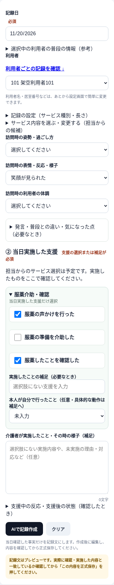
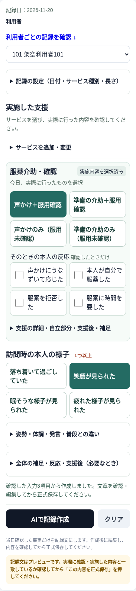
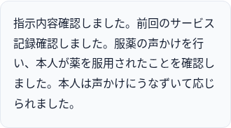
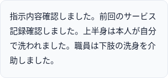
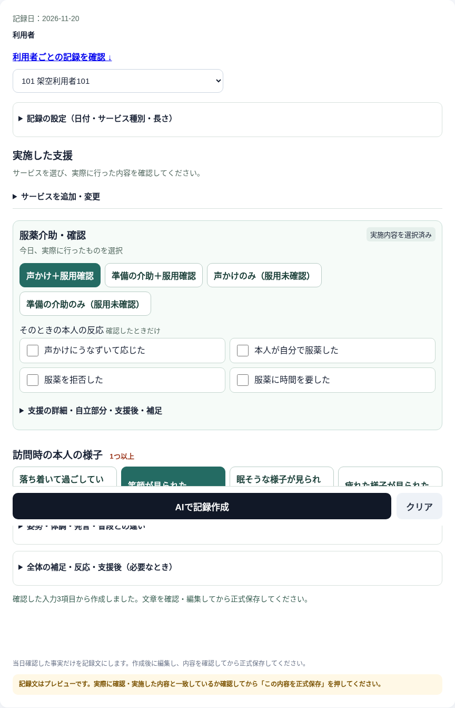

# AI記録の文章品質・入力操作の再改善

2026年11月20日（日本時間）。開発ブランチ：`feature/record-quality-simple-input`。
**本番DB・main・公開環境は変更していません。追加の有料サービスは導入していません。**

## 原因と改善方針

実際の入口は `index.html` です。過去の固定コミットのHTMLを取得した後、旧 `generate` を差し替え、`record-facts-core.js` と `record-facts-ui.js` を同期読込し、`record-safety.js` がその生成処理を正式保存の仕組みで包んでいました。画面に残る過去HTML内のテンプレートだけを直しても、本番の生成処理には反映されません。

以前の方式には少ない操作で文章が作れる利点がありました。一方、サービス名・プロフィールだけから当日の見守り、体調確認、終了後の状態などを挿入し、長さによって補足文を切り詰めたり、生成回数で観察表現を変える処理がありました。この部分は戻していません。

直近の方式には、確認した事実だけを使う利点がありました。一方で、次の問題がありました。

- `compose()` が、選んだ支援文に句点を付けて単純に連結していた。
- サービス候補の選択に加え、実施動作を一つずつ選ぶ必要があった。
- 本人の反応・自立部分・支援後の状態が詳細欄へ分かれ、普段の操作で入力されにくかった。
- 「短め・普通・長め」は保存されるものの、文章構成には使われていなかった。
- プロフィールは参考文の表示だけで、選択肢の提示には利用されていなかった。

新方式では、事実の確認を保ちつつ、具体的な支援の組み合わせを明示した選択肢、同じ画面の本人の反応、自然な文節の組立へ変更しました。単に語尾をランダム変更する処理はありません。

## 普段の操作

担当割当から開いた場合は、利用者・日付・サービス候補を引き継ぎます。候補は実施済みにはせず、職員が具体的な内容を選択します。

1. 実際に行った支援を選ぶ。例：「声かけ＋服用確認」。
2. 訪問時に確認した本人の様子を1つ選ぶ。
3. 「AIで記録作成」を押す。
4. 文章を確認し、必要なら編集して「この内容を正式保存」を押す。

生成まで最小3タップ、正式保存を含めて4タップです。本人の反応を1つ入れる場合は生成まで4タップ、保存まで5タップです。新規ログイン、ページを開く操作、文章を読む時間は含みません。利用者を手動で選ぶ通常画面では、利用者の選択とサービスの選択が加わり、生成までおよそ6タップが目安です。

本人の反応は任意です。体調・発言・普段との違い、自立部分、介助の細部、支援後の状態、補足は必要な場合だけ開きます。複雑な支援では操作が増える場合がありますが、全項目の入力を要求しません。文字の大きさや押せる領域を小さくして詰め込む変更ではありません。スマホの代表入力画面は約1874pxから約1577pxになり、高さを約16%減らしました（390px幅、架空の服薬入力例）。

## 服薬の安全性と文章例

改善前：

> 服薬の声かけを行った。服薬したことを確認した。

改善後：

> 服薬の声かけを行い、本人が薬を服用されたことを確認しました。

反応も確認した場合：

> 服薬の声かけを行い、本人が薬を服用されたことを確認しました。本人は声かけにうなずいて応じられました。

声かけのみ・服用未確認の場合：

> 服薬に向けて声をかけ、服用済みかは確認していません。

実際の②には必ず「指示内容確認しました。前回のサービス記録確認しました。」を先頭に付けます。

- 「声かけ＋服用確認」「準備の介助＋服用確認」「声かけのみ・服用未確認」「準備の介助のみ・服用未確認」を区別。
- 服薬の拒否、時間を要したこと、自分で服薬したこと、服薬後の訴え・変化も、選択した事実だけを反映。
- 「服用確認済み」と「服薬拒否・未確認」の矛盾は生成前に案内し、経過を整理してもらう。
- 服薬後の状態を選んでも、服薬を確認した入力がなければ、その確認を求める。
- 薬剤名、服用量、副作用、嚥下状態、症状、連絡・受診の実施は推測で追加しない。

## 他のサービス・プロフィール・長さ

既存の15種類のサービスを維持しました。食事、排泄、入浴、更衣、起床・就寝、移動・移乗、口腔ケア、通院、家事、見守り・声かけ等について、少数の実施内容と本人の反応を提示します。

入浴では、例えば次のように本人と職員が行った部分を分けます。

> 上半身は本人が自分で洗われました。職員は下肢の洗身を介助しました。

プロフィールに「ゆっくり話す」「本人のペースを待つ」等があれば、当日の支援方法の候補に表示します。**選択は初期OFFです。** 今日も実施したと職員が選んだ場合だけ文章へ入れます。旧プロフィールもそのまま参考表示し、毎回の再入力は不要です。未登録でも利用できます。利用者切替時には当日の確認内容と方法の選択をクリアし、未保存の入力があれば確認します。

「短め」は1段落に、「普通」は支援別に、「長め」は項目別に整理します。確認した事実はどの設定でも省略せず、足りない事実を水増ししません。必要な情報が少なければ、文章も短いままです。既存の再生成機能は「入力内容で作り直す」と表示し、同じ事実から別の出来事を作る機能と誤解されないようにしました。

訪問時の様子は①、支援中の反応・支援後の状態は②として区別します。訪問時の笑顔を、入力なしに「介助中も笑顔だった」と移し替えません。

## 比較と画面

[架空データ9ケースの全文・操作回数・時間の比較](comparisons.md)

代表操作を実際の画面とSDKで確認しました。担当からの服薬記録では、生成まで5→3タップ、反応を含む場合は8→4タップでした。その他のケースの回数・時間は、条件を明示した見積です。実職員による時間測定は行っていません。

| 改善前のスマホ入力 | 改善後のスマホ入力 |
|---|---|
|  |  |

## 保存・権限・データ保護

- SQL・テーブル・RLS・RPCの変更はありません。既存の記録、利用者・職員ID、プロフィール、担当割当をバックフィル・削除・上書きしません。
- `daily_facts.version=1` を維持し、今回の新規入力にだけ `composerRevision=2` と反応・支援方法等の任意項目を保存します。DBの既存制約内で保存できます。過去のJSONは変更しません。
- 生成はプレビューです。内容の編集・必須冒頭文・正式保存・二重保存防止・履歴・コピー・担当リンクの既存経路を維持します。入力や長さを変えた後は、古いプレビューをそのまま保存しないよう既存の署名検証を利用します。
- 利用者・施設・認証職員のID確認を維持します。一般職員・旧施設編集者にプロフィール保存権限は追加しません。
- PR #26はバックアップ取得許可待ちのままです。このブランチは現行mainから独立しており、そのSQLを含みません。共通の機能別権限関数が使える場合はそれを参照する互換処理を用意していますが、PR #26を先に本番反映する場合には、リベースと統合テストが必要です。
- 有料AI APIは使いません。文章組立はブラウザ内で実行します。生成のためにプロフィールや利用者情報を外部AIへ送る処理はありません。

## テスト

- 新しい生成テスト：401項目。架空データ9ケース、全15サービス、各選択肢、3つの長さ、重要事実の保持、プロフィールからの推測禁止、服薬未確認・拒否・矛盾の検証。
- 既存の生成テスト：35項目を維持。文章表現の変更に合わせた意味上の確認へ更新し、事実保護の検証は維持。
- PC 1440px・スマホ390pxのブラウザ＋実Supabase SDK＋隔離Postgresで、操作数、自然な服薬文、未確認・拒否、プロフィール候補、明示的な方法選択、正式保存、手修正、元記録の不変、自立部分、利用者切替、長さ変更後の再生成を検証。
- 既存の事実入力・プロフィール・権限・保存に関するブラウザ回帰もPC・スマホで検証。
- 非ブラウザの20テストファイルとPythonの17項目が合格。NEXIA全体のPC・スマホ回帰で、ログイン再利用、トップ、今日の担当、担当割当からの往復、申し送り、食事、出勤簿、出納帳、職員氏名を確認。担当表PDF・出勤簿Excel/PDF・出納帳PDFの生成も確認。
- 画面の比較には、本番コミット `8d162e6` のHTML・生成コード・CSSを固定して利用。過去HTMLも実際に読み込む構造のまま検証。

## 変更ファイル

- `index.html`：新しい実行バンドルの読込とプロフィール権限表示の互換。
- `record-facts-core.js`：具体的な支援・反応の定義、検証、文章組立、長さ、候補提示。
- `record-facts-ui.js` / `record-facts.css`：スマホの簡易入力・任意詳細・プロフィール候補。
- `record-safety.js` / `assignment-context-guard.js` / `common-nav.js`：再生成ボタンの新しい表示名とキャッシュ更新への対応。既存の保存・担当の安全確認は維持。
- `tests/record_quality_core.cjs` / `tests/record_quality_browser.cjs` / `tests/fixtures/record_quality_cases.cjs` / `tests/fixtures/record_facts_before_quality.cjs`：比較・操作・事実検証。
- 既存の生成・ブラウザ・安全性テスト、公開テスト素材の準備、CIを更新。

## 未確認事項・反映手順

実機のiPhone Safari／Android、実職員の入力時間・判断のしやすさ、実際のExcel製品やプリンターでの目視は未確認です。ブラウザ試験はChromiumのタッチ端末エミュレーションです。入力時間は実測値と扱わないでください。

本番DBを変更する必要はありません。PRの内容とCIを確認し、**この改善のmainマージ・公開について別途承認を得た後**、最新mainとの差分を確認して反映します。PR #26の承認を今回の改善の公開承認として流用しません。
