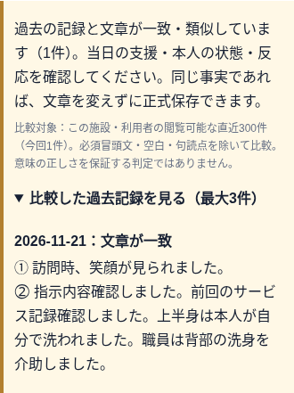
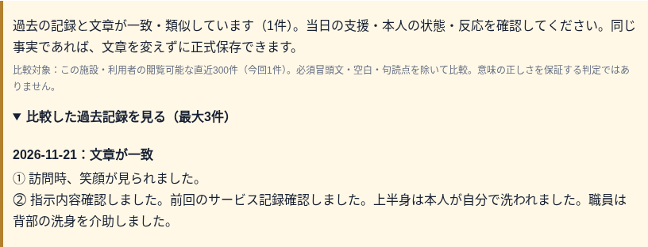

# PR #29 追加修正：当日の具体的な事実と保存前の類似確認

先週の15サービス直接チェック、姿勢・様子・体調の選択、任意欄を必要なときだけ開く操作を維持しました。同じ事実なら同じ文章を保ちます。毎日の違いは、実際に確認した方法・本人の反応・自立部分から表します。

## 操作と文章の変更

- 服薬・排泄・入浴・食事など、既存の「介助方法・本人の反応（任意）」で具体的な支援と反応を追加できます。サービスの再選択はありません。
- 入浴・排泄・食事・口腔・更衣・移動には、本人が自分で行った部分と職員の介助を明記した任意のショートカットを追加しました。例：「上半身は本人・背部の洗身を介助」。選択するまで事実へ追加しません。
- 食事の声かけとうなずきを自然につなげます。服薬拒否と服用未確認が選択された場合は、声かけ・本人の拒否・未確認という順で整理します。準備・服用確認・薬剤名・体調などを推測しません。
- 必須冒頭「指示内容確認しました。前回のサービス記録確認しました。」を維持しました。生成後の編集・正式保存・履歴・訂正は従来どおりです。

| 生成までの操作モデル | 追加修正前 | 追加修正後 |
|---|---:|---:|
| 最小入力：1サービス＋観察1つ | 6 | 6 |
| 服薬の方法＋反応の例 | 9 | 9 |
| 入浴・排泄・食事の自立部分＋介助＋反応の例 | 12 | 9 |
| 類似確認のために追加する必須クリック | 0 | 0 |
| 正式保存 | 各例に＋1 | 各例に＋1 |

利用者選択から算定。選択欄は開く＋選ぶで2操作、チェック・任意欄を開く・生成は各1操作。スクロール・ログイン・実機の所要時間は含みません。7日分の実際の比較対象は[別表](seven-days.md)に記載しています。

390px幅で任意欄を閉じた入力画面は、1サービス・3サービスとも1518pxで初回のPR #29から変わっていません。入力文字は16pxを維持しています。類似表示は生成結果側に置き、入力欄を長くしません。

## 保存前の一致・類似表示

「AIで記録作成」の後、同じ施設・同じ利用者の閲覧可能な保存済み記録を自動比較します。追加の入力欄・確認チェック・確認ダイアログはありません。

一致・類似があれば、生成文の下に注意を表示し、通常の正式保存ボタンを「当日の事実として正式保存」に変えます。職員は内容を照らし合わせて1回押すだけで保存できます。同じ事実なら、文章を変える必要はありません。比較した過去の文章・日付は任意で展開できます。もともとの担当割当の二重保存確認は従来どおりです。

文章編集時は同じ比較結果を使って表示を更新します。生成時の比較待ちの間でも文章を編集でき、編集後の内容で比較します。比較中に施設・利用者・入力した事実が変われば、結果を破棄して保存を止めます。過去記録や訂正履歴の取得に失敗した場合も「類似なし」とは表示せず、入力を残して再生成を案内します。

## 参照範囲と権限

- ブラウザの既存Supabaseクライアントとログインセッションを使用します。管理用キー・新しいRPC・SECURITY DEFINER・RLS変更はありません。
- 認証ユーザーID、施設への有効な所属、生成時の施設・利用者・職員の一致を確認します。
- `care_records`を`organization_id`と`client_id`の両方で絞り、RLSで閲覧可能な直近300件を取得します。名前による紐付けは行いません。結果も両IDで再検証します。
- `care_record_amendments`は同じ施設と取得した記録IDに限定し、最新の閲覧可能な訂正を比較へ反映します。APIの件数上限で古い訂正を誤用しないよう、履歴は500件ずつ読みます。1バッチの履歴が10,000件を超えて比較できない場合は保存を止めて知らせます。
- 比較履歴は画面のメモリ内だけに保持します。施設・利用者の切替、生成し直し、保存完了で破棄します。localStorageへの介護記録の追加保存や第三者サービスへの送信はありません。

## 7日分の検証

[服薬・排泄・入浴・食事の各7日分、計28記録の改善前後の全文・操作数](seven-days.md)と、[機械可読の結果](seven-days.json)を保存しました。

2日目は1日目、7日目は3日目と同じ事実にし、文章一致を検出しました。異なる状態・方法・反応は文章に反映されます。追加の検証として、全7日を同じ事実にした場合も架空の変化を作らないことを確認しました。旧PR #29も詳細を入力すれば具体的な文章になるため、同じ事実の比較で文章が変わらない例もそのまま報告しています。

## テスト結果

- 文章生成：既存35＋品質409＋UI復元413項目が合格。
- 類似比較：23項目が合格。一致・類似・必須冒頭除外、施設・利用者ID、認証職員、最新訂正、ページをまたぐ訂正、エラー時の停止、元データの不変を確認しました。
- 7日分比較：390項目が合格。28記録と、同じ事実を7日連続させる4サービスの追加検証を含みます。
- 実際に使用する固定HTML・実Supabase SDK・隔離Postgresで1440px／390pxのブラウザ検証が合格。管理者・旧施設編集者・一般職員、同じ事実の1回保存、文章編集、二重クリック、通信失敗、比較中の入力変更、別利用者の除外、他施設への直接APIアクセス拒否を確認しました。
- 既存の安全性・必須冒頭のPython17項目が合格。ログイン・施設切替・URL連携・履歴・担当への戻りの既存テストも合格しました。
- 既存記録は検証前後で一致しています。ブラウザ検証の追加保存は隔離DB内の架空データだけです。

Windows／iPhone実機、iPhone Safari、実際のExcelアプリ・プリンターは未検証です。PC・スマホ相当のChromium検証と区別しています。

## 変更範囲・残る制約

製品ファイルは`index.html`、`common-nav.js`（AI記録用スクリプトのキャッシュ更新のみ）、`record-facts-core.js`、`record-facts-ui.js`、`record-facts.css`、`record-safety.js`、新規`record-similarity.js`です。このほかにテスト・CI・比較資料を追加しています。

DBスキーマ・RLS・権限設定・保存済み記録は変更しません。プロフィール、担当割当、申し送り、食事、出勤簿、出納帳の処理とExcel・PDF出力は変更していません。前回の各機能の回帰結果を引き継ぎ、今回は変更に関係する記録・権限・連携を重点検証しています。

類似度は文字の2文字連続ペアによる参考判定です。必須冒頭・空白・句読点を除き、支援文の類似度82%以上かつ支援文75%＋訪問文25%の合計80%以上を目安に表示します。意味の同一性や記録の適切さを判定する機能ではありません。表示がなくても事実の確認は必要です。

比較範囲は生成時点で閲覧できる直近300件です。それより古い記録や、生成後に別端末で新たに保存・訂正された記録はその画面の比較へ自動反映されません。次に生成した時点で読み直します。無関係な大量データの取得や、保存時の重複禁止は行いません。

追加料金が発生するAPI・外部サービス・有料プランは追加していません。本番DB変更、mainへのマージ、本番公開は未実施です。承認後の反映はPR #29のマージと既存GitHub Pages更新のみで、SQL適用は不要です。不具合時はこのPRのフロントエンド差分を戻せばよく、記録データを巻き戻す必要はありません。
