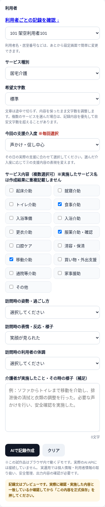
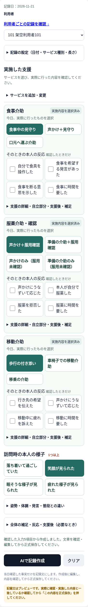
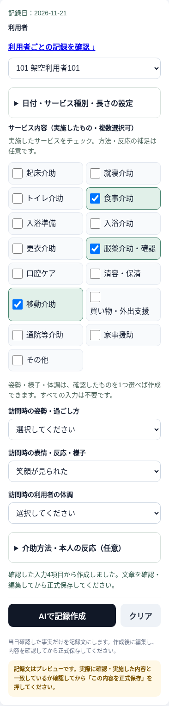
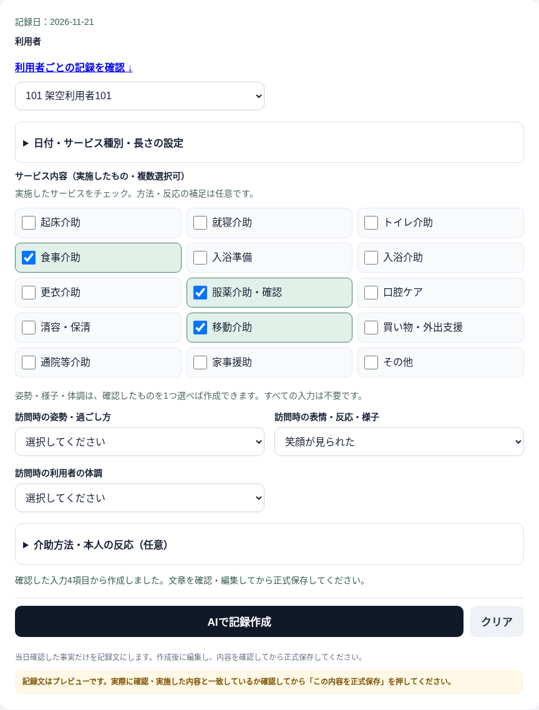

# AI記録の入力画面復元と文章品質の改善

11月12日の入力画面を基本に、15種類のサービスを直接チェックする方式へ戻しました。サービスを選んだ後に具体的な支援も必須で選ばせる操作をなくし、方法・本人の反応・支援後の状態は任意の補足欄へまとめています。

## 調査した版と実行経路

- 先週の入力UI：`982997ab351f6ddb2fc2461973729b68d1ce61c3`（2026年11月12日）。11月9〜15日の関連履歴を調べ、この期間の最終のAI記録入力画面を基準にしました。
- 改修前：`8b2f5b8b5d896536b2bf4fc3e63fc99b1671bb89`（PR #28反映後）。
- 実際の画面は `index.html` が固定コミット `a8fa212e05b08867c5a426d13f05baa8847e4165` のHTMLを読み込み、追加スクリプトで構築します。その実行画面をChromiumで比較しました。
- 過去版のコードは比較用アセットとしてのみ取得し、コミットIDとSHA256を固定しています。NEXIA全体の巻き戻しは行いません。

## 操作の違い

通常は「利用者を選択 → 実施したサービスをチェック → 姿勢・様子・体調のいずれか1つを選択 → 生成 → 確認して正式保存」です。日付・サービス種別・文章の長さは必要なときだけ設定できます。

| 通常入力・プレビュー作成まで | 先週 | 改修前 | 修正版 |
|---|---:|---:|---:|
| サービス1種類 | 8操作 | 6操作 | 6操作 |
| サービス3種類 | 10操作 | 12操作 | 8操作 |
| 正式保存の操作 | 上記に1操作 | 上記に1操作 | 上記に1操作 |

上記は利用者選択から計測した操作モデルです。タップ・チェックを1操作、ネイティブの選択欄を開いて選ぶ動作を2操作として数えています。画面スクロール、ログイン、文字入力の時間は含めていません。実際のWindows・iPhoneの操作時間は未計測です。

現行版で必須だった具体的な介助方法を任意へ変更した比較であり、最小入力同士で文章の詳細量が同じになるという意味ではありません。文章品質は、同じ事実を入力した架空の9ケースで別に確認しています。

サービスの選択肢は以前と同じ15種類・同じ順番です。訪問時の3つの選択欄を復元し、毎回の介入度選択や、サービス選択後の必須の再選択はありません。

## スマホ・PC画面の比較

390px幅、3種類のサービス選択時の入力欄の高さは、先週1766px、改修前2508px、修正版1518pxでした。修正版は先週より約14%、改修前より約39%短くなっています。入力文字・サービス名は16px、チェック欄は押しやすい大きさを保っています。

### 先週のスマホ画面

### 改修前のスマホ画面

### 修正版のスマホ画面

### 修正版のPC画面

## 文章の違い

必須冒頭文「指示内容確認しました。前回のサービス記録確認しました。」を維持します。以下の例では比較しやすいよう冒頭文を省略しています。

服薬の声かけ・服用確認・うなずきが確認された場合：

- 改修前：「服薬の声かけを行い、本人が薬を服用されたことを確認しました。本人は声かけにうなずいて応じられました。」
- 修正版：「服薬に向けて声をかけると、本人はうなずいて応じられました。本人が薬を服用されたことを確認しました。」

訪問時に側臥位で休んでおり、笑顔が見られた場合：

- 改修前：「訪問時、ベッド上で側臥位で休んでいた、笑顔が見られました。」
- 修正版：「訪問時、ベッド上で側臥位にて休まれており、笑顔が見られました。」

入浴の自立部分と介助部分を区別する処理は維持しています。例えば「上半身は本人が自分で洗われました。職員は下肢の洗身を介助しました。」と記録し、洗髪や全身介助を追加しません。排泄・食事・口腔・更衣・起床・就寝・移動・通院なども、選択した具体的な方法だけを文章にします。

サービス名だけをチェックした場合、例えば「服薬に関する支援を行いました。」と記録します。服用完了・薬の準備・飲み込み・体調変化を推測して詳しくしません。具体的な実施方法や反応を記載したい場合は、既存の任意の補足欄を使います。

プロフィールは候補の参考に使用し、当日の事実として転記しません。同じ事実なら同じ文章になり、ランダムな言い換え・水増し・切り捨ては行いません。

## 検証結果

すべて架空データで実施しています。実在する利用者の情報や本番バックアップはテストに使用していません。

- 文章生成：既存35項目・既存品質401項目・今回追加413項目が合格。15サービス、追加の具体的介助、指定された9比較ケース、最小入力、プロフィールの混入防止、服用未確認・拒否を確認しました。
- 入力比較：11月12日・改修前・修正版を、1440pxと390pxの実際のHTML実行画面で比較しました。
- 保存：プレビュー・文章編集・正式保存・連打防止・保存内容変更時の再生成・既存記録の保持を確認しました。
- 連携・権限：担当割当の利用者・日付・リンク、予定と実施の区別、プロフィール保存・再読込み、管理者・一般職員・旧施設編集者・機能別権限の付与解除を隔離Postgresで確認しました。
- 回帰：主要7機能の遷移、施設切替、職員氏名、再ログイン、出勤簿Excel、担当割当・出勤簿・出納帳PDF、管理用CSV/PDFを確認しました。
- Pythonによる既存の安全性・冒頭文の17項目が合格しました。
- Windows・iPhone実機、iPhone Safari、実際のExcelアプリ・プリンターは未検証です。

## 変更範囲と本番反映

製品側の変更は `index.html`、`record-facts-ui.js`、`record-facts-core.js`、`record-facts.css` の4ファイルです。このほかにテスト・比較用アセット定義・CI・本報告を更新しています。

DBマイグレーション・RLS・権限設定・料金計算・保存済み記録への変更はありません。新しい記録の入力情報は、既存の `daily_facts` JSONへ、実施サービスの明示確認を示すフラグと文章生成版を含めて保存します。過去のJSONや文章は変換・再生成しません。

有料AI APIや新しい外部サービスは追加していません。文章生成は端末内で行います。追加した権限・食事料金・他のNEXIA機能を巻き戻しません。

本番反映は未実施です。承認後、このPRをmainへマージして既存GitHub Pagesを更新します。SQL適用は不要です。公開後は画面を再読み込みし、実際のPC・iPhoneでもサービス選択、生成・編集・保存、担当からの起動を確認してください。
