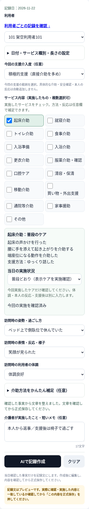
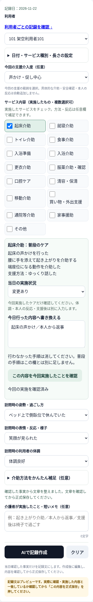
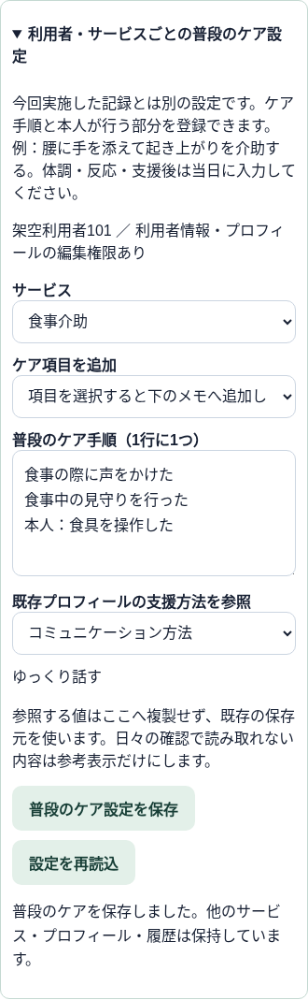
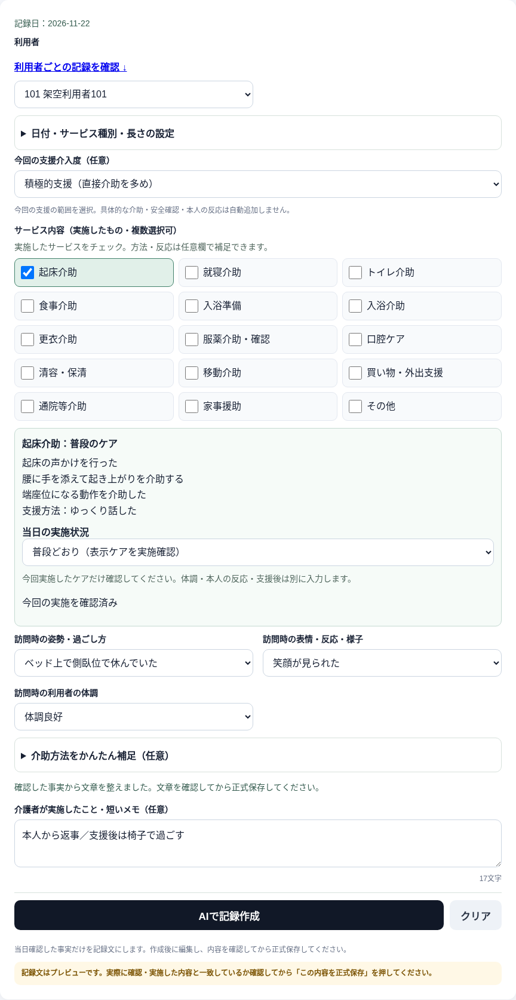

# 利用者ごとの普段のケアを使うAI記録（本番未反映）

2026年11月22日。PR #34 `fix/record-nov12-simple` の `c14e576` を基準に、別ブランチ `feature/resident-routine-care` で実装しました。PR #34本体・main・本番Pagesは変更していません。

## 変更内容と操作

15サービスの直接選択・介入度・訪問時の3項目・普通／長め・任意メモ・文章の手修正は維持しています。普段のケアを設定したサービスを選ぶと、ケア全文と当日の実施状況が表示されます。大量の詳細チェックを通常画面へ追加していません。

| 当日の状態 | 職員の操作 | 記録への扱い |
| --- | --- | --- |
| 未確認（初期値） | 追加操作なし | 普段の内容は参考のみ。実施済みとは書かない |
| 普段どおり | 表示全文を読み「表示ケアを実施確認」を選ぶ | その時点のケアだけを当日の確認済み事実として使用 |
| 変更あり | 普段の内容を出発点に当日文へ書き換え、実施確認 | 書き換えて確認した文だけを使用。消したケアを足さない |

体調・反応・支援後の状態は設定から持ち込みません。必要な場合だけ、既存の短いメモ・任意欄から当日の観察を加えます。担当割当の候補を実施済みにすることもありません。

設定手順：AI記録画面で利用者を選び、「利用者プロフィール」→「利用者・サービスごとの普段のケア設定」を開く→サービスを選ぶ→ケア手順を登録→保存。項目の追加候補と、具体的な手順文（例：腰に手を添えて起き上がりを介助する）を使えます。条件付きの手順、当日の体調・反応など、意味を確定できない内容を普段の実施事実へ自動変換しません。

編集は管理者、またはその施設で `resident_info: full` を明示付与された施設編集者のみ。従来の `legacy` 範囲を自動拡張しません。一般職員は所属施設の設定を読んで当日確認できます。設定の保存失敗・権限解除・版の競合では入力を保持します。

## 画面と全文

- [起床・服薬・排泄・入浴・食事 × 3状態 × 普通／長め：生成全文30組](examples.md)
- [PCで採取した入力・文章・保存結果](1440-results.json)
- [スマホ幅で採取した入力・文章・保存結果](390-results.json)
- [PR #34の入力画面とメモ整形の比較](../record-memo-quality/report.md)

| スマホ：普段どおり | スマホ：変更あり |
| --- | --- |
|  |  |

| スマホ：設定 | PC：入力 |
| --- | --- |
|  |  |

[未確認の画面](images/mobile-unconfirmed.png)・[生成文章](images/mobile-record.png)・[PC設定](images/desktop-settings.png)

## 操作数・文章の評価

設定後の普段どおりは、サービスの二重選択も、普段の手順の再入力も不要です。表示全文を読んでネイティブ選択欄で確認する1回の選択（開く＋選ぶ＝2タップ相当）を加えます。未確認は0、変更ありは選択2＋1欄の編集＋確認ボタン1です。文字入力・スクロール・文章を読む時間は別に必要です。

利用者・介入度・訪問時の3項目をすべて選ぶモデルでは、PR #34の簡易入力12タップに対し、普段どおり14タップでプレビュー、正式保存まで15タップ相当です。これはタップの算定モデルで、実測時間ではありません。具体的な複数のケアを毎日選び直す／打ち直す負担を共有設定で減らします。今回の実画面例にある当日メモの入力は任意で、この算定とは別です。

普通は関連する事実を接続し、長めは本人が行った部分・職員の介助・方法・支援後を明確に分けます。設定された手順文の順番を保ち、職員と本人の動作を取り違えません。確定できる生成句は過剰な受身の敬語を避け、引用や意味不明なメモは勝手に書き換えません。

既存の生成回数による表現選択、最大32の異なる候補、同一施設・同一利用者の閲覧可能な過去記録との比較を継続利用します。候補が尽きても事実を追加せず、同じ事実の類似記録は保存できます。重複ゼロや、入力の少ないケースの長文化は保証しません。

## 保存・データ設計

既存の `client_record_profiles`（施設ID＋利用者ID）へ `routine_care` JSONB列を追加します。既存プロフィール `data` や、利用者マスターの支援方法は変更しません。共有する情報は既存の保存元を参照キーで指定します。ケア設定に同じプロフィール値をコピーして編集する仕組みは作っていません。読み取れない支援方針・一般情報は参考表示だけにします。

設定変更は `save_routine_care` RPCで1サービスだけ差分更新します。他サービス・プロフィール・権限を初期化しません。既存プロフィールと同じrevisionとロックを使用し、同時編集の上書きを拒否。変更前後・職員ID・日時は既存の非公開 `record_profile_history` に追記します。旧画面の `save_record_profile` から保存しても新列を保持することを確認しました。

日々の記録は既存の `daily_facts` に、施設・利用者・確認職員・日付・設定版・確認内容・当日変更文をスナップショットとして保存します。生成前にログイン本人・現在の施設／利用者・最新設定と照合し、設定が変わっていたら再確認を求めます。後日設定を変更しても保存済みの記録文・確認内容を再生成しません。保存の作成者は従来どおりサーバー側の認証IDです。

## DB・権限と安全性

新規SQL：`supabase/migrations/20261122003150_resident_routine_care.sql`。列・制約・新規RPCのみを追加し、既存RLS・既存RPC・権限設定を置き換えません。既存行へのバックフィルはありません。DROP・TRUNCATE・DELETE・WHEREなしUPDATEはありません。将来の保存時に、施設＋利用者の主キーで限定したUPSERTと監査履歴へのINSERTを行います。

公開RPCはSECURITY INVOKER、実装はprivateのSECURITY DEFINER・空のsearch_path。DB内の `auth.uid()` と既存の `lock_facility_feature(...,'resident_info',true)` で所属・有効施設・機能範囲を検証し、利用者の所属も再確認します。匿名実行・直接テーブル更新・権限の自己付与は許可しません。

本番では個人の行を取得せず、テーブル・制約・RLS・RPC・ロック関数の定義だけを読み取り確認しました。本番SQL適用・データ変更は行っていません。

## 検証結果

- 960生成（5サービス×3状態×2長さ×32シード）：事実・本人／職員の役割・原入力の保持、未確認・変更時の普段のケアの不使用、確認日・本人IDの照合。
- 新規DBテスト48確認：1サービスPATCH、旧プロフィールRPCとの互換性、管理者／full編集者／legacy編集者／一般職員／匿名、権限解除、直接API／直接UPDATE拒否、施設分離、競合、履歴・既存記録・利用者の保持。
- 架空DBの圧縮バックアップを別の隔離DBへ復元し、設定・監査履歴・既存記録の一致と、復元後の一般職員による設定変更の拒否を確認。これは本番全体のバックアップ復元証明ではありません。
- Chromium 1440px／390px：各30生成、各15正式保存。設定共有、プロフィール参照、別職員の利用、権限解除後の拒否、保存失敗時の入力保持、設定更新後の古い確認の拒否、複数施設所属者の実際の施設切替、再読込後の履歴一致。
- 既存の文章・介入度・メモ・類似チェック・連続生成テストは合格。通常入力にケア設定がない場合の挙動を維持。
- NEXIA全体のPC／スマホ幅ブラウザ確認：トップ・担当・AI記録・申し送り・担当割当・出勤簿・食事・出納帳・職員／権限画面。PCの担当割当PDF、出勤簿Excel／PDF、出納帳PDFを生成。スクリプトエラー・想定外リクエスト・横はみ出しなし。
- HTML構文・画面遷移・既存安全性契約21テストは合格。GitHub CIの最終結果はPRのChecksを参照。

## 未確認・制限

Windows／iPhoneの実機、Safari・音声入力、実職員による読解時間、実Office／プリンター、本番DBへの新RPC適用・保存は未検証です。これらを検証済みとは扱いません。すべての文章検証は架空データです。

任意の日本語を完全に理解する仕組みではありません。具体的な独自手順は対応する行動表現だけを扱い、条件・未確認の観察を含む文は設定時に確認を求めます。意味を確定できない既存プロフィールは参考情報として残ります。設定内容自体の妥当性と当日実施の確認は職員の責任で行ってください。

## 本番反映に必要な作業

[適用・停止・復旧手順](rollout.md)。承認後に最新バックアップと復元手段を確認し、この新規SQLだけを適用、確認後にフロントを公開する順序です。PR #26／#28／既存のプロフィールSQLを再適用しません。本番へのマージ・公開・SQL適用は行っていません。追加の有料API・従量課金サービス・プランは導入していません。
