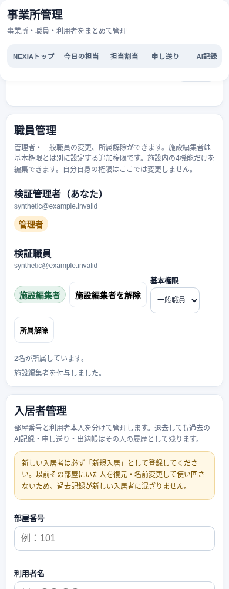
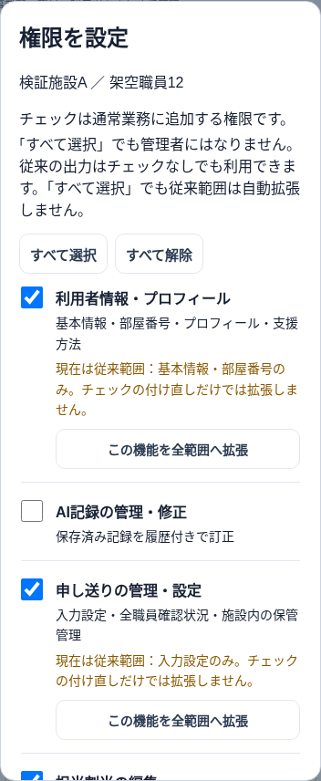
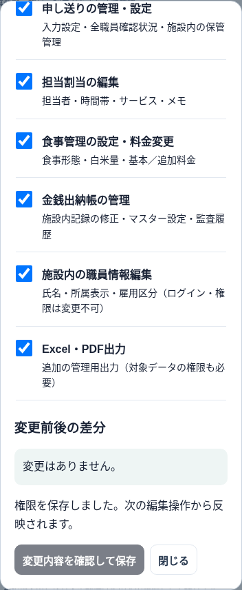
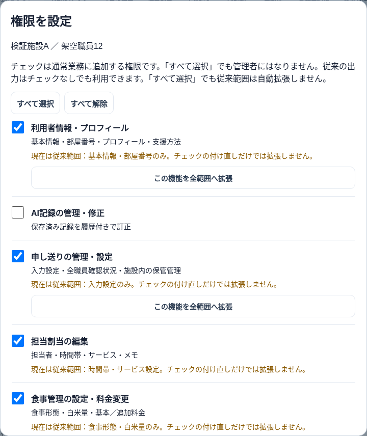
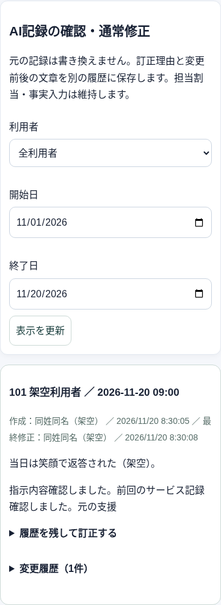
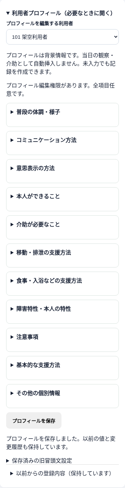

# 施設編集者を8機能のチェック式へ変更

2026年11月20日（日本時間）。開発ブランチ：`feature/scoped-facility-permissions`。
**本番SQL適用・mainマージ・公開・本番料金変更は実施していません。**

## 調査と設計

現行本番の45テーブル、57関数、関連RLS・制約・トリガーを読み取りで調査しました。`organization_members.role` は実際のCHECK制約でも `admin/staff` です。`organization_facility_editors.enabled` により4機能を一括付与し、`private.can_edit_facility` / `private.lock_facility_editor` と共通の `NexiaPermissions` で制御していました。調査時点の旧フラグは有効4件・無効1件でした。今回、本番の権限行は変更していません。

新role追加は既存のrole制約・管理者専用RPC・各システムの分岐へ影響するため採用していません。基本roleを保ち、**施設ID＋認証ユーザーID＋機能識別子**で追加権限を保存します。管理者だけが他の一般職員の権限を変更できます。氏名による紐付けは行いません。

確認いただいた移行方針に従い、旧権限には `legacy`（従来範囲）、管理者が明示付与する権限には `full` を保存します。これにより、同じ項目名のままプロフィール・料金・全職員確認機能が自動的に開放されることを防ぎます。

## 8機能と操作範囲

| 項目 | 明示的に許可した場合 | 旧施設編集者の移行直後 |
|---|---|---|
| 利用者情報・プロフィール | 利用者登録、氏名・部屋、選択式プロフィール・旧プロフィール・注意事項・支援方法 | 基本情報・部屋番号のみ。プロフィール編集は拡張操作が必要 |
| AI記録の管理・修正 | 所属施設の記録確認、訂正理由・変更前後・修正者・日時を残す通常修正 | OFF。通常の記録作成・閲覧は従来どおり |
| 申し送りの管理・設定 | 入力設定、全職員確認状況、履歴を保つ保管・復元など | 入力設定のみ。全職員管理は拡張操作が必要 |
| 担当割当の編集 | 時間帯・サービス等の設定。既存の担当者・メモ編集も維持 | 従来範囲を維持。夜勤の翌朝順・記録リンクを維持 |
| 食事管理の設定・料金変更 | 食事形態・白米量・基本／追加料金を施設別に設定 | 食事形態・白米量のみ。料金変更は拡張操作が必要 |
| 金銭出納帳の管理 | 他職員の施設内記録の通常修正、マスター名の編集、監査履歴 | OFF。自分の通常入力・既存出力は維持 |
| 施設内の職員情報編集 | 氏名・所属表示・雇用区分を狭いRPCで編集 | OFF。認証・メール・所属追加解除・本人紐付け・権限変更は許可しない |
| Excel・PDF出力 | 対象権限も確認する追加の管理用出力 | OFF。従来の出勤簿Excel・各画面のCSV/PDFは維持 |

新たな管理用出力はAI記録・出納帳・職員表示情報に対応します。Excelで開けるUTF-8 BOM付きCSVと印刷/PDFで、出力の直前にも出力権限と対象機能の両方をDBで再確認します。出力チェックだけでデータ取得はできません。既存のExcel形式を置き換える変更ではありません。

「すべて選択」でも管理者にはなりません。請求確定・確定解除、他職員記録の削除、開始残高のリセット、認証・所属・権限管理は追加していません。出納帳には現行スキーマ上の「確定」状態がないため、新たな確定機能や削除権限は作らず、既存の本人・管理者操作を維持しています。

## 管理者の操作手順

1. 「事業所・権限管理」で施設を選ぶ。
2. 対象職員の「権限を設定」を開く。自分自身・管理者には追加権限変更ボタンを出さない。
3. 8項目から選ぶ。「すべて選択」「すべて解除」も利用できる。
4. 旧権限の拡張が必要な場合だけ「この機能を全範囲へ拡張」を押し、確認する。チェックを付け直すだけでは旧権限を拡張しない。
5. 変更前後の差分を読み、「変更内容を確認して保存」→確認→保存結果を確認する。
6. 未保存で閉じると警告する。通信失敗時は入力を残す。他の管理者が先に保存した場合は競合として拒否し、最新を読み直す。

職員はNEXIAトップの「施設の編集」から許可された画面を開けます。追加の記録管理・職員表示情報・出納帳管理・管理用出力は「許可された業務管理・出力」にまとめました。職員管理URLへ直接アクセスした一般職員も、許可のある範囲だけを表示する画面へ案内します。

## 画面の比較（すべて架空データ）

旧画面では「施設編集者を付与／解除」の一括切替でした。新画面では機能ごとの説明、従来範囲の注意書き、差分、保存結果を表示します。スマホでも文字を縮めず、24pxのチェックと44px以上の操作領域を設けました。

| 旧4機能の一括方式 | 新・従来範囲と拡張の確認 | 新・下部の項目と保存結果 |
|---|---|---|
|  |  |  |

## Supabaseの変更と保全

追加マイグレーション：`supabase/migrations/20261119144626_granular_facility_permissions.sql`。

- `organization_permission_sets`：職員・施設ごとの版番号と新画面での管理状態。
- `organization_feature_permissions`：機能別の許可と従来／拡張範囲。所属への外部キー、SELECT用RLSを設定し、ブラウザからの直接書換は禁止。
- `private.feature_permission_history`：権限の変更前後・操作職員ID・日時・理由。クライアントによる変更・削除は禁止。
- `care_record_amendments`：元の介護記録を保持したまま、変更前後の文章・訂正理由・修正者・日時・版を保存。元の記録ID、利用者ID、担当割当、作成者、当日の事実入力は変更しない。通常の保存済み記録画面・コピー・追加管理用出力では最新の訂正を表示。
- `facility_operation_history`：出納記録／マスター、職員表示情報、基本料金、申し送り本文、利用者情報の変更前後。監査行への直接INSERT/UPDATE/DELETEは禁止。
- `private.has_facility_permission` / `lock_facility_feature` に判定を共通化。権限・所属の行ロックと版番号により権限解除と編集を整合させる。新しい訂正・監査テーブルには施設・対象・日時の検索用インデックスを設け、管理用出力も上限を超える場合は期間を絞るよう案内する。
- チェック画面の権限一覧と版番号は専用RPCで**同じDBスナップショット**から取得する。別々の読み取りによる競合の取りこぼしを防ぐ。
- 既存の公開RPCは維持し、必要な狭い機能だけ拡張。`set_facility_editor` は未移行の旧4機能に限って互換動作し、新方式で保存済みの職員は旧RPCから変更できない。
- 料金変更は提供時の単価スナップショット、追加料金履歴、確定請求版を変更しない。過去請求の解除・再確定は管理者のまま。
- 旧プロフィールの保存先と職員氏名の正規保存先を維持する。職員氏名は同施設・同認証ユーザーIDで同期し、同姓同名の別職員を書き換えない。

既存の有効な旧編集者だけに旧4機能の `legacy` 行を追加します。旧4項目が揃わない／追加権限が混ざる場合、SQL全体を中止します。一般職員に新機能を自動付与せず、業務データをバックフィル・削除・一括上書きしません。権限変更の通信失敗を理由にDBの設定を消去する処理もありません。

## テスト結果

- 新しい隔離DBテスト：**205項目合格**。旧権限の移行、全8項目の独立ON/OFF、職員・施設分離、自己昇格禁止、RLSと直接RPC、旧RPCとの互換、同じ版での再保存拒否、通常業務維持、確定請求の保護、元記録の保護、監査保護、互換モードと復帰を含む。
- 共通権限ヘルパー：**31項目合格**。通信失敗・不正な施設／本人ID・重複行・非同期読込競合で許可しないことを確認。
- 実SDK→隔離Postgresのブラウザ試験：**PC 1440px／スマホ390pxで合格**。8項目、差分、保存エラー、二人の管理者による競合、記録訂正、職員氏名、マスター、CSV/PDF、実際の旧HTML出納帳の修正、旧HTML記録のプロフィール、従来範囲と明示拡張、権限解除、読込失敗を確認。外部への未予定通信・スクリプトエラーなし。
- 既存4機能のPC・スマホ画面試験も合格。従来の設定編集、同じ利用者ID、夜勤の翌朝順、権限解除、他施設分離を確認。
- 既存の隔離DBテスト：施設編集者100項目、食事追加料金53項目、プロフィール43項目が合格。
- NEXIA全体のPC・スマホ回帰：ログイン再利用、トップ、今日の担当、担当割当→記録→戻る、AI記録、申し送り、出勤簿、食事、出納帳、管理画面、氏名同期、再ログインを確認。担当表PDF・出勤簿Excel/PDF・出納帳PDFの生成も合格。
- 申し送りの回帰：複数確認、本人取消、対応／再開、操作競合、継続、日勤夜勤・翌日、管理者確認、施設切替が合格。
- 既存の食事・事実入力記録の実SDK／隔離DBブラウザ試験もPC・スマホで合格。

CIでも新テストを実行するよう追加しています。テストには架空の施設・職員・利用者だけを使用し、実際の利用者情報をテストAPIへ送信していません。

## 主な変更ファイル

| 対象 | ファイル |
|---|---|
| 共通権限 | `facility-permissions.js` |
| 管理者のチェック画面 | `manage/index.html`, `manage/feature-permissions.js`, `manage/feature-permissions.css` |
| 追加の業務管理画面 | `facility-tools/index.html`, `facility-tools/app.js`, `facility-tools/style.css` |
| 導線・既存画面への統合 | `home/index.html`, `home/app.js`, `staff/index.html`, `assignment/index.html`, `assignment/settings-panel.js` |
| 申し送り・食事 | `handoff/app.js`, `handoff/index.html`, `meals/app.js`, `meals/extras.js`, `meals/index.html` |
| 実際に読み込まれる旧HTMLの処理 | `index.html`, `record-facts-ui.js`, `record-history.js`, `cashbook/index.html`, `cashbook/feature-addon.js` |
| DB・切り戻し | `supabase/migrations/20261119144626_granular_facility_permissions.sql`, `supabase/rollbacks/20261119144626_*.sql` |
| 新テスト | `tests/scoped_permissions_core.cjs`, `tests/scoped_permissions_database.cjs`, `tests/scoped_permissions_browser.cjs`, `tests/scoped_fixture.cjs`, `tests/fixtures/scoped_permissions_schema.sql` |
| 回帰試験・CI | `tests/facility_editor_browser.cjs`, `tests/facility_editor_database.cjs`, `tests/meal_extras_database.cjs`, `tests/record_history.cjs`, `.github/workflows/safety-check.yml` |

既存試験の変更は、新しい機能別権限のfixtureへの対応、訂正履歴の空データへの対応、日本時間の日付を使う料金テストのタイムゾーン明示です。既存の期待結果を削って通す変更ではありません。

## 未確認事項と本番反映

- 本番での移行は未実施です。「本番の4件を移行済み」とはしていません。隔離DBで移行一致と業務データ不変を確認しました。
- 本番バックアップの取得・実物の復元試験・現在の契約で使えるバックアップ機能は未確認です。適用前の必須確認としています。
- ローカルの同時編集試験は二つのブラウザからの版競合とDBロックの設計を確認するものです。本番規模の負荷試験・複数Postgres接続でのロック待ち／デッドロック試験は未実施です。競合・ロック待ちの失敗では全体をロールバックしてエラーを表示します。
- スマホ表示はChromiumのタッチ端末エミュレーションです。実機iPhone Safari／Androidの端末固有動作、プリンター、実際のExcel製品での目視は未確認です。
- 既存の閲覧・出力は維持する方針です。出力チェックをOFFにしても従来の出勤簿Excel等は停止しません。画面にすでに閲覧できる情報のコピーやブラウザ自身の印刷を禁止する機能ではありません。
- 追加の有料サービス、AI API、有料プラン、PITRは導入していません。

本番反映は、[バックアップ・移行・照合・切り戻し手順](rollout.md)を確認して、このPRのSQL適用・mainマージ・公開の承認後に実施します。

## PR #27公開後の統合確認

PR #27の公開コミット `789759c` を取り込み、改善済みのAI記録入力・自然な文章生成を維持しました。AI記録の入口では新しい権限判定と入力コードのキャッシュ識別子を更新しています。

- 権限DB 205項目・共通判定31項目・文章生成401項目が合格。
- 権限画面と改善済み記録画面のPC・スマホ試験が合格。明示的なプロフィール権限で保存でき、解除後は開いたままの画面からも保存できないことを確認。
- 既存の事実入力ブラウザ試験にも新しいDB構造を適用し、一般職員の正式保存・旧編集者のプロフィール編集拒否を確認。
- 本番適用するSQLは承認対象から変更していません。SHA256：`eecba69ca0b7b210335ba8ee213e1fd50faeace186a547c1331fe26a24e82639`。

バックアップの実データ・復元キーはPRやリポジトリへ含めません。本番適用結果は作業完了時に別途報告します。
