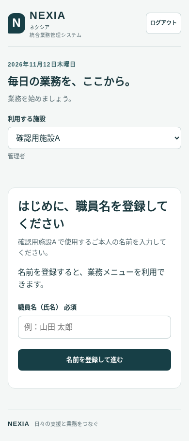

# 職員名の登録忘れを防ぐ変更

この文書は名前登録必須化（PR #18）時点の記録です。職員マスターとの氏名取得・同期に関する後続修正は [職員氏名の不一致修正](staff-name-consistency.md) を参照してください。

作業日：2026年11月12日。開発ブランチ：`codex/require-staff-name`。
起点：NEXIA公開済みの `0c718aaecc8fbcc460c6cca6c1bb3ff2beb4e313`。
本番反映・マージは承認後に行う。今回の実装・テストでは本番の名前や記録を変更していない。

## 利用者に見える動作

- ログイン後、選択施設の職員名が空欄の場合は「はじめに、職員名を登録してください」と表示する。業務メニュー・管理者メニューは表示しない。
- 空白、全角空白、ゼロ幅文字だけの入力や「氏名未設定」「職員名未登録」などは未登録として扱う。新しく入力する名前は1〜80文字。
- 「名前を登録して進む」で保存し、サーバーから再取得した名前を確認してから業務メニューを表示する。保存に失敗した場合は入力を残し、業務画面を開かない。
- 登録済みの名前は変更せず、繰り返し入力させない。施設ごとに名前が管理されるため、別施設だけ未登録ならその施設の登録を案内する。施設の切替・ログアウトは可能。
- 今日の担当・AI記録・担当割当などの旧URLから入った場合も職員名を確認し、未登録ならトップの登録画面へ進む。登録後は元のURLへ戻る。割当ID・記録ID・担当画面への戻り情報を維持する。
- まだ施設に所属していない方には、従来のアカウント作成・施設参加の手順を残す。所属後に職員名を登録する。

## 調査結果と保存範囲

従来の職員名登録はAI記録画面内の任意入力で、`organization_members.staff_name` は空文字を許す。これが名前未登録のまま使えていた原因。

既存DBのメタデータをSELECTで確認し、認証利用者に許されるメンバー更新列が `staff_name` だけであること、RLSが本人の `user_id` と施設所属を確認することを確認した。この既存権限を維持し、本人・選択施設の1行だけを更新する。

- 書き込み内容は `{ staff_name: 入力した名前 }` のみ。`user_id`、`organization_id`、`role`、本人紐付けは変更しない。
- 保存直前にログイン利用者を確認する。本人ID・施設ID・変更前の名前を更新条件に含める。別端末で既に登録された名前を古い画面から上書きしない。
- 更新結果の行数・本人ID・施設ID・名前を確認する。RLSなどで0件更新になっても保存成功として扱わない。その後、施設・所属情報を再取得する。
- 未保存の名前は画面内のメモリーにだけ保持する。新しい氏名キャッシュをlocalStorageへ作らず、ログアウト時に破棄する。
- 復帰先は同一オリジンの既存業務URLに限定する。外部URL、トップへの循環、認証トークン・認証コードを含む復帰先は採用しない。

### 職員マスターとの違い

出勤簿などで使う `organization_staff.staff_name` は別の職員マスターで、メンバー名との自動同期トリガーは存在しなかった。今回は既存マスターの改名・統合・本人紐付けを自動で行わない。過去の記録や職員を氏名で同一視しない。

既存の職員マスターに「氏名未設定」などが残っている場合は、管理者が既存の職員管理画面で本人を確認して修正する。今後、ログイン利用者を職員マスターへ追加する際は、登録されたメンバー名を既存機能が利用する。

この変更は画面からの登録忘れを防ぐもの。DBに名前の必須制約を新設したり、業務テーブルのRLSを変更したりはしない。APIを直接操作する利用者に対する新しい名前必須制約をサーバーへ追加した、という意味ではない。

## テスト

- DOMテスト49ケース成功。従来35ケースに加えて、空白・全角空白・不可視文字・未設定表記、正常保存、入力上限、更新列と本人/施設条件、保存失敗、0件更新、再試行、施設別登録、別端末との競合、保存中のログアウト、安全な復帰先を確認した。
- 実ChromiumでPC 1440px・スマホ相当390pxを確認。旧担当URLから登録画面への案内、空白入力の拒否、通信失敗時の入力保持、再試行、保存後の元URLへの復帰、再読込後は再登録不要、別施設だけ未登録のケースが成功。
- ブラウザの登録テストは各ケースで合成データの名前2行だけを更新した。役割・他施設の既存名・職員マスター・記録に対する予定外の更新はない。実Supabaseへの通信はすべて置き換えており、本番データにテスト書き込みを行っていない。
- 登録済み利用者の7機能往復・ログイン1回維持・施設/管理者表示・本人出勤簿・Excel/PDF出力のブラウザ回帰検証も成功。既存の担当復帰・記録リンク・Python安全性17件も成功。
- 新しい共有スクリプトとトップ画面のキャッシュ識別子を更新した。

再実行は既存の `tests/nexia_portal.cjs` と `tests/nexia_browser.cjs` を利用する。新規の名前テストも同じCIで実行する。

## 未確認・本番反映時

実アカウントと本番DBを使う名前保存、スマホ実機、Safariは未確認。DB構造・RLS・GRANT・有料サービス・公開範囲の変更は不要。

承認後の反映では、登録済み職員には追加入力が出ないこと、名前未登録の職員には登録が必須になることを本人の端末で確認する。名前が既にある職員や既存マスターを、確認のために空欄へ変更しない。問題があればフロントエンドを戻し、本人が登録した名前は削除しない。
